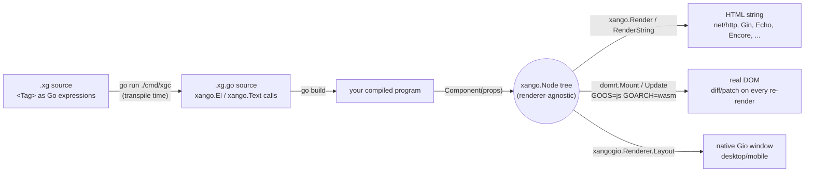

# gojiberry / Xangô

[](https://github.com/elaous/gojiberry/actions/workflows/ci.yml)


A JSX-for-Go: write `<div>...</div>` tags directly in Go source as an
expression, anywhere a Go expression is legal, compiling down to plain
Go that renders identically on the server (HTML strings) and in the
browser (real DOM, via WASM), with no separate template language.

```go
func Greeting(props GreetingProps) xango.Node {
	if props.Name == "" {
		return <p class="greeting">Hello, stranger!</p>
	}
	return <p class="greeting">Hello, {props.Name}!</p>
}
```

## The name

Xangô (shan-GOH) is the Yoruba orisha of thunder, lightning and justice
(Sàngó in Yoruba; Xangô in Brazil, where Candomblé keeps his worship alive).
The engine takes his name for the lightning: markup goes in, plain Go comes out
in a flash, and the result is fair to every renderer, the same tree for
server, browser and window. In code the name is ASCII: the package is `xango`,
templates are `.xg` files and the generated Go is `.xg.go`. (Xangô was called Gox before.)

## How it works

Two separate steps, run at two separate times:

1. **Transpile time** (`go run ./cmd/xgc <dir>`, or `go generate ./...`
   via the repo-root `go:generate` directive): every `*.xg` file's
   `<Tag>` expressions are rewritten into plain `xango.El`/`xango.Text`
   calls, emitted as an ordinary `*.xg.go` file next to it. This file
   is committed like `templ`'s own `*_templ.go` convention, so
   `go build`/`go test` never need `xgc` on the critical path.
2. **Run time**: your component function runs as plain compiled Go —
   there's no interpreter, template engine, or reflection involved —
   and returns a `xango.Node`, a plain tree (element / text / fragment /
   raw) that carries no opinion about how it gets displayed. The same
   tree feeds whichever renderer(s) your program calls:



The `xango.Node` tree itself never knows which of these it's headed for
— `xango.Render`/`domrt.Mount`/a `xangogio.Renderer` are just three
different functions that each walk the exact same tree shape and do
something different with it (see `xango/render.go`, `domrt/domrt.go`, and
`xangogio/render.go`, in that order, if you want to read the actual walk
each one does — `xangogio` is its own separate Go module, like `domrt`'s
sibling examples are, so it can depend on `gioui.org` without adding it
to this one; see `xangogio/README.md`). Nothing about writing a component
needs to know or care which renderer(s) will eventually consume it.

## Getting Started

Requires Go 1.26+. This module (`github.com/elaous/gojiberry`) is
private, so it isn't `go get`-able from outside this checkout the way a
public package would be — every consumer in this repo (including every
separate-module example under `examples/`) uses it via a local
`replace` directive pointing at this checkout instead. From your own
project elsewhere on disk:

```
# your-project/go.mod
require github.com/elaous/gojiberry v0.0.0
replace github.com/elaous/gojiberry => /path/to/gojiberry
```

Write a component (`hello.xg`):

```go
package main

import (
	"fmt"

	"github.com/elaous/gojiberry/xango"
)

func Greeting(name string) xango.Node {
	if name == "" {
		return <p class="greeting">Hello, stranger!</p>
	}
	return <p class="greeting">Hello, {name}!</p>
}

func main() {
	html, err := xango.RenderString(Greeting("gojiberry"))
	if err != nil {
		panic(err)
	}
	fmt.Println(html)
}
```

Transpile it by running `xgc` from *this* checkout, pointed at your
project's directory (this avoids needing `xgc`'s own dependencies —
HCL, sqlc, etc. — in your project's `go.mod`; see the `-experimental`
flag below for when those matter to you):

```
cd /path/to/gojiberry
go run ./cmd/xgc /path/to/your-project
```

Then, from your own project:

```
go mod tidy
go run .
# <p class="greeting">Hello, gojiberry!</p>
```

From here:

- `examples/ssr-demo` is the smallest complete example in this repo —
  read it alongside this walkthrough.
- `examples/wasm-counter` shows the same component shape mounted into
  a real browser DOM instead, via `domrt` and `GOOS=js GOARCH=wasm`.
- Every directory under `examples/` has its own `Makefile` (`make run`,
  `make test`) wrapping the exact commands its own section below
  documents — see [Development](#development).
- `## Packages` and `## Components` below are the reference material
  for everything you can import once the basic loop above is familiar.

## Why tags can just be Go expressions

Go's generics use `Foo[T]`, not `Foo<T>`, so unlike TSX there's no
ambiguity between a tag and a generic instantiation to resolve. The
only remaining question is distinguishing a tag-open from the
less-than operator (`a < b`), which `.xg` resolves the same way JSX
parsers do: `<` only means "less than" immediately after something
that completes a value (an identifier, a literal, or a closing
`)`/`]`/`}`). Everywhere else — after `return`, `(`, `,`, `=`, `{`, or
at the start of a statement — a `<` can only legally begin a new
expression, so that's exactly where a tag is allowed to start.

`{expr}` holes, in both attribute values and child position, are
always a single Go expression, exactly like JSX. There's no separate
`if`/`for` template syntax: loops and conditionals are ordinary Go,
usually via an inline closure —

```go
<ul>{func() []xango.Node {
	var items []xango.Node
	for _, s := range list {
		items = append(items, <li>{s}</li>)
	}
	return items
}()}</ul>
```

— which is itself just a Go expression, so tags inside its body are
expanded by the same recursive scan, with no extra grammar required.

## Packages

- **`xango`** — the runtime. `Node` is a plain, renderer-agnostic tree
  (element / text / fragment / raw) that both the server and the
  client render from, so a component behaves identically either way.
  `xango.Render`/`xango.RenderString` render to HTML with automatic
  escaping (`xango.Raw` is the explicit escape hatch). `xango.Event.Value`
  is `any`, read back type-safely via `xango.EventValue[T]`.
- **`internal/transpile`** — the `.xg` → `.go` source-to-source
  transpiler described above, plus the stable resource-import loaders
  (JSON/JSONC/JSONL, CSS) and the `@title`/`@wasm`
  page-metadata annotations, both described below. Beyond tag/brace
  structure (mismatched/unterminated tags, malformed attributes — all
  caught with a real line/col error), a lowercase tag's name and its
  non-event attribute names are validated against a real HTML tag/
  attribute list (`htmlvalidate.go`) — `<dvi>` (a typo for `<div>`) or
  `calss="x"` (for `class`) now error at transpile time instead of
  silently rendering broken markup with no warning anywhere. A tag
  name containing a hyphen (a custom element, e.g. `<my-widget>`) and
  its attributes are always accepted, the same as a Component's own
  props — neither is a fixed HTML vocabulary. `data-*`/`aria-*`
  attributes are always accepted too, per their own specs. If xango
  rejects a real tag/attribute this list is simply missing, add it to
  `validHTMLTags`/`validHTMLAttrs`.
- **`internal/transpile/experimental`** — the resource-import loaders
  that shell out to a mature external tool this project doesn't
  reimplement (HCL/proto/capnp/sqlc), wired in only via
  `transpile.Options.ExperimentalLoaders` — see Resource imports below.
- **`cmd/xgc`** — the CLI: `go run ./cmd/xgc <dir>` transpiles every
  `*.xg` under `<dir>` into a gofmt-clean `*.xg.go` next to it (the
  generated file is committed, like `templ`'s `*_templ.go` convention,
  so `go build`/`go test` work without running xgc first). Wired up
  as `go generate` via the repo-root `generate.go`. `-experimental`
  (or `XANGO_EXPERIMENTAL=1`) enables the experimental resource imports
  below; a directory literally named `experimental` is otherwise
  skipped entirely.
- **`domrt`** — the client runtime (`GOOS=js GOARCH=wasm` only).
  `domrt.Mount` creates real DOM nodes for a `xango.Node` tree;
  `Root.Update` diffs the next tree against what's live and patches
  only what changed — text content in place, attributes added/removed,
  event listeners registered at most once per (element, event) with
  the Go closure swapped on later renders, and children reconciled by
  key when present — preserving DOM node identity (focus, scroll
  position, input state) wherever the shape didn't change.
- **`domrt/browser`** (`GOOS=js GOARCH=wasm`) — `browser.Global(name)`
  exposes any global browser API by name (e.g. `Global("WebAssembly")`)
  for one-offs; typed wrappers cover the APIs most apps need: `Fetch`/
  `Response.Text`/`Response.JSON`, `LocalStorage`/`SessionStorage`,
  `Connect` (WebSocket), `Document()`/`Window()` (see `domrt/html`),
  `OpenDatabase` (IndexedDB — open/upgrade/transaction/object-store,
  each blocking call bridged from IndexedDB's event-based requests the
  same way `domrt.Await` bridges Promises), `GetUserMedia`/
  `EnumerateDevices`/`SetVideoSource` (camera/mic),
  `WriteClipboardText`/`ReadClipboardText`, the File API (`File`'s
  `ReadAsText`/`ReadAsArrayBuffer`/`ReadAsDataURL`, bridged from
  `FileReader`'s events the same way as IndexedDB, plus
  `CreateObjectURL`/`RevokeObjectURL`) for reading `html.InputElement`'s
  or `html.DataTransfer`'s `File` objects, `FormData`
  (`NewFormData`/`NewFormDataFromForm`, `Append`/`AppendFile`/`Get`/
  `Has`/`Delete`) for multipart submissions — pass its `.Value` as
  `FetchOptions.BodyValue` for a real file upload over `fetch` —,
  `Cookies` (`Get`/`All`/`Set`/`Delete`, values percent-encoded on the
  way in and out so arbitrary strings round-trip), `CurrentPosition`/
  `WatchPosition` (Geolocation), `NewWorker` (a dedicated Web
  Worker running a separate Go/WASM binary on a real background thread
  — see `domrt/worker` for the worker-side half and
  `wasm-worker-demo` below; note that the worker's script does async
  work before it can register any listener, so a message posted right
  after `NewWorker` returns can arrive before the worker is listening
  and get silently dropped — have the worker signal readiness first,
  as the demo does), `EstimateStorage` (`navigator.storage.estimate()`
  — a browser's own best-guess `{Usage, Quota}` in bytes for this
  origin's combined LocalStorage/IndexedDB/Cache Storage usage; errors
  out rather than panicking on an older browser with no
  `StorageManager` API at all, checked directly since real gaps here
  are common enough in the wild to be worth a graceful message rather
  than a bare `syscall/js` panic), and `NewRouter` (wraps the History API's
  `pushState`/`replaceState` plus the browser's own back/forward
  buttons behind one `OnNavigate` callback — `pushState`/`replaceState`
  fire no event themselves, only `popstate` does, so without this,
  code driving routing from Go would otherwise have to duplicate its
  "render this URL" logic in two places and remember to route both
  through the same function; see `wasm-router-demo` below).
- **`domrt/html`** (`GOOS=js GOARCH=wasm`) — typed `Document`/`Element`/
  `Window` wrappers around raw `syscall/js` DOM calls (`GetElementByID`,
  `AppendChild`, `AddEventListener`, `SetTimeout`, ...), each with a
  `Get`/`Call`/`Set` escape hatch for whatever a typed method doesn't
  cover yet, the same principle as `browser.Global`.
  `Window.AddEventListener` returns the `js.Func` it registered, since
  `RemoveEventListener` only works when given that exact reference
  back; `SetTimeout`/`SetInterval`/`RequestAnimationFrame` return the id
  their `Clear*` counterpart needs for the same reason.
  `DomNode` is the interface `Element` and every element type below
  satisfy (via Go embedding, mirroring how `HTMLCanvasElement` etc.
  extend `Element` in the real DOM), so `AppendChild`/`RemoveChild`
  accept any of them: `CanvasElement` (`Element.AsCanvas()`,
  `GetContext2D`/`GetContext3D` for Canvas 2D and WebGL — the constants
  a WebGL program needs, like `TRIANGLES()`/`ARRAY_BUFFER()`, are
  methods that read the real value off the live context rather than
  hardcoded Go integers, so they can't drift from whatever the browser
  actually defines), `AnchorElement` (`AsAnchor()`,
  `Href`/`Target`/`Rel`/`Download`), `ButtonElement` (`AsButton()`,
  `Disabled`/`Type`/`Click`), `SelectElement` (`AsSelect()`,
  `SelectedIndex`/`Multiple`/`Options`), `InputElement` (`AsInput()`,
  `Checked`/`Type`/`Disabled`/`Files` — see the File API above for
  reading what `Files` returns), `ImageElement` (`AsImage()`,
  `NaturalWidth`/`NaturalHeight`/`Complete`/`OnLoad`/`OnError`), and
  `FormElement` (`AsForm()`, `Submit`/`Reset`/`CheckValidity`/
  `Elements`/`OnSubmit`). Also: `NewIntersectionObserver`/
  `NewResizeObserver`, `Element.OnDragStart`/`OnDragOver`/`OnDrop` plus
  a typed `DataTransfer`, `Element.OnContextMenu` (suppresses the
  browser's native menu and reports the click's viewport position, for
  `components.ContextMenu` or your own), `Document.CreateElementNS` (see `domrt/svg`
  for SVG — use `Element.ClassListAdd`/`ClassListContains` rather than
  `GetClassName`/`SetClassName` on an SVG element, since its
  `className` is an `SVGAnimatedString` object, not a plain string),
  and `Element`'s dimension/scroll/style surface: `ClientWidth`/
  `ClientHeight`, `ScrollWidth`/`ScrollHeight`, `ScrollLeft`/`ScrollTop`
  (get and set), `ScrollTo`/`ScrollBy`, `ClientRects`, and `Style()`
  (get/set/remove a CSS property, or its whole `CSSText`) — paired with
  `Window.ComputedStyle` for a resolved, read-only view including
  inherited/stylesheet rules, and `Window.InnerWidth`/`InnerHeight`/
  `ScrollX`/`ScrollY`/`DevicePixelRatio` for the viewport itself.
  `Element.DispatchCustomEvent`/`OnCustomEvent` dispatch and listen for
  `CustomEvent`s, for decoupled component communication or interop with
  non-Go script on the same page. `Window.OnError`/`OnUnhandledRejection`
  catch a real uncaught exception or unhandled promise rejection from
  *anywhere* on the page (not just this program), each as a `JSError` —
  `AsGoError()` returns it as a plain `error` explicitly, `AsJSException()`
  unwraps to the raw JS value for reading anything `JSError` doesn't
  model (a custom error subclass's own fields, its stack trace).
  `Element.OnKeyDown`/`OnKeyUp` report a typed `KeyEvent` (`Key`/`Code`/
  `CtrlKey`/`ShiftKey`/`AltKey`/`MetaKey`), for the keys "input" never
  fires for (arrows, Backspace, Enter, shortcuts); `Element.OnMouseDown`/
  `OnMouseMove`/`OnMouseUp` report a typed `MouseEvent` (`X`/`Y`,
  viewport-relative) for anything that needs a real click/drag
  position xango.Event can't carry — canvas hit-testing, custom
  selection, and so on. Both mirror `DragEvent`'s shape (a
  `PreventDefault`/`StopPropagation` pair alongside the typed fields);
  see `examples/canvas-editor-app` for `MouseEvent.PreventDefault`
  actually mattering, not just being there for symmetry — clicking a
  non-focusable element like a bare `<canvas>` makes the browser clear
  focus right after every mousedown handler returns, silently undoing
  a same-handler call to focus something else, unless you prevent that
  default first. `Element.OnWheel` reports a typed `WheelEvent`
  (`DeltaX`/`DeltaY`) the same way, for anything that needs to drive
  its own scroll position — a canvas has none of its own to read back,
  unlike a normal scrollable DOM element.
- **`domrt/svg`** (`GOOS=js GOARCH=wasm`) — `svg.CreateElement(document,
  tag)` creates an SVG element in the right namespace (`svg.Namespace`)
  — `createElement` alone produces an unrenderable element in the
  wrong one. Once created, an SVG element is a plain `*html.Element`
  like any other: presentation attributes (`d`, `cx`, `cy`, `r`,
  `viewBox`, `fill`, `stroke`, ...) are ordinary attributes, already
  covered by `GetAttribute`/`SetAttribute`, and `BoundingRect`/`Style`/
  event-listener methods all work the same as on HTML elements.
- **`domrt/sw`** (`GOOS=js GOARCH=wasm`) — lets a Go/WASM binary run as
  a browser service worker: `OnInstall`/`OnActivate`/`OnFetch` register
  the lifecycle/fetch events, `ExtendableEvent.WaitUntil` and
  `FetchEvent.RespondWith` bridge to `event.waitUntil`/`respondWith`,
  and `CachesOpen`/`CacheAddAll`/`CachesMatch`/`ClaimClients` wrap the
  Cache Storage API. `domrt.Await`/`domrt.ToPromise` (in the `domrt`
  package itself) bridge JS Promises in both directions and are shared
  by `browser` and `sw` rather than duplicated.
- **`domrt/worker`** (`GOOS=js GOARCH=wasm`) — the worker-side half of
  `browser.Worker`: `OnMessage`/`PostMessage`/`Close`, for a Go/WASM
  binary running inside a dedicated Web Worker's own global scope, the
  same `importScripts('wasm_exec.js')` trick `domrt/sw` uses for
  service workers, adapted to a worker's simpler message-passing-only
  API (no fetch/cache lifecycle events).
- **`buffer`** — `GapBuffer[T]`, the text-editing data structure
  classic Emacs (among others) uses: O(1) amortized `InsertAt`/
  `DeleteAt` at a moving edit point, paying an O(distance) memmove only
  when that point jumps somewhere new (a click, Ctrl+Home) rather than
  on every single keystroke the way a plain slice's
  `append(a[:i], append(new, a[i:]...)...)` does regardless of where
  `i` is. Generic specifically so a real document can pair each
  character with its own formatting in one buffer instead of two
  parallel slices that could drift out of sync (see
  `examples/canvas-editor-app/model.go`'s `char` type, which does
  exactly this). Verified against a plain-slice reference
  implementation through 5,000 random insert/delete/read operations
  (`TestAgainstNaiveReference`) and benchmarked against that same naive
  approach for the realistic case -- typing 1,000 characters in the
  middle of an already-100,000-character document -- at roughly 200x
  faster (`go test ./buffer/... -bench=.`).
- **`crdt`** — the offline-first sync engine: a last-writer-wins
  register per document block, keyed by ID. Each replica (a phone, a
  laptop, a sync server) mutates its own copy freely while offline via
  `Doc.Put`/`Doc.Delete`; `Doc.Drain()` returns only the Ops written
  since the last sync (the delta a metered connection actually sends),
  and `Doc.Apply(ops...)` merges received Ops in, converging to the
  same state on every replica regardless of delivery order or
  duplication. `Doc.Snapshot()` returns the full current state instead,
  for onboarding a brand-new replica with nothing to diff against yet.
- **`syncserver`** — the decoupled backend half: a thin HTTP relay
  (`POST /ops` to push a delta, `GET /ops` for a full snapshot) that is
  itself just another CRDT replica, so it never needs bespoke
  conflict-resolution logic clients must trust. Alongside the real
  document Ops, `POST /presence` lets a replica broadcast its own
  ephemeral cursor position/display identity (`Presence` — replica,
  name, color, plus a client-defined block ID/offset this package
  never interprets), and `GET /presence?replica=X` returns every
  *other* live replica's own last-broadcast one, excluding the
  caller's own; entries older than `presenceTTL` (10s, several sync
  ticks' worth of grace) are pruned lazily on read rather than by a
  background sweep. Unlike an Op, a Presence is never merged into
  `doc` or persisted — a peer's cursor a few seconds ago is noise, not
  state worth keeping. Every deployment detail
  — listen address, region label, merge strategy — comes from
  `GOJIBERRY_SYNC_ADDR` / `GOJIBERRY_SYNC_REGION` /
  `GOJIBERRY_SYNC_STRATEGY` (`"lww"`, the default, or `"char-crdt"` —
  see `syncserver.ConfigFromEnv`), so the same binary (`cmd/syncserver`)
  can be pointed at any operator's own infrastructure, running either
  merge strategy, without a rebuild. `Config.Strategy` must match
  whatever strategy every client uses: a `MergeCharCRDT` client relayed
  through a `MergeLWW` server doesn't just lose the fine-grained merge,
  it silently empties the block's `Content` outright
  (`TestMergeCharCRDTServerConvergesConcurrentEdits` is the regression
  test for exactly that). Every response also carries permissive CORS
  headers, with OPTIONS preflight requests short-circuited before
  reaching the routes at all — a client's own static assets are almost
  never served from this relay's own origin, so without this a
  browser's `fetch()` would refuse every request before `handleOps`
  ever saw it.
- **`fontserver`** — a small standalone "font CDN," the same
  environment-configured, CORS-open, single-binary shape as
  `syncserver` (`cmd/fontserver`). It serves two font sources behind
  one HTTP API: a local directory of `.ttf`/`.otf` files (`Repo.Scan`
  walks `GOJIBERRY_FONTSERVER_DIR`, reads each file's sfnt `name`
  table for its family/subfamily, and derives a CSS-style numeric
  weight and italic flag from the subfamily string, e.g. `"Bold
  Italic"` → `700, true` — `GET /local/fonts` for the resulting
  manifest, `GET /local/files/{path}` for the bytes, `POST
  /local/rescan` to pick up files added after startup without a
  restart), and a cached, proxied view of the Google Fonts Developer
  API (`GET /google/fonts`) — proxied so the API key
  (`GOJIBERRY_FONTSERVER_GOOGLE_KEY`) never reaches the browser, and
  cached (`GOJIBERRY_FONTSERVER_GOOGLE_CACHE_TTL`, default 24h) so a
  picker re-querying it doesn't hit Google on every keystroke. With no
  key configured, or on a fetch failure, `/google/fonts` still returns
  `200` with an empty family list rather than an error — the same
  graceful-degradation posture the editor's own Lora `<link>` already
  takes when a web font fails to load, so a font picker built against
  this endpoint works identically whether or not a deployment has
  opted into the online catalog. `Repo.Open` only ever serves a path
  its last `Scan` actually produced, rather than trusting a
  traversal-cleaned path alone, so a request like
  `/local/files/../../etc/passwd` is rejected outright rather than
  merely normalized. `GET /local/symbols?family={name}` (`cmap.go`)
  answers a different question than `/local/fonts`: not "what families
  exist" but "what characters does this specific one actually have a
  glyph for" -- it reads that family's own representative variant
  (`Repo.VariantPath`, the lightest non-italic-preferred one) and
  parses its `cmap` table (`sfntCmapRanges`, alongside `sfntNames`'
  `name`-table parser, both sharing `findSfntTable`'s table-directory
  walk), returning a sorted, merged list of inclusive rune ranges
  rather than a flat list of individual codepoints -- the `cmap`
  table itself is already range-encoded (format 4/12's own segments),
  so this is both the natural parse output and a compact wire format,
  even for a CJK font with tens of thousands of glyphs. Understands
  subtable formats 4 (segment mapping, BMP-only, what most Windows/
  Unicode subtables use -- including walking an *indirect* segment's
  own `glyphIdArray` to correctly split out individual "holes" rather
  than assuming a whole declared segment is populated), 12 (segmented
  coverage, full Unicode range), and 0 (a legacy 256-glyph Mac table);
  `cmapPreferredSubtable` scores every subtable by platform/encoding
  (full-Unicode Windows/Unicode subtables first, then BMP-only, then
  Symbol-encoded dingbat fonts like Wingdings/Webdings -- whose own
  codepoints already sit in the `cmap` at their real Private Use Area
  positions, no extra offsetting needed -- then the legacy Mac table
  last) and picks the best-scoring one that's *also* in a format we
  can actually decode, rather than failing outright on an
  undecodable-but-otherwise-preferred subtable. This is what powers
  OnDesign's special-character picker browsing a font's own real
  symbol repertoire (as opposed to the fixed curated table it ships
  with) -- see that repo's own README for the client-side half.
  `/local/symbols` only ever reads a file `Repo.Scan` already found on
  disk -- Google Fonts (or any other *remote* font registry) has no
  file to read locally, so symbol-browsing a family from one of those
  isn't supported yet: that would need fontserver to itself fetch and
  decompress the actual font binary (WOFF2, not the raw sfnt this
  parser reads) just to reach its `cmap`, real additional work tracked
  as known future scope rather than built here. Similarly, "Google
  Fonts" is really just the one remote web-font registry this server
  happens to speak today, not the only one that could exist --
  `fetchGoogleFontsAPI`'s own `func(apiKey string) ([]googleFont,
  error)` shape is already a plugin point in spirit; making that
  literal (a small registry interface a deployment could register
  additional remote catalogs against, the same way `docstore`'s
  `RegisterAdapter` lets a deployment add a storage backend without
  touching this package) is also future work, not done here.
- **`docfile`, `saver`, `transfer`** — saving canvas documents. `docfile.Document`
  mirrors the editor's content (text runs, paragraph formats, columns, breaks,
  named styles, fonts) and writes as JSON, protobuf text or protobuf binary
  (`docfile.Schema()` prints the `.proto`). `saver.Saver` pairs a format with
  named targets, each a `docstore.Adapter`: Postgres, **SQLite** (new,
  pure Go), S3/MinIO, local files, memory, `docstore.NewHTTPAdapter` (a
  docstore server in front of any of those, for a WASM client) or
  `docstore.NewBrowserAdapter` (localStorage). `components.Saver` is the form
  and `saver.Session` its state. `transfer.Registry` is the seam for
  importers and exporters (Markdown and plain text built in), with
  `components.Transfer` for the buttons. See [docs/saving.md](docs/saving.md).
- **`fonts.Library`** — fonts added from the `FontSelector` are downloaded into
  a store (any docstore backend) the first time the document uses them, then
  loaded from there. See [docs/saving.md](docs/saving.md#lazy-fonts).
- **`docstore`** — a storage-agnostic document persistence server. The
  `Adapter` interface (`Save`/`Load`/`List`/`Delete`, keyed by document
  ID) is implemented six ways: `MemoryAdapter` (in-process, the
  zero-dependency default), `LocalFSAdapter` (one file per document,
  base64url-encoded ID as the filename), `PostgresAdapter` (one
  `documents` table, created on first connect if missing),
  `MongoAdapter` (one `documents` collection, `_id` set directly to
  the document ID), `S3Adapter` (one object per document, built
  against a narrow `s3API` interface so its key-prefixing and
  pagination logic has native tests against an in-memory fake with no
  live bucket required), and `BlobAdapter` (task #174's own concrete
  deliverable: one blob per document, built directly on
  [go-cloud](https://gocloud.dev)'s `*blob.Bucket` -- a *portable
  client library*, not an infra-provisioning tool, opened by URL
  scheme (`"file:///..."`, `"s3://..."`, `"gs://..."`, `"mem://"` for
  tests, whichever driver package a given binary blank-imports) rather
  than one hand-written adapter per cloud, the way `S3Adapter` itself
  is; registered as `"blob"`, alongside `"s3"`/`"minio"`, not in place
  of them, so an existing deployment configured for either keeps
  working unchanged). Each backend is a self-contained plugin, not
  a case in some central switch: it defines its own JSON-tagged config
  type (`PostgresConfig{DSN}`, `MongoConfig{URI, DB}`,
  `S3Config{Bucket, Prefix, Endpoint, ForcePathStyle}`,
  `LocalFSConfig{Dir}`, `BlobConfig{URL, Prefix}`) and registers itself
  under a name via `RegisterAdapter` (the same self-registration
  convention `database/sql.Register`/`image.RegisterFormat` use) from
  its own `init()`. `S3Adapter` is registered under two names, `"s3"`
  and `"minio"` -- the identical adapter and config either way,
  `"minio"` only differing in which way `ForcePathStyle` defaults (on,
  since MinIO doesn't support AWS's own virtual-hosted-style addressing
  by default) so a deployer pointing at a self-hosted MinIO instance
  doesn't need to know that AWS-vs-MinIO distinction exists at all to
  configure it correctly. `Config` (the server's own config) and
  `BuildAdapter` never reference any backend-specific field at all --
  just `Backend` (the registered name) and `BackendConfig`
  (`json.RawMessage`, that backend's own config blob, opaque to
  everyone but the backend itself) -- so adding a new backend is
  purely additive: a new file registering a new name, zero changes to
  `docstore.go`, `server.go`, or any existing backend. `Server` exposes
  whichever `Adapter` `BuildAdapter` constructs over plain HTTP
  (`PUT`/`GET`/`DELETE /docs/{id}`, `GET /docs` for a metadata listing,
  `GET /health`, `GET /quota` for how much storage is left -- an
  optional `QuotaReporter` interface (`Usage(ctx) (Quota, error)`)
  an `Adapter` implements if and only if it has a real, checkable
  answer, `handleQuota` reporting `{"available":false}` rather than a
  wrong or made-up number for one that doesn't; today only
  `LocalFSAdapter` does, via the underlying disk's own free space
  (`syscall.Statfs`, Linux-only -- `diskusage_linux.go`/
  `diskusage_other.go`), with `Postgres`/`MongoDB`/`S3`/`Memory`/`Blob`
  left unimplemented since none has a generic, queryable notion of
  "quota" this package could answer for them -- go-cloud's own
  `*blob.Bucket` has no such concept either, being a portable client
  library over whichever backend it's opened against, not a
  provisioning/billing API), with the same environment-
  configured, CORS-open,
  single-binary shape as `syncserver`/`fontserver` --
  `GOJIBERRY_DOCSTORE_BACKEND` names the backend,
  `GOJIBERRY_DOCSTORE_BACKEND_CONFIG` carries its JSON config directly
  (e.g. `GOJIBERRY_DOCSTORE_BACKEND=postgres
  GOJIBERRY_DOCSTORE_BACKEND_CONFIG='{"dsn":"postgres://..."}'`), so
  `cmd/docstore` is one binary that switches its real storage
  technology without a rebuild. This is the piece a browser client talks to for any backend
  it cannot itself speak (a browser has no Postgres/MongoDB/S3 wire
  protocol, and no filesystem beyond its own sandboxed storage) — a
  client's own choice of storage adapter only ever needs to know
  whether it's talking to `LocalStorage`, `IndexedDB`, or this one HTTP
  API, never which concrete backend the server operator picked behind
  it. Postgres is tested with `sqlmock` and MongoDB's conformance suite
  is gated behind `TEST_MONGO_URI` (both skip cleanly in an environment
  with no live service, e.g. this repo's own CI sandbox, which has no
  Docker daemon available to start either one) — every other adapter,
  and the HTTP server itself, is exercised with real, no-live-service-
  required native tests. Optionally mounts `auth`'s own `/auth/*`
  Sign-in-with-OIDC routes alongside `/docs/*` — see `auth` below;
  off by default. Also optionally enforces a per-document ACL
  (`acl.go`) once one's been set via `PUT /docs/{id}/acl` — an
  `Owner` email plus a `Grants` map (email → `editor`/`viewer`),
  stored as an ordinary document of its own under a reserved `acl:`
  key through the exact same `Adapter` every real document already
  goes through, so no backend needs its own code to support it.
  `GET /docs/{id}/acl` (Owner-only) and `PUT` (bootstraps ownership on
  first use — whatever `Owner` the request body claims is always
  overwritten with the caller's own identity, never trusted from the
  client) sit alongside the enforcement itself: every `GET`/`PUT`/
  `DELETE /docs/{id}` checks that document's own ACL, if any, against
  the caller's bearer token. A document nobody has ever shared this
  way is completely unaffected — enforcement, and `/docs/{id}/acl`
  itself, are no-ops without an `auth.Manager` configured at all,
  since without one no request can ever resolve to a real identity to
  check an ACL against in the first place.
- **`auth`** — a minimal OpenID Connect login flow ("Sign in with
  Google/Microsoft/any OIDC-compliant provider") for servers in this
  repo that need to know who a request is from. One generic
  `Manager`/`Config`/`Provider` implementation driven entirely by an
  issuer URL plus a client ID/secret — Google, Microsoft/Azure AD,
  Okta, Auth0, or any other OIDC-compliant provider all work through
  the same code, no per-provider branching. `User` carries only `ID`
  (`"{provider}:{sub}"`, so two providers' subject claims can never
  collide), `Email`, and `Name` — no picture/locale/etc. Sessions are
  bearer tokens (`Authorization: Bearer <token>`), not cookies: this
  repo's HTTP servers already answer CORS with a wildcard
  `Access-Control-Allow-Origin`, which a credentialed cookie-based
  session can't safely ride along with, and a bearer token sidesteps
  that entirely while matching how a browser client already keeps
  everything else (documents, local config) in its own storage rather
  than a server-set cookie. `Manager.Routes()` mounts `GET
  /auth/providers` (list configured providers), `GET
  /auth/{provider}/login` (redirect to that provider's own consent
  screen, with a server-generated, single-use, 10-minute CSRF `state`
  value), `GET /auth/{provider}/callback` (exchanges the code, verifies
  the ID token via `go-oidc`, mints a 30-day-default session, and
  redirects back to the caller-supplied `ReturnTo` with the session
  token in the URL fragment — `#auth_token=...`, never a query
  parameter, so it never lands in server access logs), `GET /auth/me`
  (resolve the current bearer token to a `User`, or 401), and `POST
  /auth/logout`. `docstore` is the first consumer — set
  `GOJIBERRY_DOCSTORE_AUTH_PROVIDERS` (a JSON array of providers) and
  `GOJIBERRY_DOCSTORE_AUTH_BASE_URL` and its `/auth/*` routes mount
  automatically alongside `/docs/*`; leave `AUTH_PROVIDERS` unset (the
  default) and docstore behaves exactly as it did before this package
  existed. Identity only — resolving a bearer token to a `User` is as
  far as this package goes; document ownership/sharing/permissions on
  top of that identity is a separate layer, `docstore`'s own `acl.go`
  (OnDesign's task #140 — see that repo's `docs/CHANGELOG.md` for the
  full writeup).
- **`translateserver`** — a small translation proxy, the same
  environment-configured, CORS-open, single-binary shape as
  `syncserver`/`fontserver`/`docstore` (`cmd/translateserver`). One
  route, `POST /translate` (`{"text","targetLang","sourceLang"}` →
  `{"translatedText","detectedSourceLanguage"}`), forwards to DeepL via
  [`cluttrdev/deepl-go`](https://github.com/cluttrdev/deepl-go) — the
  API key (`GOJIBERRY_TRANSLATESERVER_DEEPL_KEY`) lives only in this
  server-to-DeepL request, never reaching the browser, the same reason
  `fontserver` proxies the Google Fonts API instead of handing its own
  key out. With no key configured, `/translate` reports `503` rather
  than refusing to start at all — the same graceful-degradation
  posture `fontserver`'s own `handleGoogleFonts` takes with no Google
  key. The real DeepL client is reached through a narrow `translator`
  interface (`TranslateText`), so tests inject a fake instead of
  hitting the network, the same "swappable network call" shape
  `fontserver`'s own `fetchGoogleFonts` field already established.
  DeepL only for now; a second provider would slot in behind that same
  interface without touching the HTTP layer at all.
- **`voiceserver`** — a small standalone speech proxy, the same
  environment-configured, CORS-open, single-binary shape as
  `syncserver`/`fontserver`/`translateserver` (`cmd/voiceserver`), but
  for a different reason than `translateserver`'s DeepL key: Piper
  (text-to-speech) and a whisper.cpp-compatible CLI (speech-to-text)
  are both genuinely local, offline tools with no API key or network
  call involved at all — this package exists purely because neither
  one speaks HTTP on its own, execing each as a subprocess per request
  instead (`POST /speak` pipes text into Piper's own stdin and reads
  the WAV it writes to a temp `--output_file`; `POST /transcribe`
  writes an uploaded WAV to a temp file and reads back whatever a
  whisper.cpp-compatible `-otxt` run writes). `Server.speak`/
  `Server.transcribe` are swappable func fields, the same shape
  `translateserver`'s own `translator` interface and `fontserver`'s
  own `fetchGoogleFonts` field already established, so tests cover the
  full HTTP surface without needing real Piper/whisper installs.
  Either `GOJIBERRY_VOICESERVER_PIPER_BINARY`/`_WHISPER_BINARY` left
  unset reports `503` on its own route rather than refusing to start
  at all, the same graceful-degradation posture every server here
  takes with something unconfigured.
- **`brailleserver`** — the same environment-configured, CORS-open,
  single-binary shape as `voiceserver` (`cmd/brailleserver`), and for
  the same underlying reason: [liblouis](https://liblouis.io), the
  standard open-source engine for real contracted (Grade 2) or
  uncontracted (Grade 1) braille transcription, is a C library that
  speaks no HTTP of its own, so this package execs its `lou_translate`
  CLI as a subprocess per request (`POST /translate` pipes text into
  `lou_translate`'s own stdin and reads the ASCII-braille text it
  writes to stdout — liblouis's own default output encoding, and
  already BRF's own on-the-wire representation, so no further
  re-encoding is needed downstream). `Server.translate` is a
  swappable func field, the same shape `voiceserver`'s own
  `speak`/`transcribe` fields establish, so tests cover the full HTTP
  surface without needing a real liblouis install.
  `GOJIBERRY_BRAILLESERVER_LOU_TRANSLATE_BINARY` left unset reports
  `503` on `/translate` rather than refusing to start at all;
  `GOJIBERRY_BRAILLESERVER_TABLE` picks the default liblouis
  translation table (`en-us-g2.ctb`, contracted Grade 2 US English,
  out of the box), overridable per request via the JSON body's own
  `table` field.
- **`devreload`** / **`devwatch`** — the two halves of xango's dev-mode
  hot-reload loop, generalized out of `examples/canvas-app`'s own
  hand-rolled version so any xango server can opt in with a few lines
  instead of re-deriving it. `devreload` is the browser-side half:
  `Reloader.Wrap(html)` injects a small script that polls
  `Reloader.Handler()`'s endpoint and reloads the tab once the served
  version differs from the one the page was rendered with; a nil
  `*Reloader` makes both calls no-ops, so production code needs no
  separate devMode branch. `devwatch` is the process-supervision half:
  `devwatch.Run(Config{...})` watches a source tree, and on a relevant
  change (debounced, with `.xg.go`/VCS metadata always skipped via
  `DefaultIgnore`) reruns the project's own `Rebuild` and restarts a
  managed server subprocess — not real hot module replacement (a
  compiled binary is one opaque unit), just a fast watch/rebuild/
  restart/reload cycle, the same tradeoff `examples/canvas-app`'s own
  version already made. `cmd/xgdev` is a generic CLI front end for
  projects with no Go code of their own to wire `devwatch.Run` into:
  `go run github.com/elaous/gojiberry/cmd/xgdev -build "..." -- ./myserver`.
  `examples/canvas-app`'s `cmd/devwatch`/`cmd/devserver` now use both
  packages directly, verified via a real watch/rebuild/restart cycle
  against the running app (a file change triggers a real rebuild, a
  real process restart, and the served `/__dev/version` genuinely
  changes) as well as a real headless-Chromium/Postgres run.

## Components

A component is a plain Go function taking a typed props struct:

```go
type ButtonProps struct {
	Label   string
	OnClick xango.EventHandler
}

func Button(props ButtonProps) xango.Node {
	return <button onClick={props.OnClick}>{props.Label}</button>
}
```

`<Button label="Save" onClick={handleSave}/>` (uppercase tag name)
compiles to `Button(ButtonProps{Label: "Save", OnClick: handleSave})` —
attribute names map to struct fields by capitalizing the first letter.
If the tag has children, they're collected into a `Children
[]xango.Node` field. Lowercase tag names (`<div>`, `<span>`, custom
elements like `<my-widget>`) are real HTML elements and compile to
`xango.El(...)` instead.

### Components with instance state or helper methods

`<Name attr>{children}</Name>` always compiles to
`Name(NameProps{...})` — there's no second tag form for a component
that wants real instance state or extra methods beyond just rendering
(a class component, in React terms). None is needed: Go doesn't allow a
type and a func to share a name, so `Name`'s callable surface is always
that one plain function — but nothing stops its body from delegating
to an unexported struct instead of building the returned `xango.Node`
inline:

```go
type CounterProps struct {
	Count int
	OnInc xango.EventHandler
}

// Counter is called exactly like any other component:
// <Counter count={5} onInc={handleInc}/> -> Counter(CounterProps{...}).
func Counter(props CounterProps) xango.Node {
	return counter{props}.Render()
}

// counter is unexported -- callers never see it, only Counter's usual
// Name(NameProps) xango.Node signature.
type counter struct {
	Props CounterProps
}

// Label is a helper method alongside Render, the kind of thing a
// one-shot function body would otherwise have to recompute inline.
func (c counter) Label() string {
	return strconv.Itoa(c.Props.Count)
}

func (c counter) Render() xango.Node {
	return <button onClick={c.Props.OnInc}>{c.Label()}</button>
}
```

See `examples/wasm-struct-counter-demo` for a full working example.

### The `<html>` entrypoint

`xango.Document{Title, Head, Body}.Render()` builds the
`<html><head>...</head><body>...</body></html>` wrapper almost every
top-level page needs, so pages don't each hand-roll it:

```go
func Page(props PageProps) xango.Node {
	return xango.Document{
		Title: "My App",
		Head:  []xango.Node{xango.Style(someCSSContent)},
		Body:  <h1>Hello, {props.Name}!</h1>,
	}.Render()
}
```

`Head` is just `[]xango.Node` — append whatever `<meta>`/`<link>`/
`<script>` nodes a page needs. `xango.Style(css string) xango.Node` wraps
a `<style>` tag around raw CSS content, the same way `xango.Raw` does for
any other trusted HTML. `Body` takes one node, so use `<>...</>`
(`xango.Frag`) to group several top-level children there.

For the common case — a static title known at transpile time — an
`@title` doc-comment annotation does this for you, so `Page` only needs
to return its actual content (stylesheets come from CSS imports, below,
and `xango.Document` adds them to the head itself):

```go
// @title My App
func Page(props PageProps) xango.Node {
	return <h1>Hello, {props.Name}!</h1>
}
```

xgc reads these directly above a `func ... xango.Node` declaration
and rewrites every one of that function's own top-level `return`
statements into the `xango.Document{...}.Render()` form above — so
conditional early returns (`if props.Name == "" { return <p>...</p> }`)
all get wrapped too, while a `return` inside a nested closure (e.g. the
immediately-invoked `func() []xango.Node {...}()` idiom used for
rendering a list) is left alone, since that's a different function's
return value, not the page's. Omitting `@title` falls back to a
package-level `DefaultTitle` identifier, which you declare once
yourself (`xango` does not declare it for you — same "trust the Go
compiler" stance as the JSON typed-import annotation: an undeclared
`DefaultTitle` just fails with an ordinary undefined-identifier error).
Use `xango.Document` directly instead when a page's title or stylesheets
genuinely need to vary at runtime, not just per document/request
content within an otherwise-static page.

A third annotation, `@wasm`, covers the other boilerplate every
WASM-consuming SSR page in this repo otherwise hand-wrote — the
`wasm_exec.js` loader plus a `WebAssembly.instantiateStreaming`
bootstrap script:

```go
// @wasm /static/main.wasm
func CanvasPage(props CanvasPageProps) xango.Node {
	return <textarea id="canvas">{props.Content}</textarea>
}
```

`@wasm`'s value is a URL, not a file path — the
compiled `.wasm` binary doesn't exist yet when its SSR page is
transpiled (it's built separately, from a different package, usually
afterward), so there's nothing to read at transpile time, only a
location to generate `<script>` tags for. `wasm_exec.js`'s URL is
derived from the `.wasm` URL's own directory (`/static/main.wasm` →
`/static/wasm_exec.js`). Both `<script>` tags are appended *after* the
function's own returned content, inside `<body>`, not into `Head` —
scripts that call `document.getElementById` need the elements they
target to already exist.

These are deliberately a third comment shape, not a reuse of either
existing convention in this codebase: a tool directive (`//go:generate`,
`//encore:api`) triggers an external command or build-time codegen,
and `//language=SQL` (see `editors/vscode-xango`) is a pure editor hint
with zero effect on the compiled program. `@title`/`@wasm`
are neither — they're informational metadata that a real tool
(xgc) turns into code — so they get the `@key value` shape instead,
mirroring swaggo/swag's `// @Summary`/`// @Router` handler annotations
(real, widely-used Go prior art for exactly this kind of per-function
informational comment).

### A ready-made component library

`components` is a small library of common UI components built on the
pattern above: `Link`, `Button`, `Chip`, `RadioGroup`, `Tabs`,
`Accordion`, `Dropdown` (single/multiple, with per-option icons and,
in multi-select, checkboxes), `DatePicker`, `ColorPicker`, `Slider`,
`Carousel`, `Wizard`, `FileUploader` (click-to-browse and
drag-and-drop, with an optional progress bar), `ContextMenu`
(typically opened from a real right-click via `domrt/html`'s
`Element.OnContextMenu`, with a full-viewport backdrop that closes it
on an outside click), `Tooltip` (pure CSS `:hover`/`:focus-within` —
no JS, nothing to keep positioned), `Loader` (an indeterminate spinner
for when there's no known completion percentage), `Progress`
(`Variant: ProgressLinear` or `ProgressCircle`, both determinate or
`Indeterminate`), `Modal` (a backdrop plus a centered content box —
the base `Dialog`, and through it `Confirm`/`Alert`, build on; use it
directly for fully custom modal content), `Dialog` (`Modal` with the
common title/body/footer-actions shape), `Confirm` and `Alert`
(`Dialog` presets for a yes/no decision and a single acknowledgment,
each rendered with `role="alertdialog"` instead of `Dialog`'s default
`role="dialog"`, per ARIA, since both demand an immediate response),
and `Toast` (a non-modal, transient notification — no backdrop, no
opinion on where it sits on screen; wrap one or more in your own
`position:fixed` container to stack them).

Also `Checkbox` and `CheckboxGroup` (RadioGroup's independent-selection
counterpart — any number, including none, may be checked), `Switch` (a
real checkbox, visually hidden but still keyboard/screen-reader
accessible, styled as a sliding track via the CSS `:checked` sibling
selector — the same "real control, custom look" idea `FileUploader`'s
hidden file input already uses), `Textarea`, `OTPInput` (N
single-character boxes for a verification code; like `FileUploader`
and `ContextMenu`, advancing focus to the next/previous box on
input/backspace needs a real DOM reference `xango.Event` doesn't carry,
so it's the caller's job via `domrt/html`, keyed off each box's
`fmt.Sprintf("%s-%d", ID, i)` id), `Breadcrumbs`, `Pagination` (with
ellipsis windowing so its width stays constant regardless of page
count), `Avatar` (an image, or a colored initials fallback when there's
no `Src`), `Search` (a basic ARIA combobox — ranking/filtering/
debouncing `Suggestions` is the caller's job, the same split
`FileUploader` uses for reading files), `ImageZoom` (click a thumbnail
for a full-viewport enlarged overlay, `Modal`-style backdrop and all),
and `Popover` (anchored, click-triggered content with the same
outside-click-to-close backdrop trick as `ContextMenu`, for when
`Tooltip`'s pure-hover/non-interactive content isn't enough).

Last, `Icon`: a small set of built-in glyphs (`IconCheck`, `IconClose`,
the four `IconChevron*`, `IconPlus`/`IconMinus`, `IconMenu`, `IconStar`)
or any caller-supplied `Glyph`, sized and colored via CSS. It's
deliberately a Unicode character in a `<span>`, not an inline `<svg>`:
see the `Progress` circle-variant note below for why an `<svg>` tree
silently fails to render once mounted client-side, a constraint this
hits directly since an icon is exactly the kind of thing you'd reach
for `<svg>` for. Reach for `domrt/svg.CreateElement` directly (paired
with one of this package's existing `Icon *xango.Node` slots on `Chip`/
`Dropdown`/`ContextMenu`) if you need a real vector icon client-side.

Three more round out the set. `Collab` wraps shared content and gates
what a collaborator can see and do with it by role — `CollabOwner`
(edit/view/delete/share/comment), `CollabEditor` (edit/view/comment),
or `CollabViewer` (view/comment only, plus a "View only" badge) —
`CapabilitiesForRole` gives each role's defaults, or pass a custom
`CollabCapabilities` to override them. It has no networking or
persistence of its own, the same pure-function-of-props shape as
everything else here; see `examples/collab-editor-app` for pairing it
with real multi-user sync over `domrt/browser.Socket`. `Floating`
formalizes the "wrap one or more Toasts in your own `position:fixed`
container" idiom Toast's own doc comment already describes, generalized
to any content pinned to a corner/edge of the viewport (or the nearest
positioned ancestor, via `Absolute`) — a floating action button, a
badge, a persistent status widget. `Box` is a full-height (or
explicitly sized) layout container split into `len(Divisions)` stacked
sub-boxes, each independently sized by percentage, a fixed unit value,
or left flexible to fill whatever height its siblings don't claim —
built on CSS Grid's `grid-template-rows`, which already handles
exactly that mix of units in one declaration.

`DataTable` rounds out data display: a sortable, optionally
selectable/searchable/paginated table. It isn't generic over your own
row type — there's no way to write a type parameter into the `.xg`
tag syntax every other component here is invoked through (`<DataTable
columns=... />`) — so, the same way `Tabs`' own `Tab.Content` or
`DropdownOption`'s own `Icon` already work, you turn each real row into
a `DataTableRow` first: a stable `ID` (selection tracking, and the
keyed `<tr>` reconciliation it gets for free) plus its own
already-rendered `Cells`. It reuses `Checkbox`'s own plain markup for
`Selectable` rather than a new selection primitive, `Search` directly
for its own `Search` field, and `Pagination` directly for its own
`Pagination` field; sorting/filtering the underlying data is the
caller's job, the same controlled-component split every other
component here takes — it only reflects `SortKey`/`SortDesc`/
`Selected`/`Search.Value` back and fires `OnSort`/`OnSelectChange`/
`OnSearchChange` when they change. `DataView[T]` is the data-*source*
half: a small generic type (no `.xg` tag needed, since nothing renders
it directly) that owns the paginated/filtered/sorted query state for a
dataset fetched from some backend and hands `DataTable` already-loaded
data as plain props, the same "component is a pure function of props,
networking is the caller's job" split `Collab` already takes. `Fetch`
is the one required field: a `func(DataViewQuery) (DataViewResult[T],
error)` adapter translating `DataView`'s own generic page/search/sort
request into whatever real pagination/filter/sort protocol your
backend actually speaks (JSON:API, OData, GraphQL, a bespoke REST
endpoint — deliberately left open rather than DataView committing to
one); `PaginationProps()`/`SearchProps()` hand back ready-to-wire
`Pagination`/`Search` configs bound to its own current state.

`Grid`, despite the name's overlap with `DataTable`, is a different
kind of thing entirely: a plain CSS Grid layout container, `Box`'s own
sibling for a two-dimensional layout instead of `Box`'s single-axis
stacked divisions. It has no notion of rows, selection, sorting, or
pagination at all — just `Children` arranged into a grid, `Width`
(`""` fills the parent, the same default `Box`'s own `Height` takes),
`Columns` (a `grid-template-columns` value; `""` defaults to a
responsive auto-fill of 200px-minimum tracks), and `Gap` (the space
between cells). Reach for `DataTable` when what you're actually
browsing is tabular data, `Grid` when the job is just arranging an
arbitrary set of already-built children into a responsive layout.

**Known gap: `DataTable`/`Grid` render every `Rows`/`Children` entry
unconditionally** — there's no windowing/virtualization of any kind, so
a dataset large enough that converting it all to `[]DataTableRow` (or
building that many already-rendered `Children`) every render becomes
the actual bottleneck has no better option today than paginating it
smaller via `DataView` (which already avoids fetching more than one
page's worth at a time, just not rendering-side windowing within a
page). A `DataSource`-style interface swapped in for `Rows` wouldn't
fix this on its own — `DataTable` isn't generic (no way to write a type
parameter into the `.xg` tag syntax it's invoked through), so such an
interface could only ever hand back `[]DataTableRow` too, no different
from passing the slice directly — the part that would actually help is
rendering only the currently-visible rows and re-querying the source as
the viewport scrolls, a real, separate feature not attempted here.

`Theme` scopes which `--gj-*` design-token palette (`components/
base.css`, which now carries both a `.gj-theme-light` and a
`.gj-theme-dark` palette alongside `:root`'s own light defaults)
applies to its own `Children` — a plain wrapping `<div>` carrying a
class (or an inline style for one-off `Custom` token overrides), since
CSS custom properties already cascade to every descendant regardless
of DOM depth. Nestable: a `Theme` inside another `Theme` re-scopes from
that point down, composing in a way a single page-wide `body.dark`
class toggle (the pattern `OnDesign`'s own `applyConfig` uses) can't.

`ContextProvider`/`ContextValue` are gojiberry's answer to the "how
would a Context API even work here" question a stateless-component
library like this one has to answer differently than React: a
`xango.Node` tree is built *eagerly*, one plain Go function call at a
time, entirely before `xango.Render`/`domrt.Mount` ever walks it, so
there's no implicit, ambient scope left for either renderer to inject a
value into by the time it sees the tree — whatever a descendant needs
has to already be resolved during that eager build. `ContextProvider`
resolves this the same way stdlib's own `context.Context` is meant to
be used: `ContextProvider(ctx, key, value, func(ctx context.Context)
xango.Node { ... })` calls your `render` closure with a *new* context
carrying `value` attached, and whatever it returns is built from that
— typically reading the value back out with `ContextValue[T](ctx,
key)` and handing it down as an ordinary prop, or nesting a further
`ContextProvider` of its own. `NewContextKey` mints an unforgeable key
(identity is the pointer, not the debug name you pass it), the same
collision-proofing convention `context.Context`'s own doc comment
recommends for a plain interface{}/any key. This is deliberately not
fully transparent the way React's Context is — an intermediate
component between the `ContextProvider` and the real consumer still
has to accept and forward `ctx` (or the value) itself to reach a
descendant several layers down — but it does mean those intermediate
layers only ever thread one generic `context.Context` parameter,
rather than growing a bespoke prop of their own for every distinct
value some deeper descendant happens to need, and it works identically
in SSR and client rendering since resolution always happens before
either renderer runs.

Last, a `.xg` syntax note: `<>...</>` has no room for an attribute at
all, so there was previously no way to give a fragment its own
reconciliation `Key` (`xango.Node.Key`, which `domrt`'s differ already
reads) without dropping out of `.xg` syntax entirely and calling
`xango.Frag(...).WithKey(id)` by hand. `<Fragment key="...">...
</Fragment>` (or `key={expr}` for a non-literal key) now covers that
case directly in `.xg` syntax — the same split JSX itself draws
between the bare `<>...</>` shorthand and the long-form `<React.
Fragment key={id}>...</React.Fragment>` for exactly the same reason.
`Fragment` is a reserved pseudo-tag name for this, not an ordinary
Component, so it's only ever useful for a fragment that's itself one
entry in a keyed list (e.g. a `DataTable` row rendered as multiple
sibling cells with no wrapper element) — most keyed lists, including
`DataTable`'s own row reconciliation above, still just call `.WithKey`
on an ordinary keyed element instead.

None of them import
`domrt` or `syscall/js` — every interactive one is a pure function of
its props, taking the current state and `On*` callbacks the same way
`wasm-counter`'s `Counter` does, so a single component works unchanged
in an SSR-only page and in a WASM page driving it with
`domrt.Mount`/`Update`. `Progress`'s circle variant is drawn with a CSS
conic-gradient rather than `<svg>`/`<circle>`: `domrt.Mount`/`Update`
create elements with plain `createElement`, which builds the wrong
(HTML, not SVG) element for those tags, so an SVG-based ring would
silently fail to render once mounted client-side even though it looks
fine in server-rendered HTML (the browser's HTML parser switches
namespace for a parsed `<svg>` tag on its own — `domrt` doesn't):

```go
components.RadioGroup(components.RadioGroupProps{
	Name:     "plan",
	Options:  []components.RadioOption{{Value: "free", Label: "Free"}, {Value: "pro", Label: "Pro"}},
	Selected: state.Plan,
	OnChange: func(v string) { state.Plan = v; render() },
})
```

`DatePicker`/`ColorPicker`/`Slider` are thin styled wrappers around
`<input type="date"/"color"/"range">` — the browser does the actual
picker UI and locale/keyboard handling. `Dropdown` is a fully custom
widget instead, since no native `<select>` can render per-option icons;
it implements the ARIA listbox pattern's roles/attributes but not its
own keyboard navigation. `FileUploader` renders a `<label>` wrapping a
visually-hidden `<input type="file">`, so click-to-browse works with
zero JS (a label natively opens its associated control), but since
`xango.Event` carries no file/`DataTransfer` payload, reading the actual
selected or dropped files is done through `domrt/html` directly by the
consuming app (`InputElement.Files()`, or `Element.OnDrop` for
drag-and-drop) — see `FileUploaderProps`'s doc comment and the
`wasm-components-demo` example below. `ContextMenu` has the same
split for the same reason: `xango.Event` carries no `clientX`/`clientY`,
so the consuming app wires `domrt/html`'s `Element.OnContextMenu` on
whatever should be right-clickable and passes the position it reports
straight through as `ContextMenuProps.X`/`Y`.

CSS is split one file per component (`components/button.css`,
`components/modal.css`, ...) plus `components/base.css` for the shared
`--gj-*` design tokens and the couple of `@keyframes` more than one
component reuses (`gj-spin`, `gj-progress-indeterminate`) — pull in
`base.css` plus only the per-component files a page actually uses.
Importing the `components` package already registers all of them (see
"CSS imports" below), so `xango.Document` and `domrt.Mount` include them
with nothing to link or copy; to ship only some, import the files you
want yourself, e.g. `import _ "github.com/elaous/gojiberry/components/button.css"`,
or use plain `<link rel="stylesheet">` tags. A component's doc comment says which stylesheet
it needs; `Dialog` (and `Confirm`/`Alert`, built on it) also needs
`modal.css`, since they render inside `Modal`'s box.

## Resource imports

An import spec whose path ends in a recognized non-Go extension is a
resource import, not a Go package import — the file is loaded (and,
where needed, compiled) at transpile time instead of at runtime. Paths
resolve relative to the `.xg` file's own directory, the same
convention `go:embed` uses — not fetched from a URL or module proxy.

Resource imports split into two tiers: **stable** (on by default) and
**experimental** (opt-in via `xgc -experimental` or
`XANGO_EXPERIMENTAL=1`, or `transpile.Options{Experimental: true}`).
Experimental means shelling out to a mature external tool this project
doesn't try to reimplement — xango still *recognizes* these extensions
without opting in (so it can give an actionable "enable experimental
mode" error instead of a confusing "not a valid Go import path" one),
but none of that code runs, and a directory literally named
`experimental` is skipped entirely by an ordinary `xgc`/`go generate`
walk so a checked-in experimental example can't break the default
build.

### Stable

```go
import (
	config "config.json"          // -> config (decoded any) + configBytes ([]byte)
	cfg.(Config) "config.json"    // -> cfg (as Config, which you declare) + configBytes
)
```

- **`.json`** binds the alias to the decoded value (as `any`) and
  `<alias>Bytes` to the raw content. With an `alias.(TypeName)
  "file.json"` annotation — reusing Go's type assertion syntax for a
  new meaning that's never valid in a real import spec — xango instead
  decodes directly into `TypeName` and binds `alias` as that type.
  **`TypeName` must already be declared by you** (in the same package
  or an import); xango does not generate it or infer its shape from the
  file's data — it's exactly `json.Unmarshal(configBytes, &v)` with
  the boilerplate written for you, not schema inference, so the only
  failure mode is the ordinary one of your type not matching your
  data, identical to writing the unmarshal call yourself. An earlier
  version of this tried to infer and generate the struct from sample
  data instead; that traded a small amount of boilerplate for a real
  footgun (a field that's a whole number in your sample but a fraction
  in production data would infer `int` and then fail to unmarshal) and
  was dropped in favor of this.
- **`.jsonc`** is `.json` with `//` and `/* */` comments allowed
  (stripped by a small string-literal-aware preprocessor before
  parsing — not a full JSONC library), including the same annotation.
- **`.jsonl`** is one JSON value per line; `<alias>` binds to a slice
  instead of a single value — `[]TypeName` with an annotation, `[]any`
  without one.

- **`.css`** — see "CSS imports" below.

### CSS imports

A stylesheet is imported like a Go package: with its module-qualified
path, and a blank name.

```go
import (
	_ "github.com/me/app/components/button.css"
	"net/http"
)
```

xgc embeds the file and generates a `func init() { xango.RegisterStyle(id,
css) }` for it, so — as with a blank import of a Go package — whoever
imports the Go package gets its styles, wherever in the program that is:

- `xango.Document` (what `@title`/`@wasm` pages return) puts every
  registered stylesheet in `<head>`, one `<style data-xango-style="<path>">`
  each, ahead of the page's own `Head`; `xango.Styles()` returns the same
  nodes for a hand-written `<head>`; `Document.NoStyles` turns it off.
- `domrt.Mount` installs them in the browser's `<head>` (skipping ones
  the server already rendered); `domrt.InstallStyles()` does it by hand.
- A page can pick its own: `// @styles components/base.css button.css`
  above the page function (full IDs or their ends, whole path segments)
  includes only those, `// @styles none` none -- the annotation becomes
  `xango.Document{Styles: ...}`, which you can also set by hand. Without it a
  page gets every registered sheet.
- A sheet imported by several files is registered once (its ID is its
  module-qualified path) and sheets keep package-initialisation order, so
  a package's dependencies' styles come first.

The path resolves, in order, relative to the `.xg` file (`"./dark.css"`,
`"style.css"`, as `go:embed` paths do), as a path in the current module
(`<module path>/dir/file.css`), and as a path in a required module (found
with `go list -m`, so replace directives, vendoring and the module cache
all work) — which is what lets a component library ship its CSS next to
its code. A named import, `theme "<path>/dark.css"`, doesn't register
anything: it binds the file's text to a constant, for code that wants to
place it itself. A CSS import without `_` or a name is an error.

The old `@stylesheets` annotation is gone; xgc says so, with this
replacement, if it sees one.

### Experimental

```go
import (
	schema "schema.hcl"    // -> a generated package: schema.Users{}, schema.Books{}
	books  "books.proto"   // -> a generated package via protoc/protoc-gen-go
	queries "queries.sql"  // -> a generated package via sqlc
)
```

- **`.hcl`** is xango's schema DSL (`table "x" { column "y" { type = ...
  } }`), parsed with `hashicorp/hcl/v2`. Generates a real Go
  subpackage at `internal/xggen/hcl/<alias>/` with model structs
  (`models.go`) and an initial `CREATE TABLE` migration
  (`migrations/0001_init.sql`), and rewrites the import to point at
  it — so `schema.Users{}` works like any normal imported type, which
  splicing a value into the importing file (as JSON does) couldn't
  give, since Go has no runtime notion of a type namespace. Scoped to
  snapshot generation: each run regenerates the models/migration from
  the current schema; there's no diffing against a previous version
  for incremental migrations.
- **`.proto`** shells out to the real `protoc`/`protoc-gen-go`
  toolchain (xango doesn't reimplement a protobuf compiler), using
  protoc-gen-go's `-M` file-mapping flag to place output at
  `internal/xggen/proto/<alias>/` under xango's control rather than
  requiring the `.proto` to declare its own `go_package`. Also runs
  `protoc-gen-go-grpc` if it's on `PATH`. Requires `protoc` +
  `protoc-gen-go` on `PATH`.
- **`.capnp`** shells out to `capnp`/`capnpc-go`. Unlike protoc-gen-go,
  capnpc-go has no external flag for output location — it takes both
  the package and Go import path solely from a
  `$Go.import("...")`/`$Go.package("...")` annotation the schema
  itself must declare (the real go-capnp convention), and writes
  output next to the source file; xango parses that annotation back out
  to know what to import. Requires `capnp` + `capnpc-go` on `PATH`.
- **`.sql`** shells out to the real `sqlc` toolchain (xango doesn't
  reimplement sqlc's query analysis/codegen). sqlc's own config
  (`sqlc.yaml`/`sqlc.json`, found by walking up from the `.sql` file)
  already fully owns pairing queries with a schema and choosing output
  location — xango doesn't generate or validate that config, only
  locate it, run `sqlc generate -f <config>`, and derive the Go import
  path from its `gen.go.package`/`out` fields. Requires `sqlc` on
  `PATH` and a real sqlc project config; xango does not verify the
  config actually lists this specific `.sql` file among its query
  sources (that would mean reimplementing sqlc's own config
  resolution), only that a config exists somewhere above it.

The experimental loaders live in `internal/transpile/experimental`, a
separate package from `internal/transpile` — wired in only via
`transpile.Options.ExperimentalLoaders`, so unless a caller explicitly
imports and supplies that package, its code is never reached, not just
flag-gated within the same files. `internal/transpile/experimental`'s
own package doc has more on the design.

Neither `protoc` nor `capnp` nor `sqlc` are installed in the sandbox
this was built in. The sqlc loader's "no config found" error path is
verified, and its actual invocation and import-path derivation are
verified too, against a stubbed `sqlc` executable standing in for the
real tool (xango's own discovery/invocation/derivation logic is what's
under test, not sqlc's codegen correctness). `.proto`/`.capnp` are
verified only against their "tool not found" error path. JSON (both
paths), CSS imports, `@title`/`@wasm`, and HCL are exercised fully,
including `mustCompileAndRun`-style tests that actually `go run` the
generated code.

## Examples

- `examples/ssr-demo` — components with props, a conditional branch,
  and a rendered list, run server-side:

  ```
  go generate ./...
  go run ./examples/ssr-demo
  go test ./examples/ssr-demo/...
  ```

- `examples/wasm-counter` — a stateful counter compiled to WASM and
  mounted client-side, proving domrt's diff/patch against a real
  browser:

  ```
  go generate ./...
  GOOS=js GOARCH=wasm go build -o examples/wasm-counter/main.wasm ./examples/wasm-counter/
  cp "$(go env GOROOT)/lib/wasm/wasm_exec.js" examples/wasm-counter/
  cd examples/wasm-counter && python3 -m http.server 8080
  # open http://localhost:8080/
  ```

- `examples/wasm-struct-counter-demo` — the same counter, but `Counter`
  delegates to an unexported `counter` struct with a `Label` helper
  method alongside `Render`, instead of building its `xango.Node` inline
  -- called exactly the same way (`<Counter .../>` ->
  `Counter(CounterProps{...})`) as any other component, since Go won't
  let a type and a func share a name in the first place. Verified
  against a real browser: correct initial/updated label text through
  several clicks, and DOM node identity preserved across updates
  (proving `Render()`'s output really goes through `domrt`'s
  diff/patch, not a fresh mount each time):

  ```
  go generate ./...
  GOOS=js GOARCH=wasm go build -o examples/wasm-struct-counter-demo/main.wasm ./examples/wasm-struct-counter-demo/
  cp "$(go env GOROOT)/lib/wasm/wasm_exec.js" examples/wasm-struct-counter-demo/
  cd examples/wasm-struct-counter-demo && python3 -m http.server 8080
  # open http://localhost:8080/
  ```

- `examples/wasm-browser-api-demo` — `domrt/browser`'s `Fetch` and
  `LocalStorage` wrappers, reading a local `config.json` and round
  -tripping a stored value:

  ```
  go generate ./...
  GOOS=js GOARCH=wasm go build -o examples/wasm-browser-api-demo/main.wasm ./examples/wasm-browser-api-demo/
  cp "$(go env GOROOT)/lib/wasm/wasm_exec.js" examples/wasm-browser-api-demo/
  cd examples/wasm-browser-api-demo && python3 -m http.server 8080
  # open http://localhost:8080/
  ```

- `examples/wasm-sw-demo` — a cache-first service worker compiled from
  `.xg`, proving a Go/WASM binary can run as a real browser service
  worker (not just page-context script):

  ```
  go generate ./...
  GOOS=js GOARCH=wasm go build -o examples/wasm-sw-demo/sw.wasm ./examples/wasm-sw-demo/
  cp "$(go env GOROOT)/lib/wasm/wasm_exec.js" examples/wasm-sw-demo/
  cd examples/wasm-sw-demo && python3 -m http.server 8080
  # open http://localhost:8080/ -- devtools > Application > Service Workers
  # shows it installed, activated, and claimed the page.
  ```

- `fonts` (package) — finding fonts: a `Repository` lists the families
  one source offers (`WebSafe`, `Static`, `Local` -- a directory of
  .ttf/.otf files, `Server` -- a gojiberry `fontserver` (its local
  fonts or Google Fonts catalog), `BrowserLocal` -- the fonts installed
  on the user's machine via the Local Font Access API), `Multi` merges
  them, `Cached` remembers the answer, and `Search`/`CSSFamily`/
  `FontFaceCSS` help a UI use the result. Used by the new `components`
  `FontSelector` (searchable, previews each font in itself, filters by
  source, remembers recents) and `StyleEditor` (edits a `canvas.Format`:
  font, size, weight, bold/italic/underline/strike/super/subscript,
  colors, with a live preview). Demo: `examples/wasm-style-editor-demo`.

- `canvas` (package) — components drawn on an HTML `<canvas>` rather
  than built from DOM. Every component has a view mode (read-only, the
  default) and an edit mode (`SetMode`); layout, hit-testing, editing
  state and drawing are plain Go behind a small `Painter` interface so
  they're unit-tested natively, and only the browser glue
  (`Stage.Bind`, `LoadImage`) is js/wasm. A `Stage` draws several
  components on one canvas and routes mouse/keyboard events to them.
  - `TableView` — Obsidian-style table: click-to-edit cells, Tab/Enter/
    arrow navigation, `+` bars to add a column/row, grips above columns
    and left of rows (and a 2x2 icon for the table) that select and open
    a context menu (insert, move, sort, duplicate, delete, clear).
  - `Menu` — a canvas context menu (no view/edit modes).
  - `TextFlow` — flows text into a page of a given width/height using
    font family/size/weight/style and line height, in one or more
    columns (a width per column plus a gap); in edit mode, drag the grip
    above a gap to resize the neighbouring columns. Can flow around
    `Obstacle`s.
  - `Image` — a bitmap with a crop (clip), opacity (alpha) and a
    text-wrap-around mode; in edit mode a toolbar picks Move (left/right
    drag, snapping to 5), Clip, Alpha or Wrap, and the `TextFlow` it is
    attached to re-wraps live.
  - `FloatingText` — a text box anchored at x, y with a width and height
    that text wraps around like an `Image`, but whose own text is
    editable (caret, selection, typing, per-character bold/italic/size).
  - `ScrollView` — a scroll container (no edit mode): a width x height
    viewport onto larger canvas objects, clipped like CSS `overflow`,
    scrolled by wheel or scrollbar, with the vertical and horizontal
    scroll lockable. Components inside it work unchanged.
  - `PageSet` — pages as sheets (margins, border, shadow, like Google
    Docs) with per-page headers, footers and page numbers; each page's
    header/footer/number config is "same as the previous page" or new.
  - `TextFlow` also flows continuously across a `PageSet`: its content is
    a stream of `Chars` (text + `Format`), `ColumnConfig` (column widths
    and gap, kept until the next one) and `Break` (user page or column
    break); the layout adds natural page breaks when text overflows.

  Also: `TextFlow.Transform` turns a `Source` string into the content
  stream (`canvas.Markdown` is the first: headings, bold/italic, strike,
  underline, highlight, `^super^`/`~sub~`, code, links, lists, tables,
  rules, images and `\pagebreak`/`\columnbreak`/`\columns N`
  directives); inline objects (tables, rules, inline `Image`s) sit in
  the text and are fitted to the column and page; floating `Image`s and
  `FloatingText` take a page `Anchor`; headers and footers are editable
  by double-click (per page: same as previous, or new) and page numbers
  are selectable, with a settings menu.

  Editing: `FloatingText` has color and highlight palettes, code-editor
  auto-closing of quotes/brackets, word auto-completion, and key
  bindings (`Keymap`, e.g. Ctrl+B, Ctrl+Alt+C / Ctrl+Alt+V to copy and
  paste a format). Text in a `TextFlow` can be selected (drag or double
  click) and copied; copying a format takes the minimum common
  formatting of the selection, shared across components through the
  `Stage`'s `FormatClipboard`. A `TableView` can float like an image
  (page `Anchor`, `Wrap`, drag its icon to move it).

  `.xg` components can be generic and take function props with markup:
  `<components.List[Person] items={people} item={func(p Person) xango.Node { return <b>{p.Name}</b> }} />`
  (see `examples/generic-list-demo`).

  `canvas/canvas/xango` draws an xango tree on a canvas (`<canvas.Canvas>`,
  `<canvas.TextFlow pages={func(page xango.Node, n int) xango.Node {...}}>`,
  `<canvas.Header>`, `<canvas.Footer>`, `<canvas.PageNumber>`), updating the
  live components in place on each render: see `docs/xango-canvas.md` and
  `examples/canvas-xango-demo`. What is still to do is in `docs/canvas-todo.md`.

  Editing capabilities are *features* registered with the Stage
  (`canvas.Registry`, `canvas.Feature`): multi-cursor (Ctrl/Cmd+click,
  Ctrl/Cmd+D, Ctrl/Cmd+Shift+L, Alt+Shift+I), line operations (Alt+Up/Down
  move, Alt+Shift+Up/Down copy, Ctrl/Cmd+Shift+K delete) and Markdown copy
  and paste (Ctrl/Cmd+Shift+C / V), page and column breaks (Ctrl/Cmd+Enter,
  with Shift). The `TextFlow` is editable in edit mode, and
  `examples/canvas-editor-showcase` registers everything -- the xango canvas
  tree, the features, the style editor and font selector -- in one editor. Each registers commands and default key
  chords; leave one out of `Stage.Features` (or `<canvas.Canvas features=...>`)
  to switch it off, or add your own. The status of everything built and what
  is left is in `docs/canvas-todo.md`.

  Demos, each with a Playwright e2e test run by `go test` (skipped when
  node/playwright/chromium are missing): `examples/canvas-table-demo`,
  `examples/canvas-flow-demo`, `examples/canvas-image-demo`,
  `examples/canvas-scroll-demo`, `examples/canvas-document-demo`,
  `examples/canvas-xango-demo`, `examples/canvas-editor-showcase` (run one with
  `make -C examples/<name> run`).

- `examples/wasm-canvas-demo` — `domrt/html`'s `Context2D`/`Context3D`:
  fills a 2D canvas with a solid color and draws a full-viewport quad
  on a WebGL canvas with a solid-color shader, then reads a pixel back
  from each (via the same package's `GetImageData`/`ReadPixels`) to
  prove the draw calls actually landed. Verified against a real
  headless Chromium (falls back to software WebGL there, which is
  expected and fine):

  ```
  go generate ./...
  GOOS=js GOARCH=wasm go build -o examples/wasm-canvas-demo/main.wasm ./examples/wasm-canvas-demo/
  cp "$(go env GOROOT)/lib/wasm/wasm_exec.js" examples/wasm-canvas-demo/
  cd examples/wasm-canvas-demo && python3 -m http.server 8080
  # open http://localhost:8080/
  ```

- `examples/wasm-platform-demo` — `domrt`'s newer platform wrappers
  together: IndexedDB (open/upgrade/put/get), `IntersectionObserver`/
  `ResizeObserver`, drag-and-drop (`Element.OnDragStart`/`OnDragOver`/
  `OnDrop` + `DataTransfer`), `MediaDevices.GetUserMedia`, and the
  Clipboard API, each writing its result into its own element. Verified
  against a real headless Chromium: a fake camera device
  (`--use-fake-device-for-media-stream`) producing a real video track,
  a real IndexedDB round trip, and drag-and-drop driven by Playwright's
  actual mouse-based drag (which the browser turns into genuine
  `dragstart`/`dragover`/`drop` events), not just a compile check:

  ```
  go generate ./...
  GOOS=js GOARCH=wasm go build -o examples/wasm-platform-demo/main.wasm ./examples/wasm-platform-demo/
  cp "$(go env GOROOT)/lib/wasm/wasm_exec.js" examples/wasm-platform-demo/
  cd examples/wasm-platform-demo && python3 -m http.server 8080
  # open http://localhost:8080/ -- camera/clipboard permissions need
  # to be granted (browsers prompt automatically over plain HTTP on
  # localhost; a real deployment needs HTTPS for both).
  ```

- `examples/wasm-typed-elements-demo` — `domrt/html`'s typed element
  subtypes and `domrt/browser`'s File API: `Element.AsCanvas`/
  `AsAnchor`/`AsButton`/`AsSelect`/`AsInput` cast a plain `Element` to
  `CanvasElement`/`AnchorElement`/`ButtonElement`/`SelectElement`/
  `InputElement`, each exercised through its actual type-specific
  methods, plus reading a real uploaded file's contents back through
  `browser.File.ReadAsText` and minting a `blob:` URL with
  `CreateObjectURL`. Verified against a real headless Chromium: a real
  mouse click (on top of a synthesized `Click()` call) and a real file
  upload via Playwright's `setInputFiles`, not just a compile check:

  ```
  go generate ./...
  GOOS=js GOARCH=wasm go build -o examples/wasm-typed-elements-demo/main.wasm ./examples/wasm-typed-elements-demo/
  cp "$(go env GOROOT)/lib/wasm/wasm_exec.js" examples/wasm-typed-elements-demo/
  cd examples/wasm-typed-elements-demo && python3 -m http.server 8080
  # open http://localhost:8080/
  ```

- `examples/wasm-dom-extras-demo` — `domrt/html`'s dimension/scroll/style
  surface, `QuerySelector`/`QuerySelectorAll` (on `Document` for
  document-wide CSS-selector lookup, and on `Element` scoped to that
  element's own subtree — nil/empty on no match, and a void element
  like `<input>` simply has no descendants to find, exactly as in the
  browser), `domrt/svg` (`CreateElement`, plus `html.Element`'s
  `ClassListAdd`/`ClassListContains`), `ImageElement`, `FormElement`,
  `DispatchCustomEvent`/`OnCustomEvent`, `Window.OnError`/
  `OnUnhandledRejection`, and `domrt/browser`'s `FormData`, `Cookies`,
  and Geolocation.
  Verified against a real headless Chromium: real viewport/document/
  element dimensions (not just that the getters don't panic), scrolling
  an overflowing div and reading its new `ScrollTop` back, an inline
  style round trip plus a real `Window.ComputedStyle` resolution, an
  SVG `<circle>` with a non-zero rendered bounding box, a real PNG
  (generated with `image/png`, not hand-typed bytes) loading and
  reporting its actual decoded `NaturalWidth`/`NaturalHeight`, a real
  form-submit event building a `FormData` from the form's actual
  controls, a cookie round trip confirmed encoded correctly on the wire
  (via the browser's own cookie jar, not just decoded by the same code
  that encoded it), a dispatched-and-received `CustomEvent`, a genuine
  uncaught exception and unhandled promise rejection from an inline
  `<script>` this Go program doesn't control (caught by `OnError`/
  `OnUnhandledRejection`), a geolocation reading via Playwright's
  mocked coordinates, and CSS-selector queries where a document-wide
  `.item` count (4) genuinely differs from a fixture-scoped one (3),
  proving element-level queries search only their own subtree:

  ```
  go generate ./...
  GOOS=js GOARCH=wasm go build -o examples/wasm-dom-extras-demo/main.wasm ./examples/wasm-dom-extras-demo/
  cp "$(go env GOROOT)/lib/wasm/wasm_exec.js" examples/wasm-dom-extras-demo/
  cd examples/wasm-dom-extras-demo && python3 -m http.server 8080
  # open http://localhost:8080/
  ```

- `examples/wasm-worker-demo` — two separate Go/WASM binaries: the page
  (`main.xg`) spawns a dedicated Web Worker running `worker/worker.go`
  via `browser.NewWorker`, and exchanges messages with it via
  `PostMessage`/`OnMessage`. The worker counts primes up to N by trial
  division and posts the count back. Verified against a real headless
  Chromium: two separate message round trips (proving the worker stays
  alive rather than answering once and exiting) each returning the
  correct, independently-known prime count (25 for N=100, 15 for N=50)
  — computed by the *worker's* binary, not the page's:

  ```
  go generate ./...
  GOOS=js GOARCH=wasm go build -o examples/wasm-worker-demo/main.wasm ./examples/wasm-worker-demo/
  (cd examples/wasm-worker-demo/worker && GOOS=js GOARCH=wasm go build -o ../worker.wasm .)
  cp "$(go env GOROOT)/lib/wasm/wasm_exec.js" examples/wasm-worker-demo/
  cd examples/wasm-worker-demo && python3 -m http.server 8080
  # open http://localhost:8080/
  ```

- `examples/wasm-router-demo` — a minimal two-page SPA built on
  `browser.Router`. Verified against a real headless Chromium:
  `Navigate` updates the page and the URL and pushes exactly one new
  history entry; a real click on the browser's own Back button (not a
  simulated event) fires the same `OnNavigate` callback and reverts
  both, Forward replays it; and `Replace` updates the page without
  growing `history.length`, unlike `Navigate` — proving the "one
  callback for any URL change" design actually holds across all three
  paths, not just the programmatic one:

  ```
  go generate ./...
  GOOS=js GOARCH=wasm go build -o examples/wasm-router-demo/main.wasm ./examples/wasm-router-demo/
  cp "$(go env GOROOT)/lib/wasm/wasm_exec.js" examples/wasm-router-demo/
  cd examples/wasm-router-demo && python3 -m http.server 8080
  # open http://localhost:8080/
  ```

- `examples/wasm-components-demo` — a gallery of every component in
  `components`, each wired to real local state and mounted with
  `domrt.Mount`/`Update`. Verified against a real headless Chromium:
  every one of the 37 components driven through its actual
  interactivity (clicking a tab/accordion header/carousel arrow/wizard
  step, opening the dropdown and picking a multi-select option,
  removing a chip, dragging the slider, setting the date/color inputs,
  uploading a real file read back through `FileUploader` + the File
  API, a real right-click opening `ContextMenu` at the actual click
  position then closing it via an item selection and, separately, via
  an outside click on its backdrop, hovering to reveal a `Tooltip` --
  checked via its bubble's real computed opacity, not just DOM
  presence, since it's always in the DOM -- confirming `Loader`
  and both `Progress` variants are actually animating via their
  computed `animation-name`, opening a `Modal` and closing it with a
  real click on its backdrop (not the box itself, proving a click
  inside the content can't accidentally trigger it), a `Dialog`
  closed three different ways (Cancel, Save, backdrop) each setting a
  distinct result, `Confirm`/`Alert` each checked for
  `role="alertdialog"` plus both of their outcomes, a `Toast`
  dismissed via its own close button, toggling `Checkbox`/`Switch` and
  a multi-select `CheckboxGroup`, typing into an `OTPInput` and
  confirming focus genuinely advances/retreats across its boxes via
  `document.activeElement` (not just that the value changed), a
  `Breadcrumbs` click checked to both fire its handler and, via
  `PreventDefault`, not actually navigate the page, `Pagination`
  checked for its ellipsis windowing at a large page count plus
  jumping to a specific page, an `Avatar` checked in both its image and
  initials-fallback form, typing into `Search` and picking a real
  suggestion from the resulting list, and opening/closing both
  `ImageZoom` (via its own backdrop) and `Popover` (via its own
  backdrop, with the panel's content checked for real visibility), not
  just a compile check:

  ```
  go generate ./...
  GOOS=js GOARCH=wasm go build -o examples/wasm-components-demo/main.wasm ./examples/wasm-components-demo/
  cp "$(go env GOROOT)/lib/wasm/wasm_exec.js" examples/wasm-components-demo/
  cp components/*.css examples/wasm-components-demo/
  cd examples/wasm-components-demo && python3 -m http.server 8080
  # open http://localhost:8080/
  ```

- `examples/resource-imports-demo` — a JSON config decoded straight
  into a hand-declared `SiteConfig` (`config.(SiteConfig)
  "config.json"`, bound directly from the `.xg` import block) and a
  page component whose `@title` doc-comment annotation wraps it in
  `xango.Document{}.Render()` automatically, with its stylesheet pulled in
  by `import _ "<module path>/style.css"`:

  ```
  go generate ./...
  go run ./examples/resource-imports-demo
  go test ./examples/resource-imports-demo/...
  ```

- `examples/http-server-demo` — SSR the way it's actually meant to be
  used: served over real HTTP (`xango.Render` takes any `io.Writer`, and
  `http.ResponseWriter` satisfies that directly — no xango changes
  needed). Verified against a real `httptest.Server` TCP listener, and
  by curling a locally-run instance:

  ```
  go generate ./...
  go test ./examples/http-server-demo/...
  go run ./examples/http-server-demo &
  curl 'http://localhost:8089/?name=World'
  ```

- `examples/canvas-app` — the big one: a bare-minimum Google-Docs-style
  typing canvas tying together xango SSR pages (a CSS import for the
  page's stylesheet, `@title`, and `@wasm` for the autosave client's bootstrap `<script>`
  tags — neither page hand-writes either), a WASM autosave client
  (`domrt.Mount`/`Update` plus `domrt/browser.FetchOpts` for the
  debounced `PUT`), real Postgres
  via `database/sql` (Docker Compose for local dev, schema managed with
  [Atlas](https://atlasgo.io)'s versioned migrations), and
  Encore-annotated handlers for the same business logic. `make run`
  chains the whole thing together; `make watch` (`cmd/devwatch`)
  rebuilds and restarts on every save and reloads the open tab
  automatically, no true WASM hot-swapping but genuinely verified end
  to end. It's a separate Go module
  (`examples/canvas-app/go.mod`, `replace`-ing this repo) so it depends
  on gojiberry the way an actual consumer would. See
  `examples/canvas-app/README.md` for what's
  genuinely verified here (the xango pages, the WASM client against a
  real headless browser, the store against a real Postgres) versus
  what's best-effort and unverified (the `//encore:api` handlers'
  actual behavior under `encore run`, since this sandbox's network
  policy blocked the Encore CLI installer).

- `examples/showcase-app` — every capability above, on one page: the
  full 37-component gallery, `domrt/browser`'s core wrappers plus DOM
  extras (fetch/localStorage/window+document dimensions/scroll/style/
  SVG/image loading/form submission/cookies/custom events/global error
  capture/geolocation), the newer platform wrappers (IndexedDB/
  MediaDevices/IntersectionObserver/ResizeObserver/drag-and-drop/
  Clipboard), Canvas2D/WebGL, typed elements + the File API,
  client-side routing, and a Web Worker round trip — each section
  wired up exactly the way its original standalone demo did (the
  sections are literally that code, consolidated), so nothing here is
  a simplified restatement. Verified against a real headless Chromium,
  section by section, the same real checks each standalone demo uses
  (a genuine `IntersectionObserver` flip from off-screen to
  intersecting once its element is actually scrolled into view in this
  longer, merged page, unlike the standalone demo where it starts
  already visible):

  ```
  go generate ./...
  GOOS=js GOARCH=wasm go build -o examples/showcase-app/main.wasm ./examples/showcase-app/
  (cd examples/showcase-app/worker && GOOS=js GOARCH=wasm go build -o ../worker.wasm .)
  cp "$(go env GOROOT)/lib/wasm/wasm_exec.js" examples/showcase-app/
  cp components/*.css examples/showcase-app/
  cd examples/showcase-app && python3 -m http.server 8080
  # open http://localhost:8080/
  ```

- `examples/canvas-editor-app` — a document editor whose content is
  drawn directly onto an HTML5 `<canvas>` via `domrt/html`'s
  `Context2D`, the way Google Docs' own editor renders (not
  `contenteditable`, not a `<textarea>` — see `examples/canvas-app`
  above for the latter). `model.go` holds the document as a
  `buffer.GapBuffer` of `char` (a rune paired with its own `Bold`/
  `Italic` in one buffer, not two parallel slices — see `buffer`
  above), so insert/delete/selection/format toggling stay O(1)
  amortized even in a large document instead of an O(n) slice shift on
  every keystroke; `layout.go` word-wraps it
  against the canvas's own `MeasureTextWidth` so layout always matches
  what's actually drawn, and hit-tests a click/drag position back to a
  character index. Real keyboard input (including paste and IME
  composition) comes from a visually-hidden `<input>` kept focused
  behind the canvas: character insertion rides its native "input"
  event (read the value, insert it, clear the field so the next
  keystroke starts clean), while arrows/Backspace/Delete/Enter are
  intercepted on "keydown" via two small additions this example
  motivated — `Element.OnKeyDown`/`OnKeyUp` (a typed `KeyEvent`) and
  `Element.OnMouseDown`/`OnMouseMove`/`OnMouseUp` (a typed
  `MouseEvent`) — since xango.Event carries neither key nor position
  information. A real, non-obvious gotcha surfaced building this:
  clicking a non-focusable element like a bare canvas makes the
  browser clear focus right after every mousedown handler returns,
  silently undoing a same-handler call to focus the hidden input,
  unless `MouseEvent.PreventDefault` is called first. Content
  autosaves to `localStorage` as a run-length-encoded JSON array.

  `linewise.go` adds VSCode-style commands on top of the same buffer:
  Ctrl/Cmd+Left/Right jumps (and, with Shift, selects) by word boundary;
  Alt+Up/Down moves the *logical* line under the cursor (a run
  delimited by `'\n'`, deliberately distinct from `layout.go`'s
  word-*wrapped* visual row — one logical line soft-wrapped across
  three rows is still one line to this command); Shift+Alt+Down
  duplicates it; Ctrl/Cmd+Shift+U/L upper/lowercases the current
  selection. The canvas also now scrolls: `Element.OnWheel` (another
  small addition this example motivated, alongside `domrt/html`'s new
  `Selection`/`GetSelection` wrapper) drives a `scrollY` offset that
  every draw call and hit-test subtracts/adds, clamped to the
  document's actual content height, with the viewport auto-following
  the cursor on every edit *except* a manual wheel-scroll or the caret
  blink timer -- both call `redrawPreservingScroll` instead of
  `redraw`, or the editor would snap back to the cursor on every single
  repaint and manual scrolling would be impossible.

  The document also supports full multi-cursor editing (VSCode's
  Alt+Click to add a caret, Escape to collapse back to one): `model.go`
  keeps a primary `Cursor`/`Anchor` plus `ExtraCursors []cursor`, and
  every buffer-mutating command (`insert`, `backspace`, `delete`,
  format/case toggling) fans out across all of them through
  `forEachCursorDescending`, which processes cursors from highest
  position to lowest so an edit never invalidates a not-yet-processed
  cursor, then rebases every *already*-processed (higher) cursor by
  each subsequent edit's length delta — miss that second half and
  cursors above an edit silently drift by the wrong amount whenever two
  cursors' selections differ in size (covered by
  `TestMultiCursorReplaceDifferentLengthSelections`). Line/word commands
  in `linewise.go` (move/duplicate line) aren't multi-cursor aware —
  rather than risk silently corrupting other cursors' positions, they
  collapse to just the primary first, a visible effect instead of a
  latent bug. `model_test.go` covers the cursor model natively (no
  browser needed) via a `//go:build !(js && wasm)` split: `model.go`/
  `linewise.go` carry no build tag so `go test` can exercise them
  directly, and `native_stub.go` supplies the `func main` other
  platforms need since the real one (in `main.xg`) is wasm-only.

  Verified against a real headless Chromium, via a committed test
  (`canvas_editor_test.go` + `e2e/verify.js`, driven by Playwright) —
  not just ad hoc manual checking: typing, Backspace, Enter/line
  breaks, click-to-position, Shift+Arrow and real mouse-drag selection,
  Bold/Italic actually flipping the model's per-character format (not
  just the button registering a click), move/duplicate-line actually
  reordering the buffer's logical lines (not just the visual rows),
  word-boundary selection landing on exact character offsets,
  upper/lowercasing an actual selection, wheel-scrolling both
  auto-following the cursor while typing past the viewport and clamping
  correctly at both ends, and multi-cursor editing end to end
  (Alt+Click adding a second caret, a single keystroke inserting at
  both, Escape collapsing back to one):

  ```
  go generate ./...
  go test ./examples/canvas-editor-app/...
  ```

  Or run it directly in a browser:

  ```
  GOOS=js GOARCH=wasm go build -o examples/canvas-editor-app/main.wasm ./examples/canvas-editor-app/
  cp "$(go env GOROOT)/lib/wasm/wasm_exec.js" examples/canvas-editor-app/
  cd examples/canvas-editor-app && python3 -m http.server 8080
  # open http://localhost:8080/
  ```

- `examples/collab-editor-app` — a live, multi-user document editor
  demonstrating `components.Collab` paired with real real-time sync:
  two or more browser tabs open on the same URL genuinely see each
  other's edits, over a real WebSocket, with each tab's permissions
  (edit/view/delete/share/comment) determined by its own role. It's a
  separate Go module (like `examples/canvas-app`), `replace`-ing
  `github.com/elaous/gojiberry` with the local checkout so it can
  depend on [`nhooyr.io/websocket`](https://nhooyr.io/websocket)
  without pulling that into the root module. `cmd/server` is a plain
  `net/http` server: it serves `static/` and handles `/ws` — a small
  in-memory hub that relays every edit to every *other* connected
  client and remembers the document's current content so a client
  joining later starts in sync instead of from a blank page.
  `client/main.xg` opens `/ws` via `domrt/browser.Connect`, reads its
  role from the page's own URL (`?role=owner`/`editor`/`viewer`), and
  renders the shared document inside `components.Collab`. Every edit
  sends the document's entire current text over the socket rather than
  a diff or an operational transform — last edit wins on a genuine
  simultaneous edit, a deliberate simplification well short of a real
  product's OT/CRDT merging. Collab only gates the surrounding
  affordances (Delete/Share only render for `CollabOwner`, both need
  `CanEdit` for the document itself to accept input) — the client makes
  a non-editor's `Textarea` genuinely `Disabled` itself, since Collab's
  own read-only styling is cosmetic and can't reach into
  caller-supplied `Content` to disable it (see `Collab`'s doc comment).
  Verified against two (and three) simultaneous real headless-Chromium
  browser contexts: role-based UI gating (owner sees Delete/Share,
  viewer doesn't, viewer's textarea is genuinely `disabled` not just
  visually muted), a live edit from one tab appearing in another purely
  from the WebSocket broadcast, a late-joining third client receiving
  the document's current state immediately instead of a blank page, an
  edit from that third (editor) client propagating to both others, and
  Delete clearing the document live everywhere:

  ```
  cd examples/collab-editor-app
  (cd ../.. && go run ./cmd/xgc examples/collab-editor-app)
  GOOS=js GOARCH=wasm go build -o static/main.wasm ./client/
  cp "$(go env GOROOT)/lib/wasm/wasm_exec.js" static/
  cp ../../components/base.css ../../components/button.css ../../components/textarea.css ../../components/collab.css static/
  go run ./cmd/server
  # open http://localhost:8096/?role=owner in one tab, ?role=editor or ?role=viewer in another
  ```

- `examples/gio-counter-demo` — the same stateful counter
  `examples/wasm-counter` mounts into a real browser DOM via `domrt`,
  mounted instead into a real native window via
  [Gio](https://gioui.org) through `xangogio` (`../../xangogio`, its own
  separate Go module -- see that module's own README for how the
  renderer works and what it covers): proof `xango.Node` is
  renderer-agnostic in the sense that actually matters, since a
  genuinely different target platform (a native GPU window, not a
  browser) is a new consumer of the tree rather than a rewrite of it.
  `shared/counter.xg` has no `js`/`wasm` or Gio import at all -- only
  `xango.El`/`xango.Text`/`xango.On`. Verified via Gio's own headless GPU
  backend (no display server needed): a real (software-rasterized
  where no GPU device is present) frame is rendered, read back
  pixel-for-pixel, a real `widget.Clickable.Click()` drives the "+"/"-"
  buttons' handlers, and both the counter's state *and* the rendered
  pixels genuinely change -- see that example's README for a real,
  non-obvious one-frame glyph-atlas latency this surfaced in Gio
  itself:

  ```
  cd examples/gio-counter-demo
  go test ./...   # headless verification, no display required
  go run .        # the real interactive window, needs a display
  ```

- `examples/block-editor` — the mobile-first, offline-first pitch end
  to end: two replicas (a phone and a desktop) edit the same
  block-based invoice fully offline, sync only their delta Ops through
  `crdt.Doc`, and converge to identical state regardless of order —
  then render it two ways from the same blocks: `Editor` (thumb-sized
  editable inputs) and `Output` (the clean final document), proving
  data capture and rendered output are decoupled components:

  ```
  go generate ./...
  go run ./examples/block-editor
  go test ./examples/block-editor/...
  ```

  Pair it with the sync relay to see the same Ops cross a real HTTP
  boundary instead of an in-process `Drain`/`Apply` call:

  ```
  GOJIBERRY_SYNC_ADDR=:8080 GOJIBERRY_SYNC_REGION=br-datacenter-1 go run ./cmd/syncserver
  # add GOJIBERRY_SYNC_STRATEGY=char-crdt too if the client uses MergeCharCRDT
  ```

- `examples/gin-ssr-demo` and `examples/echo-ssr-demo` — the same "xango
  over plain net/http" SSR demo (`examples/http-server-demo`), served
  by [Gin](https://github.com/gin-gonic/gin) and
  [Echo](https://github.com/labstack/echo) instead: `xango.Render` only
  needs an `io.Writer`, and both frameworks' own response writer
  (`*gin.Context.Writer`, `c.Response().Writer`) satisfy that directly
  -- routing, binding, and the rest of each framework's middleware
  stack are completely untouched. Both wire the same three real
  security middlewares ahead of the page route: secure headers (the
  `X-Frame-Options`/CSP/HSTS/etc. coverage gofiber/fiber's own helmet
  middleware provides), a non-wildcard CORS policy, and a per-client
  rate limit. Echo has all three built in; Gin needs `gin-contrib/secure`
  and `gin-contrib/cors` plus one small hand-rolled
  `golang.org/x/time/rate` limiter, since Gin ships no rate limiter of
  its own. Verified end-to-end against a real `httptest.Server` with a
  real `net/http` client for both: every security header's exact value,
  a trusted origin's preflight getting `Access-Control-Allow-Origin`
  echoed back while an untrusted origin gets nothing, and a burst of
  requests from one client genuinely getting a real `429` past the
  configured limit. Comparing the two also surfaced a real behavioral
  difference worth knowing: Echo's `Secure` middleware only emits
  `Strict-Transport-Security` over a connection it considers actually
  secure, while `gin-contrib/secure` emits it unconditionally -- see
  `examples/echo-ssr-demo`'s README:

  ```
  cd examples/gin-ssr-demo   # or examples/echo-ssr-demo
  go test ./...
  go run .
  ```

- `examples/domrt-bench` — task #128's own rendering benchmarks for
  `domrt`'s `patch`/`patchChildren`: a wasm harness exposes
  `window.runBench(scenario, n)`, running n update cycles of one of
  four scenarios against a real mounted `domrt.Root` (a 100-item keyed
  `<ul>`) and timing them with Go's own `time.Now`/`time.Since` inside
  the wasm program itself, so browser-launch/subprocess overhead never
  pollutes the measurement. `attrs-only` (same keys/order, only text
  changes) and `keyed-reorder` (same keys, shuffled order every cycle)
  both stay cheap -- neither creates or destroys a single DOM node, the
  cheapest paths `patch`/`patchChildren` have. `append` (one new keyed
  child added per cycle, so the list itself grows from 100 to 600 over
  the run) and `full-replace` (a completely different 100-key set every
  cycle, so nothing ever matches) both cost several times more, and
  land close to each other in this run's own numbers -- `append`'s
  cost is `patchChildren`'s cheap per-item positional-match path
  applied to a steadily growing list (so its total cost across the run
  is quadratic in iteration count), while `full-replace` pays a more
  expensive per-item create/destroy cost against a constant, smaller
  list every time; the two land in the same rough neighborhood by
  coincidence of this benchmark's own parameters, not because the two
  code paths cost the same per item.

  ```
  cd examples/domrt-bench
  make bench   # builds the wasm harness, then runs all four benchmarks
  # or directly: go test -bench=. -benchtime=1x .
  ```

## Editor support

`editors/vscode-xango` is a minimal VS Code extension: `.xg` file
association plus syntax highlighting (real Go tokenization with
`<Tag>`/`{expr}` highlighting layered on top via a TextMate injection
grammar — see that directory's README for why a naive combined pattern
list doesn't work here). No completions/hover/diagnostics yet; see
Known limitations.

It also includes a second, general-purpose injection — not xango
-specific, works in any `.go` file — for `//language=`-annotated
embedded-language raw strings, e.g. `` `//language=SQL\nSELECT...` ``
gets SQL highlighting inside the string. This is JetBrains' own
Language Injection convention from GoLand/IntelliJ, reused as-is
rather than inventing a new spelling (`@` isn't a Go token outside a
string or comment, so there's no Go precedent for an `@`-prefixed
marker to begin with). Same idea as `es6-string-html`/
`vscode-styled-components` for JS template literals. See that
directory's README for the one real constraint (the marker must share
a line with the opening backtick).

## Development

The root `Makefile` wraps the repo-wide checks used throughout this
README: `make check` regenerates every `*.xg.go` and runs
`gofmt`/`vet`/`test` for both native and `GOOS=js GOARCH=wasm`, plus
the `editors/vscode-xango` grammar suite (`make grammar-test-setup` once
first, to fetch the VS Code grammars it tokenizes against); `make docs`
regenerates every `docs/*.txt` API dump. Every example under
`examples/` has its own `Makefile` too (`make run`, `make test`, and
where relevant `make wasm`/`make clean`), each just running the exact
commands that example's own section above documents -- read the
`Makefile` itself if you want to see precisely what a shortcut expands
to, or run the commands by hand if you'd rather not use `make` at all.

`make lint`/`make wasm-lint` run `golangci-lint` (tracked as a
`go.mod` tool dependency -- `tool
github.com/golangci/golangci-lint/v2/cmd/golangci-lint`, added via `go
get -tool` rather than a separate global install every contributor has
to remember) the same native-then-`GOOS=js GOARCH=wasm` way
`vet`/`wasm-vet` already do, both wired into `make check`. `domrt` and
friends are `js`/`wasm`-only, invisible to a native-only pass, so
`wasm-lint` covers what `lint` alone can't see; see `.golangci.yml`'s
own doc comment for why that needs a host-native `golangci-lint`
binary with `GOOS`/`GOARCH` set in its own environment rather than
`go tool` directly (which would try to cross-compile the linter itself
into wasm and then fail to execute it). `examples/` is excluded from
both -- tutorial code, not the library, with its own separate lint
backlog (mostly the same wasm-only-visibility false positives) tracked
as a follow-up rather than gating the library's own clean baseline.

`make coverage` runs the native (non-`js`/`wasm`) test suite with a
coverage profile and prints the per-function summary; `make
coverage-html` turns the same profile into `coverage.out.html`, a
browsable, per-line annotated report (both `coverage.out` and
`coverage.out.html` are gitignored -- regenerate rather than commit
them). `js`/`wasm`-only packages (`domrt` and friends) have no native
test suite to profile this way; their own coverage is whatever their
example's headless-browser verification exercises, which this doesn't
measure.

`make coverage-badge` rewrites this README's own coverage badge (top
of this file) from that same profile via
`.github/scripts/gen-coverage-badge.sh` -- a small, dependency-free
shell script that reads `go tool cover -func`'s own real "total:" line
and rewrites the badge line to a static `img.shields.io/badge/...` URL
(color thresholds matching shields.io's own convention for a
percentage badge), no API token or external account needed. This repo
is private, so a self-hosted SVG served via `raw.githubusercontent.com`
(what this used to be, and what the CI badge just above it might look
like it implies) doesn't work: that domain only renders a private
repo's file for a live, signed-in github.com session, 404ing for
anyone without one -- a stale tab, a different markdown viewer, or
just enough time for GitHub's own short-lived signing token to expire.
`img.shields.io` renders unauthenticated regardless of repo
visibility (as does the CI badge, which is a first-party `github.com`
endpoint GitHub explicitly designed to be embeddable either way), so
this only needed the *text* CI computes, not a file it serves. CI
(`ci.yml`) rewrites and commits this line on every push to `main` --
not on pull-request builds or feature-branch pushes, since only
`main`'s own README is what anyone actually sees -- so the number
shown here can't silently drift from what `make coverage` itself would
print.

`make bench` runs every Go benchmark in the module: `buffer`'s own
`GapBuffer`-vs-naive-slice benchmarks (fast, native) and
`examples/domrt-bench`'s own patch/patchChildren benchmarks (drives a
real, wasm-built page through a real headless Chromium via Playwright,
skipping itself rather than failing if Playwright/Chromium isn't set
up -- see that example's own README/Makefile). `make perf` is `bench`'s
profiling counterpart: the same benchmarks, but with a CPU and memory
profile captured per package under `perf/` (Go's own `-cpuprofile`/
`-memprofile`, which only work against a single package per `go test`
invocation, so this discovers every benchmark-bearing package first
rather than hardcoding the list) -- inspect a profile with `go tool
pprof -top perf/<name>.cpu.out`. `make perf-clean` removes `perf/`.

### Git hooks (lint before you push)

CI runs `make lint`/`make wasm-lint` on every push and PR, but catching
a lint failure locally saves the round trip. Opt in once per clone:

```
git config core.hooksPath .githooks
```

This points git at `.githooks/pre-push` (checked into this repo, since
`.git/hooks/` itself never is), which runs `make lint` before any `git
push` leaves your machine.

## Known limitations (v1)

- Generated `.go` files don't yet carry `//line` directives, so a
  panic inside transpiled code reports a line number in the generated
  file, not the original `.xg` source.
- No LSP support yet (completion, hover, go-to-definition,
  diagnostics) — that needs an LSP proxy translating `.xg` positions
  to `gopls`'s view of the generated file, which in turn needs the
  `//line` directives above. Syntax highlighting alone is covered by
  `editors/vscode-xango`.
- Children/attribute list diffing in `domrt` is a straightforward
  keyed-or-positional reconciliation, not a minimal-move (LIS-based)
  algorithm — correct, but not necessarily the fewest possible DOM
  moves for a heavily-reordered keyed list. No benchmark backs that
  claim with real numbers yet, unlike `buffer`'s own measured ~200x
  (`go test ./buffer/... -bench=.`, see that entry above) — `domrt`'s
  `patch`/`patchChildren`/`patchAttrs` (`domrt.go`) are `js`/`wasm`-only
  (real `syscall/js` DOM calls), so a plain native `go test -bench`
  can't exercise them the way `buffer`'s own pure-Go benchmark does;
  measuring them for real needs either a headless-browser benchmark
  harness (timing via JS `performance.now()`, launched the same way
  the example apps' own Playwright e2e suites already drive a real
  browser) driving a realistic reorder/insert against a large keyed
  list, or splitting `patchChildren`'s own diff/plan computation
  (which keys move where) out from applying that plan to real DOM
  nodes, so the pure planning half alone could get a native benchmark
  the `buffer` package's own way. Either approach would give the
  "not minimal-move" limitation above real before/after numbers, and
  a concrete regression guard if a minimal-move algorithm is ever
  actually implemented.
- `examples/`' own `golangci-lint` baseline (deliberately excluded
  from `make lint`/`wasm-lint`, see "Development" above) still has a
  handful of real findings, mostly the same wasm-only-visibility
  "unused" false positive `//nolint:unused` already resolves
  elsewhere in this repo, concentrated in the older demo apps —
  tracked separately rather than fixed alongside the library's own
  clean baseline.
