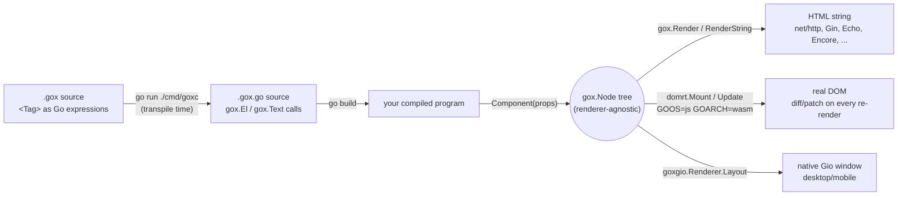

# gojiberry / gox

A JSX-for-Go: write `<div>...</div>` tags directly in Go source as an
expression, anywhere a Go expression is legal, compiling down to plain
Go that renders identically on the server (HTML strings) and in the
browser (real DOM, via WASM), with no separate template language.

```go
func Greeting(props GreetingProps) gox.Node {
	if props.Name == "" {
		return <p class="greeting">Hello, stranger!</p>
	}
	return <p class="greeting">Hello, {props.Name}!</p>
}
```

## How it works

Two separate steps, run at two separate times:

1. **Transpile time** (`go run ./cmd/goxc <dir>`, or `go generate ./...`
   via the repo-root `go:generate` directive): every `*.gox` file's
   `<Tag>` expressions are rewritten into plain `gox.El`/`gox.Text`
   calls, emitted as an ordinary `*.gox.go` file next to it. This file
   is committed like `templ`'s own `*_templ.go` convention, so
   `go build`/`go test` never need `goxc` on the critical path.
2. **Run time**: your component function runs as plain compiled Go —
   there's no interpreter, template engine, or reflection involved —
   and returns a `gox.Node`, a plain tree (element / text / fragment /
   raw) that carries no opinion about how it gets displayed. The same
   tree feeds whichever renderer(s) your program calls:



The `gox.Node` tree itself never knows which of these it's headed for
— `gox.Render`/`domrt.Mount`/a `goxgio.Renderer` are just three
different functions that each walk the exact same tree shape and do
something different with it (see `gox/render.go`, `domrt/domrt.go`, and
`examples/gio-counter-demo/goxgio/render.go`, in that order, if you
want to read the actual walk each one does). Nothing about writing a
component needs to know or care which renderer(s) will eventually
consume it.

## Getting Started

Requires Go 1.24+. This module (`github.com/elaous/gojiberry`) is
private, so it isn't `go get`-able from outside this checkout the way a
public package would be — every consumer in this repo (including every
separate-module example under `examples/`) uses it via a local
`replace` directive pointing at this checkout instead. From your own
project elsewhere on disk:

```
# your-project/go.mod
require github.com/elaous/gojiberry v0.0.0
replace github.com/elaous/gojiberry => /path/to/gojiberry
```

Write a component (`hello.gox`):

```go
package main

import (
	"fmt"

	"github.com/elaous/gojiberry/gox"
)

func Greeting(name string) gox.Node {
	if name == "" {
		return <p class="greeting">Hello, stranger!</p>
	}
	return <p class="greeting">Hello, {name}!</p>
}

func main() {
	html, err := gox.RenderString(Greeting("gojiberry"))
	if err != nil {
		panic(err)
	}
	fmt.Println(html)
}
```

Transpile it by running `goxc` from *this* checkout, pointed at your
project's directory (this avoids needing `goxc`'s own dependencies —
HCL, sqlc, etc. — in your project's `go.mod`; see the `-experimental`
flag below for when those matter to you):

```
cd /path/to/gojiberry
go run ./cmd/goxc /path/to/your-project
```

Then, from your own project:

```
go mod tidy
go run .
# <p class="greeting">Hello, gojiberry!</p>
```

From here:

- `examples/ssr-demo` is the smallest complete example in this repo —
  read it alongside this walkthrough.
- `examples/wasm-counter` shows the same component shape mounted into
  a real browser DOM instead, via `domrt` and `GOOS=js GOARCH=wasm`.
- Every directory under `examples/` has its own `Makefile` (`make run`,
  `make test`) wrapping the exact commands its own section below
  documents — see [Development](#development).
- `## Packages` and `## Components` below are the reference material
  for everything you can import once the basic loop above is familiar.

## Why tags can just be Go expressions

Go's generics use `Foo[T]`, not `Foo<T>`, so unlike TSX there's no
ambiguity between a tag and a generic instantiation to resolve. The
only remaining question is distinguishing a tag-open from the
less-than operator (`a < b`), which `.gox` resolves the same way JSX
parsers do: `<` only means "less than" immediately after something
that completes a value (an identifier, a literal, or a closing
`)`/`]`/`}`). Everywhere else — after `return`, `(`, `,`, `=`, `{`, or
at the start of a statement — a `<` can only legally begin a new
expression, so that's exactly where a tag is allowed to start.

`{expr}` holes, in both attribute values and child position, are
always a single Go expression, exactly like JSX. There's no separate
`if`/`for` template syntax: loops and conditionals are ordinary Go,
usually via an inline closure —

```go
<ul>{func() []gox.Node {
	var items []gox.Node
	for _, s := range list {
		items = append(items, <li>{s}</li>)
	}
	return items
}()}</ul>
```

— which is itself just a Go expression, so tags inside its body are
expanded by the same recursive scan, with no extra grammar required.

## Packages

- **`gox`** — the runtime. `Node` is a plain, renderer-agnostic tree
  (element / text / fragment / raw) that both the server and the
  client render from, so a component behaves identically either way.
  `gox.Render`/`gox.RenderString` render to HTML with automatic
  escaping (`gox.Raw` is the explicit escape hatch). `gox.Event.Value`
  is `any`, read back type-safely via `gox.EventValue[T]`.
- **`internal/transpile`** — the `.gox` → `.go` source-to-source
  transpiler described above, plus the stable resource-import loaders
  (JSON/JSONC/JSONL) and the `@title`/`@stylesheets`/`@wasm`
  page-metadata annotations, both described below.
- **`internal/transpile/experimental`** — the resource-import loaders
  that shell out to a mature external tool this project doesn't
  reimplement (HCL/proto/capnp/sqlc), wired in only via
  `transpile.Options.ExperimentalLoaders` — see Resource imports below.
- **`cmd/goxc`** — the CLI: `go run ./cmd/goxc <dir>` transpiles every
  `*.gox` under `<dir>` into a gofmt-clean `*.gox.go` next to it (the
  generated file is committed, like `templ`'s `*_templ.go` convention,
  so `go build`/`go test` work without running goxc first). Wired up
  as `go generate` via the repo-root `generate.go`. `-experimental`
  (or `GOX_EXPERIMENTAL=1`) enables the experimental resource imports
  below; a directory literally named `experimental` is otherwise
  skipped entirely.
- **`domrt`** — the client runtime (`GOOS=js GOARCH=wasm` only).
  `domrt.Mount` creates real DOM nodes for a `gox.Node` tree;
  `Root.Update` diffs the next tree against what's live and patches
  only what changed — text content in place, attributes added/removed,
  event listeners registered at most once per (element, event) with
  the Go closure swapped on later renders, and children reconciled by
  key when present — preserving DOM node identity (focus, scroll
  position, input state) wherever the shape didn't change.
- **`domrt/browser`** (`GOOS=js GOARCH=wasm`) — `browser.Global(name)`
  exposes any global browser API by name (e.g. `Global("WebAssembly")`)
  for one-offs; typed wrappers cover the APIs most apps need: `Fetch`/
  `Response.Text`/`Response.JSON`, `LocalStorage`/`SessionStorage`,
  `Connect` (WebSocket), `Document()`/`Window()` (see `domrt/html`),
  `OpenDatabase` (IndexedDB — open/upgrade/transaction/object-store,
  each blocking call bridged from IndexedDB's event-based requests the
  same way `domrt.Await` bridges Promises), `GetUserMedia`/
  `EnumerateDevices`/`SetVideoSource` (camera/mic),
  `WriteClipboardText`/`ReadClipboardText`, the File API (`File`'s
  `ReadAsText`/`ReadAsArrayBuffer`/`ReadAsDataURL`, bridged from
  `FileReader`'s events the same way as IndexedDB, plus
  `CreateObjectURL`/`RevokeObjectURL`) for reading `html.InputElement`'s
  or `html.DataTransfer`'s `File` objects, `FormData`
  (`NewFormData`/`NewFormDataFromForm`, `Append`/`AppendFile`/`Get`/
  `Has`/`Delete`) for multipart submissions — pass its `.Value` as
  `FetchOptions.BodyValue` for a real file upload over `fetch` —,
  `Cookies` (`Get`/`All`/`Set`/`Delete`, values percent-encoded on the
  way in and out so arbitrary strings round-trip), `CurrentPosition`/
  `WatchPosition` (Geolocation), `NewWorker` (a dedicated Web
  Worker running a separate Go/WASM binary on a real background thread
  — see `domrt/worker` for the worker-side half and
  `wasm-worker-demo` below; note that the worker's script does async
  work before it can register any listener, so a message posted right
  after `NewWorker` returns can arrive before the worker is listening
  and get silently dropped — have the worker signal readiness first,
  as the demo does), and `NewRouter` (wraps the History API's
  `pushState`/`replaceState` plus the browser's own back/forward
  buttons behind one `OnNavigate` callback — `pushState`/`replaceState`
  fire no event themselves, only `popstate` does, so without this,
  code driving routing from Go would otherwise have to duplicate its
  "render this URL" logic in two places and remember to route both
  through the same function; see `wasm-router-demo` below).
- **`domrt/html`** (`GOOS=js GOARCH=wasm`) — typed `Document`/`Element`/
  `Window` wrappers around raw `syscall/js` DOM calls (`GetElementByID`,
  `AppendChild`, `AddEventListener`, `SetTimeout`, ...), each with a
  `Get`/`Call`/`Set` escape hatch for whatever a typed method doesn't
  cover yet, the same principle as `browser.Global`.
  `Window.AddEventListener` returns the `js.Func` it registered, since
  `RemoveEventListener` only works when given that exact reference
  back; `SetTimeout`/`SetInterval`/`RequestAnimationFrame` return the id
  their `Clear*` counterpart needs for the same reason.
  `DomNode` is the interface `Element` and every element type below
  satisfy (via Go embedding, mirroring how `HTMLCanvasElement` etc.
  extend `Element` in the real DOM), so `AppendChild`/`RemoveChild`
  accept any of them: `CanvasElement` (`Element.AsCanvas()`,
  `GetContext2D`/`GetContext3D` for Canvas 2D and WebGL — the constants
  a WebGL program needs, like `TRIANGLES()`/`ARRAY_BUFFER()`, are
  methods that read the real value off the live context rather than
  hardcoded Go integers, so they can't drift from whatever the browser
  actually defines), `AnchorElement` (`AsAnchor()`,
  `Href`/`Target`/`Rel`/`Download`), `ButtonElement` (`AsButton()`,
  `Disabled`/`Type`/`Click`), `SelectElement` (`AsSelect()`,
  `SelectedIndex`/`Multiple`/`Options`), `InputElement` (`AsInput()`,
  `Checked`/`Type`/`Disabled`/`Files` — see the File API above for
  reading what `Files` returns), `ImageElement` (`AsImage()`,
  `NaturalWidth`/`NaturalHeight`/`Complete`/`OnLoad`/`OnError`), and
  `FormElement` (`AsForm()`, `Submit`/`Reset`/`CheckValidity`/
  `Elements`/`OnSubmit`). Also: `NewIntersectionObserver`/
  `NewResizeObserver`, `Element.OnDragStart`/`OnDragOver`/`OnDrop` plus
  a typed `DataTransfer`, `Element.OnContextMenu` (suppresses the
  browser's native menu and reports the click's viewport position, for
  `components.ContextMenu` or your own), `Document.CreateElementNS` (see `domrt/svg`
  for SVG — use `Element.ClassListAdd`/`ClassListContains` rather than
  `GetClassName`/`SetClassName` on an SVG element, since its
  `className` is an `SVGAnimatedString` object, not a plain string),
  and `Element`'s dimension/scroll/style surface: `ClientWidth`/
  `ClientHeight`, `ScrollWidth`/`ScrollHeight`, `ScrollLeft`/`ScrollTop`
  (get and set), `ScrollTo`/`ScrollBy`, `ClientRects`, and `Style()`
  (get/set/remove a CSS property, or its whole `CSSText`) — paired with
  `Window.ComputedStyle` for a resolved, read-only view including
  inherited/stylesheet rules, and `Window.InnerWidth`/`InnerHeight`/
  `ScrollX`/`ScrollY`/`DevicePixelRatio` for the viewport itself.
  `Element.DispatchCustomEvent`/`OnCustomEvent` dispatch and listen for
  `CustomEvent`s, for decoupled component communication or interop with
  non-Go script on the same page. `Window.OnError`/`OnUnhandledRejection`
  catch a real uncaught exception or unhandled promise rejection from
  *anywhere* on the page (not just this program), each as a `JSError` —
  `AsGoError()` returns it as a plain `error` explicitly, `AsJSException()`
  unwraps to the raw JS value for reading anything `JSError` doesn't
  model (a custom error subclass's own fields, its stack trace).
  `Element.OnKeyDown`/`OnKeyUp` report a typed `KeyEvent` (`Key`/`Code`/
  `CtrlKey`/`ShiftKey`/`AltKey`/`MetaKey`), for the keys "input" never
  fires for (arrows, Backspace, Enter, shortcuts); `Element.OnMouseDown`/
  `OnMouseMove`/`OnMouseUp` report a typed `MouseEvent` (`X`/`Y`,
  viewport-relative) for anything that needs a real click/drag
  position gox.Event can't carry — canvas hit-testing, custom
  selection, and so on. Both mirror `DragEvent`'s shape (a
  `PreventDefault`/`StopPropagation` pair alongside the typed fields);
  see `examples/canvas-editor-app` for `MouseEvent.PreventDefault`
  actually mattering, not just being there for symmetry — clicking a
  non-focusable element like a bare `<canvas>` makes the browser clear
  focus right after every mousedown handler returns, silently undoing
  a same-handler call to focus something else, unless you prevent that
  default first. `Element.OnWheel` reports a typed `WheelEvent`
  (`DeltaX`/`DeltaY`) the same way, for anything that needs to drive
  its own scroll position — a canvas has none of its own to read back,
  unlike a normal scrollable DOM element.
- **`domrt/svg`** (`GOOS=js GOARCH=wasm`) — `svg.CreateElement(document,
  tag)` creates an SVG element in the right namespace (`svg.Namespace`)
  — `createElement` alone produces an unrenderable element in the
  wrong one. Once created, an SVG element is a plain `*html.Element`
  like any other: presentation attributes (`d`, `cx`, `cy`, `r`,
  `viewBox`, `fill`, `stroke`, ...) are ordinary attributes, already
  covered by `GetAttribute`/`SetAttribute`, and `BoundingRect`/`Style`/
  event-listener methods all work the same as on HTML elements.
- **`domrt/sw`** (`GOOS=js GOARCH=wasm`) — lets a Go/WASM binary run as
  a browser service worker: `OnInstall`/`OnActivate`/`OnFetch` register
  the lifecycle/fetch events, `ExtendableEvent.WaitUntil` and
  `FetchEvent.RespondWith` bridge to `event.waitUntil`/`respondWith`,
  and `CachesOpen`/`CacheAddAll`/`CachesMatch`/`ClaimClients` wrap the
  Cache Storage API. `domrt.Await`/`domrt.ToPromise` (in the `domrt`
  package itself) bridge JS Promises in both directions and are shared
  by `browser` and `sw` rather than duplicated.
- **`domrt/worker`** (`GOOS=js GOARCH=wasm`) — the worker-side half of
  `browser.Worker`: `OnMessage`/`PostMessage`/`Close`, for a Go/WASM
  binary running inside a dedicated Web Worker's own global scope, the
  same `importScripts('wasm_exec.js')` trick `domrt/sw` uses for
  service workers, adapted to a worker's simpler message-passing-only
  API (no fetch/cache lifecycle events).
- **`crdt`** — the offline-first sync engine: a last-writer-wins
  register per document block, keyed by ID. Each replica (a phone, a
  laptop, a sync server) mutates its own copy freely while offline via
  `Doc.Put`/`Doc.Delete`; `Doc.Drain()` returns only the Ops written
  since the last sync (the delta a metered connection actually sends),
  and `Doc.Apply(ops...)` merges received Ops in, converging to the
  same state on every replica regardless of delivery order or
  duplication. `Doc.Snapshot()` returns the full current state instead,
  for onboarding a brand-new replica with nothing to diff against yet.
- **`syncserver`** — the decoupled backend half: a thin HTTP relay
  (`POST /ops` to push a delta, `GET /ops` for a full snapshot) that is
  itself just another CRDT replica, so it never needs bespoke
  conflict-resolution logic clients must trust. Every deployment detail
  — listen address, region label — comes from `GOJIBERRY_SYNC_ADDR` /
  `GOJIBERRY_SYNC_REGION` (see `syncserver.ConfigFromEnv`), so the same
  binary (`cmd/syncserver`) can be pointed at any operator's own
  infrastructure without a rebuild.
- **`devreload`** / **`devwatch`** — the two halves of gox's dev-mode
  hot-reload loop, generalized out of `examples/canvas-app`'s own
  hand-rolled version so any gox server can opt in with a few lines
  instead of re-deriving it. `devreload` is the browser-side half:
  `Reloader.Wrap(html)` injects a small script that polls
  `Reloader.Handler()`'s endpoint and reloads the tab once the served
  version differs from the one the page was rendered with; a nil
  `*Reloader` makes both calls no-ops, so production code needs no
  separate devMode branch. `devwatch` is the process-supervision half:
  `devwatch.Run(Config{...})` watches a source tree, and on a relevant
  change (debounced, with `.gox.go`/VCS metadata always skipped via
  `DefaultIgnore`) reruns the project's own `Rebuild` and restarts a
  managed server subprocess — not real hot module replacement (a
  compiled binary is one opaque unit), just a fast watch/rebuild/
  restart/reload cycle, the same tradeoff `examples/canvas-app`'s own
  version already made. `cmd/goxdev` is a generic CLI front end for
  projects with no Go code of their own to wire `devwatch.Run` into:
  `go run github.com/elaous/gojiberry/cmd/goxdev -build "..." -- ./myserver`.
  `examples/canvas-app`'s `cmd/devwatch`/`cmd/devserver` now use both
  packages directly, verified via a real watch/rebuild/restart cycle
  against the running app (a file change triggers a real rebuild, a
  real process restart, and the served `/__dev/version` genuinely
  changes) as well as a real headless-Chromium/Postgres run.

## Components

A component is a plain Go function taking a typed props struct:

```go
type ButtonProps struct {
	Label   string
	OnClick gox.EventHandler
}

func Button(props ButtonProps) gox.Node {
	return <button onClick={props.OnClick}>{props.Label}</button>
}
```

`<Button label="Save" onClick={handleSave}/>` (uppercase tag name)
compiles to `Button(ButtonProps{Label: "Save", OnClick: handleSave})` —
attribute names map to struct fields by capitalizing the first letter.
If the tag has children, they're collected into a `Children
[]gox.Node` field. Lowercase tag names (`<div>`, `<span>`, custom
elements like `<my-widget>`) are real HTML elements and compile to
`gox.El(...)` instead.

### Components with instance state or helper methods

`<Name attr>{children}</Name>` always compiles to
`Name(NameProps{...})` — there's no second tag form for a component
that wants real instance state or extra methods beyond just rendering
(a class component, in React terms). None is needed: Go doesn't allow a
type and a func to share a name, so `Name`'s callable surface is always
that one plain function — but nothing stops its body from delegating
to an unexported struct instead of building the returned `gox.Node`
inline:

```go
type CounterProps struct {
	Count int
	OnInc gox.EventHandler
}

// Counter is called exactly like any other component:
// <Counter count={5} onInc={handleInc}/> -> Counter(CounterProps{...}).
func Counter(props CounterProps) gox.Node {
	return counter{props}.Render()
}

// counter is unexported -- callers never see it, only Counter's usual
// Name(NameProps) gox.Node signature.
type counter struct {
	Props CounterProps
}

// Label is a helper method alongside Render, the kind of thing a
// one-shot function body would otherwise have to recompute inline.
func (c counter) Label() string {
	return strconv.Itoa(c.Props.Count)
}

func (c counter) Render() gox.Node {
	return <button onClick={c.Props.OnInc}>{c.Label()}</button>
}
```

See `examples/wasm-struct-counter-demo` for a full working example.

### The `<html>` entrypoint

`gox.Document{Title, Head, Body}.Render()` builds the
`<html><head>...</head><body>...</body></html>` wrapper almost every
top-level page needs, so pages don't each hand-roll it:

```go
func Page(props PageProps) gox.Node {
	return gox.Document{
		Title: "My App",
		Head:  []gox.Node{gox.Style(someCSSContent)},
		Body:  <h1>Hello, {props.Name}!</h1>,
	}.Render()
}
```

`Head` is just `[]gox.Node` — append whatever `<meta>`/`<link>`/
`<script>` nodes a page needs. `gox.Style(css string) gox.Node` wraps
a `<style>` tag around raw CSS content, the same way `gox.Raw` does for
any other trusted HTML. `Body` takes one node, so use `<>...</>`
(`gox.Frag`) to group several top-level children there.

For the common case — a static title and one or more stylesheets, both
known at transpile time — `@title`/`@stylesheets` doc-comment
annotations do this for you, so `Page` only needs to return its actual
content:

```go
// @title My App
// @stylesheets App.css
func Page(props PageProps) gox.Node {
	return <h1>Hello, {props.Name}!</h1>
}
```

goxc reads these directly above a `func ... gox.Node` declaration,
reads each `@stylesheets` file the same way a resource import would,
and rewrites every one of that function's own top-level `return`
statements into the `gox.Document{...}.Render()` form above — so
conditional early returns (`if props.Name == "" { return <p>...</p> }`)
all get wrapped too, while a `return` inside a nested closure (e.g. the
immediately-invoked `func() []gox.Node {...}()` idiom used for
rendering a list) is left alone, since that's a different function's
return value, not the page's. Omitting `@title` falls back to a
package-level `DefaultTitle` identifier, which you declare once
yourself (`gox` does not declare it for you — same "trust the Go
compiler" stance as the JSON typed-import annotation: an undeclared
`DefaultTitle` just fails with an ordinary undefined-identifier error).
Use `gox.Document` directly instead when a page's title or stylesheets
genuinely need to vary at runtime, not just per document/request
content within an otherwise-static page.

A third annotation, `@wasm`, covers the other boilerplate every
WASM-consuming SSR page in this repo otherwise hand-wrote — the
`wasm_exec.js` loader plus a `WebAssembly.instantiateStreaming`
bootstrap script:

```go
// @wasm /static/main.wasm
func CanvasPage(props CanvasPageProps) gox.Node {
	return <textarea id="canvas">{props.Content}</textarea>
}
```

Unlike `@stylesheets`, `@wasm`'s value is a URL, not a file path — the
compiled `.wasm` binary doesn't exist yet when its SSR page is
transpiled (it's built separately, from a different package, usually
afterward), so there's nothing to read at transpile time, only a
location to generate `<script>` tags for. `wasm_exec.js`'s URL is
derived from the `.wasm` URL's own directory (`/static/main.wasm` →
`/static/wasm_exec.js`). Both `<script>` tags are appended *after* the
function's own returned content, inside `<body>`, not into `Head` —
scripts that call `document.getElementById` need the elements they
target to already exist.

These are deliberately a third comment shape, not a reuse of either
existing convention in this codebase: a tool directive (`//go:generate`,
`//encore:api`) triggers an external command or build-time codegen,
and `//language=SQL` (see `editors/vscode-gox`) is a pure editor hint
with zero effect on the compiled program. `@title`/`@stylesheets`/
`@wasm` are neither — they're informational metadata that a real tool
(goxc) turns into code — so they get the `@key value` shape instead,
mirroring swaggo/swag's `// @Summary`/`// @Router` handler annotations
(real, widely-used Go prior art for exactly this kind of per-function
informational comment).

### A ready-made component library

`components` is a small library of common UI components built on the
pattern above: `Link`, `Button`, `Chip`, `RadioGroup`, `Tabs`,
`Accordion`, `Dropdown` (single/multiple, with per-option icons and,
in multi-select, checkboxes), `DatePicker`, `ColorPicker`, `Slider`,
`Carousel`, `Wizard`, `FileUploader` (click-to-browse and
drag-and-drop, with an optional progress bar), `ContextMenu`
(typically opened from a real right-click via `domrt/html`'s
`Element.OnContextMenu`, with a full-viewport backdrop that closes it
on an outside click), `Tooltip` (pure CSS `:hover`/`:focus-within` —
no JS, nothing to keep positioned), `Loader` (an indeterminate spinner
for when there's no known completion percentage), `Progress`
(`Variant: ProgressLinear` or `ProgressCircle`, both determinate or
`Indeterminate`), `Modal` (a backdrop plus a centered content box —
the base `Dialog`, and through it `Confirm`/`Alert`, build on; use it
directly for fully custom modal content), `Dialog` (`Modal` with the
common title/body/footer-actions shape), `Confirm` and `Alert`
(`Dialog` presets for a yes/no decision and a single acknowledgment,
each rendered with `role="alertdialog"` instead of `Dialog`'s default
`role="dialog"`, per ARIA, since both demand an immediate response),
and `Toast` (a non-modal, transient notification — no backdrop, no
opinion on where it sits on screen; wrap one or more in your own
`position:fixed` container to stack them).

Also `Checkbox` and `CheckboxGroup` (RadioGroup's independent-selection
counterpart — any number, including none, may be checked), `Switch` (a
real checkbox, visually hidden but still keyboard/screen-reader
accessible, styled as a sliding track via the CSS `:checked` sibling
selector — the same "real control, custom look" idea `FileUploader`'s
hidden file input already uses), `Textarea`, `OTPInput` (N
single-character boxes for a verification code; like `FileUploader`
and `ContextMenu`, advancing focus to the next/previous box on
input/backspace needs a real DOM reference `gox.Event` doesn't carry,
so it's the caller's job via `domrt/html`, keyed off each box's
`fmt.Sprintf("%s-%d", ID, i)` id), `Breadcrumbs`, `Pagination` (with
ellipsis windowing so its width stays constant regardless of page
count), `Avatar` (an image, or a colored initials fallback when there's
no `Src`), `Search` (a basic ARIA combobox — ranking/filtering/
debouncing `Suggestions` is the caller's job, the same split
`FileUploader` uses for reading files), `ImageZoom` (click a thumbnail
for a full-viewport enlarged overlay, `Modal`-style backdrop and all),
and `Popover` (anchored, click-triggered content with the same
outside-click-to-close backdrop trick as `ContextMenu`, for when
`Tooltip`'s pure-hover/non-interactive content isn't enough).

Last, `Icon`: a small set of built-in glyphs (`IconCheck`, `IconClose`,
the four `IconChevron*`, `IconPlus`/`IconMinus`, `IconMenu`, `IconStar`)
or any caller-supplied `Glyph`, sized and colored via CSS. It's
deliberately a Unicode character in a `<span>`, not an inline `<svg>`:
see the `Progress` circle-variant note below for why an `<svg>` tree
silently fails to render once mounted client-side, a constraint this
hits directly since an icon is exactly the kind of thing you'd reach
for `<svg>` for. Reach for `domrt/svg.CreateElement` directly (paired
with one of this package's existing `Icon *gox.Node` slots on `Chip`/
`Dropdown`/`ContextMenu`) if you need a real vector icon client-side.

Three more round out the set. `Collab` wraps shared content and gates
what a collaborator can see and do with it by role — `CollabOwner`
(edit/view/delete/share/comment), `CollabEditor` (edit/view/comment),
or `CollabViewer` (view/comment only, plus a "View only" badge) —
`CapabilitiesForRole` gives each role's defaults, or pass a custom
`CollabCapabilities` to override them. It has no networking or
persistence of its own, the same pure-function-of-props shape as
everything else here; see `examples/collab-editor-app` for pairing it
with real multi-user sync over `domrt/browser.Socket`. `Floating`
formalizes the "wrap one or more Toasts in your own `position:fixed`
container" idiom Toast's own doc comment already describes, generalized
to any content pinned to a corner/edge of the viewport (or the nearest
positioned ancestor, via `Absolute`) — a floating action button, a
badge, a persistent status widget. `Box` is a full-height (or
explicitly sized) layout container split into `len(Divisions)` stacked
sub-boxes, each independently sized by percentage, a fixed unit value,
or left flexible to fill whatever height its siblings don't claim —
built on CSS Grid's `grid-template-rows`, which already handles
exactly that mix of units in one declaration.

None of them import
`domrt` or `syscall/js` — every interactive one is a pure function of
its props, taking the current state and `On*` callbacks the same way
`wasm-counter`'s `Counter` does, so a single component works unchanged
in an SSR-only page and in a WASM page driving it with
`domrt.Mount`/`Update`. `Progress`'s circle variant is drawn with a CSS
conic-gradient rather than `<svg>`/`<circle>`: `domrt.Mount`/`Update`
create elements with plain `createElement`, which builds the wrong
(HTML, not SVG) element for those tags, so an SVG-based ring would
silently fail to render once mounted client-side even though it looks
fine in server-rendered HTML (the browser's HTML parser switches
namespace for a parsed `<svg>` tag on its own — `domrt` doesn't):

```go
components.RadioGroup(components.RadioGroupProps{
	Name:     "plan",
	Options:  []components.RadioOption{{Value: "free", Label: "Free"}, {Value: "pro", Label: "Pro"}},
	Selected: state.Plan,
	OnChange: func(v string) { state.Plan = v; render() },
})
```

`DatePicker`/`ColorPicker`/`Slider` are thin styled wrappers around
`<input type="date"/"color"/"range">` — the browser does the actual
picker UI and locale/keyboard handling. `Dropdown` is a fully custom
widget instead, since no native `<select>` can render per-option icons;
it implements the ARIA listbox pattern's roles/attributes but not its
own keyboard navigation. `FileUploader` renders a `<label>` wrapping a
visually-hidden `<input type="file">`, so click-to-browse works with
zero JS (a label natively opens its associated control), but since
`gox.Event` carries no file/`DataTransfer` payload, reading the actual
selected or dropped files is done through `domrt/html` directly by the
consuming app (`InputElement.Files()`, or `Element.OnDrop` for
drag-and-drop) — see `FileUploaderProps`'s doc comment and the
`wasm-components-demo` example below. `ContextMenu` has the same
split for the same reason: `gox.Event` carries no `clientX`/`clientY`,
so the consuming app wires `domrt/html`'s `Element.OnContextMenu` on
whatever should be right-clickable and passes the position it reports
straight through as `ContextMenuProps.X`/`Y`.

CSS is split one file per component (`components/button.css`,
`components/modal.css`, ...) plus `components/base.css` for the shared
`--gj-*` design tokens and the couple of `@keyframes` more than one
component reuses (`gj-spin`, `gj-progress-indeterminate`) — pull in
`base.css` plus only the per-component files a page actually uses, e.g.
`@stylesheets ../../components/base.css` and
`@stylesheets ../../components/button.css` (paths relative to your
`.gox` file), or plain `<link rel="stylesheet">` tags for a bare WASM
page with no SSR step. A component's doc comment says which stylesheet
it needs; `Dialog` (and `Confirm`/`Alert`, built on it) also needs
`modal.css`, since they render inside `Modal`'s box.

## Resource imports

An import spec whose path ends in a recognized non-Go extension is a
resource import, not a Go package import — the file is loaded (and,
where needed, compiled) at transpile time instead of at runtime. Paths
resolve relative to the `.gox` file's own directory, the same
convention `go:embed` uses — not fetched from a URL or module proxy.

Resource imports split into two tiers: **stable** (on by default) and
**experimental** (opt-in via `goxc -experimental` or
`GOX_EXPERIMENTAL=1`, or `transpile.Options{Experimental: true}`).
Experimental means shelling out to a mature external tool this project
doesn't try to reimplement — gox still *recognizes* these extensions
without opting in (so it can give an actionable "enable experimental
mode" error instead of a confusing "not a valid Go import path" one),
but none of that code runs, and a directory literally named
`experimental` is skipped entirely by an ordinary `goxc`/`go generate`
walk so a checked-in experimental example can't break the default
build.

### Stable

```go
import (
	config "config.json"          // -> config (decoded any) + configBytes ([]byte)
	cfg.(Config) "config.json"    // -> cfg (as Config, which you declare) + configBytes
)
```

- **`.json`** binds the alias to the decoded value (as `any`) and
  `<alias>Bytes` to the raw content. With an `alias.(TypeName)
  "file.json"` annotation — reusing Go's type assertion syntax for a
  new meaning that's never valid in a real import spec — gox instead
  decodes directly into `TypeName` and binds `alias` as that type.
  **`TypeName` must already be declared by you** (in the same package
  or an import); gox does not generate it or infer its shape from the
  file's data — it's exactly `json.Unmarshal(configBytes, &v)` with
  the boilerplate written for you, not schema inference, so the only
  failure mode is the ordinary one of your type not matching your
  data, identical to writing the unmarshal call yourself. An earlier
  version of this tried to infer and generate the struct from sample
  data instead; that traded a small amount of boilerplate for a real
  footgun (a field that's a whole number in your sample but a fraction
  in production data would infer `int` and then fail to unmarshal) and
  was dropped in favor of this.
- **`.jsonc`** is `.json` with `//` and `/* */` comments allowed
  (stripped by a small string-literal-aware preprocessor before
  parsing — not a full JSONC library), including the same annotation.
- **`.jsonl`** is one JSON value per line; `<alias>` binds to a slice
  instead of a single value — `[]TypeName` with an annotation, `[]any`
  without one.

CSS used to have its own `.css`/`.scss` resource-import loaders here.
They're gone in favor of the `@stylesheets` page-metadata annotation
(see "The `<html>` entrypoint" above), which reads a page's
stylesheet(s) the same way but ties them to the page component they
style instead of a standalone import line.

### Experimental

```go
import (
	schema "schema.hcl"    // -> a generated package: schema.Users{}, schema.Books{}
	books  "books.proto"   // -> a generated package via protoc/protoc-gen-go
	queries "queries.sql"  // -> a generated package via sqlc
)
```

- **`.hcl`** is gox's schema DSL (`table "x" { column "y" { type = ...
  } }`), parsed with `hashicorp/hcl/v2`. Generates a real Go
  subpackage at `internal/goxgen/hcl/<alias>/` with model structs
  (`models.go`) and an initial `CREATE TABLE` migration
  (`migrations/0001_init.sql`), and rewrites the import to point at
  it — so `schema.Users{}` works like any normal imported type, which
  splicing a value into the importing file (as JSON does) couldn't
  give, since Go has no runtime notion of a type namespace. Scoped to
  snapshot generation: each run regenerates the models/migration from
  the current schema; there's no diffing against a previous version
  for incremental migrations.
- **`.proto`** shells out to the real `protoc`/`protoc-gen-go`
  toolchain (gox doesn't reimplement a protobuf compiler), using
  protoc-gen-go's `-M` file-mapping flag to place output at
  `internal/goxgen/proto/<alias>/` under gox's control rather than
  requiring the `.proto` to declare its own `go_package`. Also runs
  `protoc-gen-go-grpc` if it's on `PATH`. Requires `protoc` +
  `protoc-gen-go` on `PATH`.
- **`.capnp`** shells out to `capnp`/`capnpc-go`. Unlike protoc-gen-go,
  capnpc-go has no external flag for output location — it takes both
  the package and Go import path solely from a
  `$Go.import("...")`/`$Go.package("...")` annotation the schema
  itself must declare (the real go-capnp convention), and writes
  output next to the source file; gox parses that annotation back out
  to know what to import. Requires `capnp` + `capnpc-go` on `PATH`.
- **`.sql`** shells out to the real `sqlc` toolchain (gox doesn't
  reimplement sqlc's query analysis/codegen). sqlc's own config
  (`sqlc.yaml`/`sqlc.json`, found by walking up from the `.sql` file)
  already fully owns pairing queries with a schema and choosing output
  location — gox doesn't generate or validate that config, only
  locate it, run `sqlc generate -f <config>`, and derive the Go import
  path from its `gen.go.package`/`out` fields. Requires `sqlc` on
  `PATH` and a real sqlc project config; gox does not verify the
  config actually lists this specific `.sql` file among its query
  sources (that would mean reimplementing sqlc's own config
  resolution), only that a config exists somewhere above it.

The experimental loaders live in `internal/transpile/experimental`, a
separate package from `internal/transpile` — wired in only via
`transpile.Options.ExperimentalLoaders`, so unless a caller explicitly
imports and supplies that package, its code is never reached, not just
flag-gated within the same files. `internal/transpile/experimental`'s
own package doc has more on the design.

Neither `protoc` nor `capnp` nor `sqlc` are installed in the sandbox
this was built in. The sqlc loader's "no config found" error path is
verified, and its actual invocation and import-path derivation are
verified too, against a stubbed `sqlc` executable standing in for the
real tool (gox's own discovery/invocation/derivation logic is what's
under test, not sqlc's codegen correctness). `.proto`/`.capnp` are
verified only against their "tool not found" error path. JSON (both
paths), `@title`/`@stylesheets`/`@wasm`, and HCL are exercised fully,
including `mustCompileAndRun`-style tests that actually `go run` the
generated code.

## Examples

- `examples/ssr-demo` — components with props, a conditional branch,
  and a rendered list, run server-side:

  ```
  go generate ./...
  go run ./examples/ssr-demo
  go test ./examples/ssr-demo/...
  ```

- `examples/wasm-counter` — a stateful counter compiled to WASM and
  mounted client-side, proving domrt's diff/patch against a real
  browser:

  ```
  go generate ./...
  GOOS=js GOARCH=wasm go build -o examples/wasm-counter/main.wasm ./examples/wasm-counter/
  cp "$(go env GOROOT)/lib/wasm/wasm_exec.js" examples/wasm-counter/
  cd examples/wasm-counter && python3 -m http.server 8080
  # open http://localhost:8080/
  ```

- `examples/wasm-struct-counter-demo` — the same counter, but `Counter`
  delegates to an unexported `counter` struct with a `Label` helper
  method alongside `Render`, instead of building its `gox.Node` inline
  -- called exactly the same way (`<Counter .../>` ->
  `Counter(CounterProps{...})`) as any other component, since Go won't
  let a type and a func share a name in the first place. Verified
  against a real browser: correct initial/updated label text through
  several clicks, and DOM node identity preserved across updates
  (proving `Render()`'s output really goes through `domrt`'s
  diff/patch, not a fresh mount each time):

  ```
  go generate ./...
  GOOS=js GOARCH=wasm go build -o examples/wasm-struct-counter-demo/main.wasm ./examples/wasm-struct-counter-demo/
  cp "$(go env GOROOT)/lib/wasm/wasm_exec.js" examples/wasm-struct-counter-demo/
  cd examples/wasm-struct-counter-demo && python3 -m http.server 8080
  # open http://localhost:8080/
  ```

- `examples/wasm-browser-api-demo` — `domrt/browser`'s `Fetch` and
  `LocalStorage` wrappers, reading a local `config.json` and round
  -tripping a stored value:

  ```
  go generate ./...
  GOOS=js GOARCH=wasm go build -o examples/wasm-browser-api-demo/main.wasm ./examples/wasm-browser-api-demo/
  cp "$(go env GOROOT)/lib/wasm/wasm_exec.js" examples/wasm-browser-api-demo/
  cd examples/wasm-browser-api-demo && python3 -m http.server 8080
  # open http://localhost:8080/
  ```

- `examples/wasm-sw-demo` — a cache-first service worker compiled from
  `.gox`, proving a Go/WASM binary can run as a real browser service
  worker (not just page-context script):

  ```
  go generate ./...
  GOOS=js GOARCH=wasm go build -o examples/wasm-sw-demo/sw.wasm ./examples/wasm-sw-demo/
  cp "$(go env GOROOT)/lib/wasm/wasm_exec.js" examples/wasm-sw-demo/
  cd examples/wasm-sw-demo && python3 -m http.server 8080
  # open http://localhost:8080/ -- devtools > Application > Service Workers
  # shows it installed, activated, and claimed the page.
  ```

- `examples/wasm-canvas-demo` — `domrt/html`'s `Context2D`/`Context3D`:
  fills a 2D canvas with a solid color and draws a full-viewport quad
  on a WebGL canvas with a solid-color shader, then reads a pixel back
  from each (via the same package's `GetImageData`/`ReadPixels`) to
  prove the draw calls actually landed. Verified against a real
  headless Chromium (falls back to software WebGL there, which is
  expected and fine):

  ```
  go generate ./...
  GOOS=js GOARCH=wasm go build -o examples/wasm-canvas-demo/main.wasm ./examples/wasm-canvas-demo/
  cp "$(go env GOROOT)/lib/wasm/wasm_exec.js" examples/wasm-canvas-demo/
  cd examples/wasm-canvas-demo && python3 -m http.server 8080
  # open http://localhost:8080/
  ```

- `examples/wasm-platform-demo` — `domrt`'s newer platform wrappers
  together: IndexedDB (open/upgrade/put/get), `IntersectionObserver`/
  `ResizeObserver`, drag-and-drop (`Element.OnDragStart`/`OnDragOver`/
  `OnDrop` + `DataTransfer`), `MediaDevices.GetUserMedia`, and the
  Clipboard API, each writing its result into its own element. Verified
  against a real headless Chromium: a fake camera device
  (`--use-fake-device-for-media-stream`) producing a real video track,
  a real IndexedDB round trip, and drag-and-drop driven by Playwright's
  actual mouse-based drag (which the browser turns into genuine
  `dragstart`/`dragover`/`drop` events), not just a compile check:

  ```
  go generate ./...
  GOOS=js GOARCH=wasm go build -o examples/wasm-platform-demo/main.wasm ./examples/wasm-platform-demo/
  cp "$(go env GOROOT)/lib/wasm/wasm_exec.js" examples/wasm-platform-demo/
  cd examples/wasm-platform-demo && python3 -m http.server 8080
  # open http://localhost:8080/ -- camera/clipboard permissions need
  # to be granted (browsers prompt automatically over plain HTTP on
  # localhost; a real deployment needs HTTPS for both).
  ```

- `examples/wasm-typed-elements-demo` — `domrt/html`'s typed element
  subtypes and `domrt/browser`'s File API: `Element.AsCanvas`/
  `AsAnchor`/`AsButton`/`AsSelect`/`AsInput` cast a plain `Element` to
  `CanvasElement`/`AnchorElement`/`ButtonElement`/`SelectElement`/
  `InputElement`, each exercised through its actual type-specific
  methods, plus reading a real uploaded file's contents back through
  `browser.File.ReadAsText` and minting a `blob:` URL with
  `CreateObjectURL`. Verified against a real headless Chromium: a real
  mouse click (on top of a synthesized `Click()` call) and a real file
  upload via Playwright's `setInputFiles`, not just a compile check:

  ```
  go generate ./...
  GOOS=js GOARCH=wasm go build -o examples/wasm-typed-elements-demo/main.wasm ./examples/wasm-typed-elements-demo/
  cp "$(go env GOROOT)/lib/wasm/wasm_exec.js" examples/wasm-typed-elements-demo/
  cd examples/wasm-typed-elements-demo && python3 -m http.server 8080
  # open http://localhost:8080/
  ```

- `examples/wasm-dom-extras-demo` — `domrt/html`'s dimension/scroll/style
  surface, `domrt/svg` (`CreateElement`, plus `html.Element`'s
  `ClassListAdd`/`ClassListContains`), `ImageElement`, `FormElement`,
  `DispatchCustomEvent`/`OnCustomEvent`, `Window.OnError`/
  `OnUnhandledRejection`, and `domrt/browser`'s `FormData`, `Cookies`,
  and Geolocation.
  Verified against a real headless Chromium: real viewport/document/
  element dimensions (not just that the getters don't panic), scrolling
  an overflowing div and reading its new `ScrollTop` back, an inline
  style round trip plus a real `Window.ComputedStyle` resolution, an
  SVG `<circle>` with a non-zero rendered bounding box, a real PNG
  (generated with `image/png`, not hand-typed bytes) loading and
  reporting its actual decoded `NaturalWidth`/`NaturalHeight`, a real
  form-submit event building a `FormData` from the form's actual
  controls, a cookie round trip confirmed encoded correctly on the wire
  (via the browser's own cookie jar, not just decoded by the same code
  that encoded it), a dispatched-and-received `CustomEvent`, a genuine
  uncaught exception and unhandled promise rejection from an inline
  `<script>` this Go program doesn't control (caught by `OnError`/
  `OnUnhandledRejection`), and a geolocation reading via Playwright's
  mocked coordinates:

  ```
  go generate ./...
  GOOS=js GOARCH=wasm go build -o examples/wasm-dom-extras-demo/main.wasm ./examples/wasm-dom-extras-demo/
  cp "$(go env GOROOT)/lib/wasm/wasm_exec.js" examples/wasm-dom-extras-demo/
  cd examples/wasm-dom-extras-demo && python3 -m http.server 8080
  # open http://localhost:8080/
  ```

- `examples/wasm-worker-demo` — two separate Go/WASM binaries: the page
  (`main.gox`) spawns a dedicated Web Worker running `worker/worker.go`
  via `browser.NewWorker`, and exchanges messages with it via
  `PostMessage`/`OnMessage`. The worker counts primes up to N by trial
  division and posts the count back. Verified against a real headless
  Chromium: two separate message round trips (proving the worker stays
  alive rather than answering once and exiting) each returning the
  correct, independently-known prime count (25 for N=100, 15 for N=50)
  — computed by the *worker's* binary, not the page's:

  ```
  go generate ./...
  GOOS=js GOARCH=wasm go build -o examples/wasm-worker-demo/main.wasm ./examples/wasm-worker-demo/
  (cd examples/wasm-worker-demo/worker && GOOS=js GOARCH=wasm go build -o ../worker.wasm .)
  cp "$(go env GOROOT)/lib/wasm/wasm_exec.js" examples/wasm-worker-demo/
  cd examples/wasm-worker-demo && python3 -m http.server 8080
  # open http://localhost:8080/
  ```

- `examples/wasm-router-demo` — a minimal two-page SPA built on
  `browser.Router`. Verified against a real headless Chromium:
  `Navigate` updates the page and the URL and pushes exactly one new
  history entry; a real click on the browser's own Back button (not a
  simulated event) fires the same `OnNavigate` callback and reverts
  both, Forward replays it; and `Replace` updates the page without
  growing `history.length`, unlike `Navigate` — proving the "one
  callback for any URL change" design actually holds across all three
  paths, not just the programmatic one:

  ```
  go generate ./...
  GOOS=js GOARCH=wasm go build -o examples/wasm-router-demo/main.wasm ./examples/wasm-router-demo/
  cp "$(go env GOROOT)/lib/wasm/wasm_exec.js" examples/wasm-router-demo/
  cd examples/wasm-router-demo && python3 -m http.server 8080
  # open http://localhost:8080/
  ```

- `examples/wasm-components-demo` — a gallery of every component in
  `components`, each wired to real local state and mounted with
  `domrt.Mount`/`Update`. Verified against a real headless Chromium:
  every one of the 37 components driven through its actual
  interactivity (clicking a tab/accordion header/carousel arrow/wizard
  step, opening the dropdown and picking a multi-select option,
  removing a chip, dragging the slider, setting the date/color inputs,
  uploading a real file read back through `FileUploader` + the File
  API, a real right-click opening `ContextMenu` at the actual click
  position then closing it via an item selection and, separately, via
  an outside click on its backdrop, hovering to reveal a `Tooltip` --
  checked via its bubble's real computed opacity, not just DOM
  presence, since it's always in the DOM -- confirming `Loader`
  and both `Progress` variants are actually animating via their
  computed `animation-name`, opening a `Modal` and closing it with a
  real click on its backdrop (not the box itself, proving a click
  inside the content can't accidentally trigger it), a `Dialog`
  closed three different ways (Cancel, Save, backdrop) each setting a
  distinct result, `Confirm`/`Alert` each checked for
  `role="alertdialog"` plus both of their outcomes, a `Toast`
  dismissed via its own close button, toggling `Checkbox`/`Switch` and
  a multi-select `CheckboxGroup`, typing into an `OTPInput` and
  confirming focus genuinely advances/retreats across its boxes via
  `document.activeElement` (not just that the value changed), a
  `Breadcrumbs` click checked to both fire its handler and, via
  `PreventDefault`, not actually navigate the page, `Pagination`
  checked for its ellipsis windowing at a large page count plus
  jumping to a specific page, an `Avatar` checked in both its image and
  initials-fallback form, typing into `Search` and picking a real
  suggestion from the resulting list, and opening/closing both
  `ImageZoom` (via its own backdrop) and `Popover` (via its own
  backdrop, with the panel's content checked for real visibility), not
  just a compile check:

  ```
  go generate ./...
  GOOS=js GOARCH=wasm go build -o examples/wasm-components-demo/main.wasm ./examples/wasm-components-demo/
  cp "$(go env GOROOT)/lib/wasm/wasm_exec.js" examples/wasm-components-demo/
  cp components/*.css examples/wasm-components-demo/
  cd examples/wasm-components-demo && python3 -m http.server 8080
  # open http://localhost:8080/
  ```

- `examples/resource-imports-demo` — a JSON config decoded straight
  into a hand-declared `SiteConfig` (`config.(SiteConfig)
  "config.json"`, bound directly from the `.gox` import block) and a
  page component whose `@title`/`@stylesheets` doc-comment annotations
  wrap it in `gox.Document{}.Render()` automatically:

  ```
  go generate ./...
  go run ./examples/resource-imports-demo
  go test ./examples/resource-imports-demo/...
  ```

- `examples/http-server-demo` — SSR the way it's actually meant to be
  used: served over real HTTP (`gox.Render` takes any `io.Writer`, and
  `http.ResponseWriter` satisfies that directly — no gox changes
  needed). Verified against a real `httptest.Server` TCP listener, and
  by curling a locally-run instance:

  ```
  go generate ./...
  go test ./examples/http-server-demo/...
  go run ./examples/http-server-demo &
  curl 'http://localhost:8089/?name=World'
  ```

- `examples/canvas-app` — the big one: a bare-minimum Google-Docs-style
  typing canvas tying together gox SSR pages (`@stylesheets` for the
  page's CSS, `@wasm` for the autosave client's bootstrap `<script>`
  tags — neither page hand-writes either), a WASM autosave client
  (`domrt.Mount`/`Update` plus `domrt/browser.FetchOpts` for the
  debounced `PUT`), real Postgres
  via `database/sql` (Docker Compose for local dev, schema managed with
  [Atlas](https://atlasgo.io)'s versioned migrations), and
  Encore-annotated handlers for the same business logic. `make run`
  chains the whole thing together; `make watch` (`cmd/devwatch`)
  rebuilds and restarts on every save and reloads the open tab
  automatically, no true WASM hot-swapping but genuinely verified end
  to end. It's a separate Go module
  (`examples/canvas-app/go.mod`, `replace`-ing this repo) so it depends
  on gojiberry the way an actual consumer would. See
  `examples/canvas-app/README.md` for what's
  genuinely verified here (the gox pages, the WASM client against a
  real headless browser, the store against a real Postgres) versus
  what's best-effort and unverified (the `//encore:api` handlers'
  actual behavior under `encore run`, since this sandbox's network
  policy blocked the Encore CLI installer).

- `examples/showcase-app` — every capability above, on one page: the
  full 37-component gallery, `domrt/browser`'s core wrappers plus DOM
  extras (fetch/localStorage/window+document dimensions/scroll/style/
  SVG/image loading/form submission/cookies/custom events/global error
  capture/geolocation), the newer platform wrappers (IndexedDB/
  MediaDevices/IntersectionObserver/ResizeObserver/drag-and-drop/
  Clipboard), Canvas2D/WebGL, typed elements + the File API,
  client-side routing, and a Web Worker round trip — each section
  wired up exactly the way its original standalone demo did (the
  sections are literally that code, consolidated), so nothing here is
  a simplified restatement. Verified against a real headless Chromium,
  section by section, the same real checks each standalone demo uses
  (a genuine `IntersectionObserver` flip from off-screen to
  intersecting once its element is actually scrolled into view in this
  longer, merged page, unlike the standalone demo where it starts
  already visible):

  ```
  go generate ./...
  GOOS=js GOARCH=wasm go build -o examples/showcase-app/main.wasm ./examples/showcase-app/
  (cd examples/showcase-app/worker && GOOS=js GOARCH=wasm go build -o ../worker.wasm .)
  cp "$(go env GOROOT)/lib/wasm/wasm_exec.js" examples/showcase-app/
  cp components/*.css examples/showcase-app/
  cd examples/showcase-app && python3 -m http.server 8080
  # open http://localhost:8080/
  ```

- `examples/canvas-editor-app` — a document editor whose content is
  drawn directly onto an HTML5 `<canvas>` via `domrt/html`'s
  `Context2D`, the way Google Docs' own editor renders (not
  `contenteditable`, not a `<textarea>` — see `examples/canvas-app`
  above for the latter). `model.go` holds a flat per-character buffer
  plus per-character `Bold`/`Italic` (insert/delete/selection/format
  toggling as plain slice operations); `layout.go` word-wraps it
  against the canvas's own `MeasureTextWidth` so layout always matches
  what's actually drawn, and hit-tests a click/drag position back to a
  character index. Real keyboard input (including paste and IME
  composition) comes from a visually-hidden `<input>` kept focused
  behind the canvas: character insertion rides its native "input"
  event (read the value, insert it, clear the field so the next
  keystroke starts clean), while arrows/Backspace/Delete/Enter are
  intercepted on "keydown" via two small additions this example
  motivated — `Element.OnKeyDown`/`OnKeyUp` (a typed `KeyEvent`) and
  `Element.OnMouseDown`/`OnMouseMove`/`OnMouseUp` (a typed
  `MouseEvent`) — since gox.Event carries neither key nor position
  information. A real, non-obvious gotcha surfaced building this:
  clicking a non-focusable element like a bare canvas makes the
  browser clear focus right after every mousedown handler returns,
  silently undoing a same-handler call to focus the hidden input,
  unless `MouseEvent.PreventDefault` is called first. Content
  autosaves to `localStorage` as a run-length-encoded JSON array.

  `linewise.go` adds VSCode-style commands on top of the same buffer:
  Ctrl/Cmd+Left/Right jumps (and, with Shift, selects) by word boundary;
  Alt+Up/Down moves the *logical* line under the cursor (a run
  delimited by `'\n'`, deliberately distinct from `layout.go`'s
  word-*wrapped* visual row — one logical line soft-wrapped across
  three rows is still one line to this command); Shift+Alt+Down
  duplicates it; Ctrl/Cmd+Shift+U/L upper/lowercases the current
  selection. The canvas also now scrolls: `Element.OnWheel` (another
  small addition this example motivated, alongside `domrt/html`'s new
  `Selection`/`GetSelection` wrapper) drives a `scrollY` offset that
  every draw call and hit-test subtracts/adds, clamped to the
  document's actual content height, with the viewport auto-following
  the cursor on every edit *except* a manual wheel-scroll or the caret
  blink timer -- both call `redrawPreservingScroll` instead of
  `redraw`, or the editor would snap back to the cursor on every single
  repaint and manual scrolling would be impossible.

  Verified against a real headless Chromium, via a committed test
  (`canvas_editor_test.go` + `e2e/verify.js`, driven by Playwright) —
  not just ad hoc manual checking: typing, Backspace, Enter/line
  breaks, click-to-position, Shift+Arrow and real mouse-drag selection,
  Bold/Italic actually flipping the model's per-character format (not
  just the button registering a click), move/duplicate-line actually
  reordering the buffer's logical lines (not just the visual rows),
  word-boundary selection landing on exact character offsets,
  upper/lowercasing an actual selection, and wheel-scrolling both
  auto-following the cursor while typing past the viewport and clamping
  correctly at both ends:

  ```
  go generate ./...
  go test ./examples/canvas-editor-app/...
  ```

  Or run it directly in a browser:

  ```
  GOOS=js GOARCH=wasm go build -o examples/canvas-editor-app/main.wasm ./examples/canvas-editor-app/
  cp "$(go env GOROOT)/lib/wasm/wasm_exec.js" examples/canvas-editor-app/
  cd examples/canvas-editor-app && python3 -m http.server 8080
  # open http://localhost:8080/
  ```

- `examples/collab-editor-app` — a live, multi-user document editor
  demonstrating `components.Collab` paired with real real-time sync:
  two or more browser tabs open on the same URL genuinely see each
  other's edits, over a real WebSocket, with each tab's permissions
  (edit/view/delete/share/comment) determined by its own role. It's a
  separate Go module (like `examples/canvas-app`), `replace`-ing
  `github.com/elaous/gojiberry` with the local checkout so it can
  depend on [`nhooyr.io/websocket`](https://nhooyr.io/websocket)
  without pulling that into the root module. `cmd/server` is a plain
  `net/http` server: it serves `static/` and handles `/ws` — a small
  in-memory hub that relays every edit to every *other* connected
  client and remembers the document's current content so a client
  joining later starts in sync instead of from a blank page.
  `client/main.gox` opens `/ws` via `domrt/browser.Connect`, reads its
  role from the page's own URL (`?role=owner`/`editor`/`viewer`), and
  renders the shared document inside `components.Collab`. Every edit
  sends the document's entire current text over the socket rather than
  a diff or an operational transform — last edit wins on a genuine
  simultaneous edit, a deliberate simplification well short of a real
  product's OT/CRDT merging. Collab only gates the surrounding
  affordances (Delete/Share only render for `CollabOwner`, both need
  `CanEdit` for the document itself to accept input) — the client makes
  a non-editor's `Textarea` genuinely `Disabled` itself, since Collab's
  own read-only styling is cosmetic and can't reach into
  caller-supplied `Content` to disable it (see `Collab`'s doc comment).
  Verified against two (and three) simultaneous real headless-Chromium
  browser contexts: role-based UI gating (owner sees Delete/Share,
  viewer doesn't, viewer's textarea is genuinely `disabled` not just
  visually muted), a live edit from one tab appearing in another purely
  from the WebSocket broadcast, a late-joining third client receiving
  the document's current state immediately instead of a blank page, an
  edit from that third (editor) client propagating to both others, and
  Delete clearing the document live everywhere:

  ```
  cd examples/collab-editor-app
  (cd ../.. && go run ./cmd/goxc examples/collab-editor-app)
  GOOS=js GOARCH=wasm go build -o static/main.wasm ./client/
  cp "$(go env GOROOT)/lib/wasm/wasm_exec.js" static/
  cp ../../components/base.css ../../components/button.css ../../components/textarea.css ../../components/collab.css static/
  go run ./cmd/server
  # open http://localhost:8096/?role=owner in one tab, ?role=editor or ?role=viewer in another
  ```

- `examples/gio-counter-demo` — the same stateful counter
  `examples/wasm-counter` mounts into a real browser DOM via `domrt`,
  mounted instead into a real native window via
  [Gio](https://gioui.org): proof `gox.Node` is renderer-agnostic in
  the sense that actually matters, since a genuinely different target
  platform (a native GPU window, not a browser) is a new consumer of
  the tree rather than a rewrite of it. `shared/counter.gox` has no
  `js`/`wasm` or Gio import at all -- only `gox.El`/`gox.Text`/
  `gox.On`; `goxgio/render.go` is the new renderer, walking `div`/
  `span`/`p`/`button` onto Gio's `layout`/`widget/material` packages
  with no diffing (Gio repaints every frame anyway) and a
  `map[string]*widget.Clickable` keyed by `Node.Key` or, failing that,
  the element's `id` attribute, since a Clickable must persist across
  frames the way a DOM element does but the `Node` tree doesn't.
  Verified via Gio's own headless GPU backend (no display server
  needed): a real (software-rasterized where no GPU device is present)
  frame is rendered, read back pixel-for-pixel, a real
  `widget.Clickable.Click()` drives the "+"/"-" buttons' handlers, and
  both the counter's state *and* the rendered pixels genuinely change
  -- see that example's README for a real, non-obvious one-frame glyph-
  atlas latency this surfaced in Gio itself:

  ```
  cd examples/gio-counter-demo
  go test ./...   # headless verification, no display required
  go run .        # the real interactive window, needs a display
  ```

- `examples/block-editor` — the mobile-first, offline-first pitch end
  to end: two replicas (a phone and a desktop) edit the same
  block-based invoice fully offline, sync only their delta Ops through
  `crdt.Doc`, and converge to identical state regardless of order —
  then render it two ways from the same blocks: `Editor` (thumb-sized
  editable inputs) and `Output` (the clean final document), proving
  data capture and rendered output are decoupled components:

  ```
  go generate ./...
  go run ./examples/block-editor
  go test ./examples/block-editor/...
  ```

  Pair it with the sync relay to see the same Ops cross a real HTTP
  boundary instead of an in-process `Drain`/`Apply` call:

  ```
  GOJIBERRY_SYNC_ADDR=:8080 GOJIBERRY_SYNC_REGION=br-datacenter-1 go run ./cmd/syncserver
  ```

- `examples/gin-ssr-demo` and `examples/echo-ssr-demo` — the same "gox
  over plain net/http" SSR demo (`examples/http-server-demo`), served
  by [Gin](https://github.com/gin-gonic/gin) and
  [Echo](https://github.com/labstack/echo) instead: `gox.Render` only
  needs an `io.Writer`, and both frameworks' own response writer
  (`*gin.Context.Writer`, `c.Response().Writer`) satisfy that directly
  -- routing, binding, and the rest of each framework's middleware
  stack are completely untouched. Both wire the same three real
  security middlewares ahead of the page route: secure headers (the
  `X-Frame-Options`/CSP/HSTS/etc. coverage gofiber/fiber's own helmet
  middleware provides), a non-wildcard CORS policy, and a per-client
  rate limit. Echo has all three built in; Gin needs `gin-contrib/secure`
  and `gin-contrib/cors` plus one small hand-rolled
  `golang.org/x/time/rate` limiter, since Gin ships no rate limiter of
  its own. Verified end-to-end against a real `httptest.Server` with a
  real `net/http` client for both: every security header's exact value,
  a trusted origin's preflight getting `Access-Control-Allow-Origin`
  echoed back while an untrusted origin gets nothing, and a burst of
  requests from one client genuinely getting a real `429` past the
  configured limit. Comparing the two also surfaced a real behavioral
  difference worth knowing: Echo's `Secure` middleware only emits
  `Strict-Transport-Security` over a connection it considers actually
  secure, while `gin-contrib/secure` emits it unconditionally -- see
  `examples/echo-ssr-demo`'s README:

  ```
  cd examples/gin-ssr-demo   # or examples/echo-ssr-demo
  go test ./...
  go run .
  ```

## Editor support

`editors/vscode-gox` is a minimal VS Code extension: `.gox` file
association plus syntax highlighting (real Go tokenization with
`<Tag>`/`{expr}` highlighting layered on top via a TextMate injection
grammar — see that directory's README for why a naive combined pattern
list doesn't work here). No completions/hover/diagnostics yet; see
Known limitations.

It also includes a second, general-purpose injection — not gox
-specific, works in any `.go` file — for `//language=`-annotated
embedded-language raw strings, e.g. `` `//language=SQL\nSELECT...` ``
gets SQL highlighting inside the string. This is JetBrains' own
Language Injection convention from GoLand/IntelliJ, reused as-is
rather than inventing a new spelling (`@` isn't a Go token outside a
string or comment, so there's no Go precedent for an `@`-prefixed
marker to begin with). Same idea as `es6-string-html`/
`vscode-styled-components` for JS template literals. See that
directory's README for the one real constraint (the marker must share
a line with the opening backtick).

## Development

The root `Makefile` wraps the repo-wide checks used throughout this
README: `make check` regenerates every `*.gox.go` and runs
`gofmt`/`vet`/`test` for both native and `GOOS=js GOARCH=wasm`, plus
the `editors/vscode-gox` grammar suite (`make grammar-test-setup` once
first, to fetch the VS Code grammars it tokenizes against); `make docs`
regenerates every `docs/*.txt` API dump. Every example under
`examples/` has its own `Makefile` too (`make run`, `make test`, and
where relevant `make wasm`/`make clean`), each just running the exact
commands that example's own section above documents -- read the
`Makefile` itself if you want to see precisely what a shortcut expands
to, or run the commands by hand if you'd rather not use `make` at all.

`make coverage` runs the native (non-`js`/`wasm`) test suite with a
coverage profile and prints the per-function summary; `make
coverage-html` turns the same profile into `coverage.out.html`, a
browsable, per-line annotated report (both `coverage.out` and
`coverage.out.html` are gitignored -- regenerate rather than commit
them). `js`/`wasm`-only packages (`domrt` and friends) have no native
test suite to profile this way; their own coverage is whatever their
example's headless-browser verification exercises, which this doesn't
measure.

## Known limitations (v1)

- Generated `.go` files don't yet carry `//line` directives, so a
  panic inside transpiled code reports a line number in the generated
  file, not the original `.gox` source.
- No LSP support yet (completion, hover, go-to-definition,
  diagnostics) — that needs an LSP proxy translating `.gox` positions
  to `gopls`'s view of the generated file, which in turn needs the
  `//line` directives above. Syntax highlighting alone is covered by
  `editors/vscode-gox`.
- Children/attribute list diffing in `domrt` is a straightforward
  keyed-or-positional reconciliation, not a minimal-move (LIS-based)
  algorithm — correct, but not necessarily the fewest possible DOM
  moves for a heavily-reordered keyed list.
