# Features of the editor, with a picture of each

The showcase (`examples/canvas-editor-showcase`) is the editor with every feature switched on; this page shows each one in a picture and a few lines. The pictures are made by a test, so they can be made again when the editor changes: `make feature-shots`. How to try each feature by hand is in [feature-testing.md](feature-testing.md); what is done and what is missing is in [status.md](status.md).

## Editing on the canvas

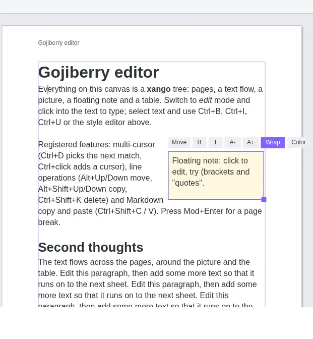

Everything you see is drawn on a canvas by Go code, and it is a real editor: type, select, copy and paste, undo and redo (each typing run is one step), several cursors at once (Ctrl+D picks the next match, Ctrl+click adds a cursor), move or copy lines, page breaks, and Markdown pasted as formatted text. A screen reader gets the same text from a hidden copy beside the canvas.

## Format

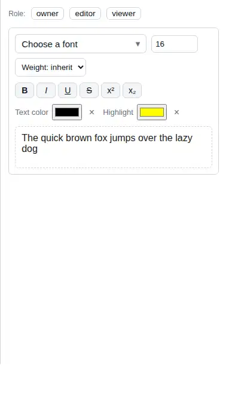

The first tab sets character formatting (bold, italic, underline, strike, super and subscript, colour, highlight, case, font and size) and paragraph formatting (alignment, indents, spacing, lists, check boxes, quotes). The buttons act on the selection, or on what you type next.

## Styles

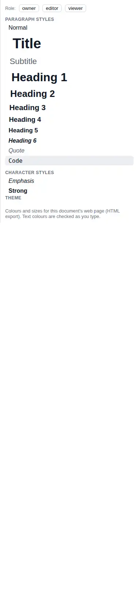

Named character and paragraph styles (Normal, Title, Heading 1 to 3, Quote, Code and your own) and a style editor. A style is expanded when the page is laid out, so changing it restyles every use; a theme editor with live contrast checks sets the colours of the document, and a theme can be shared as a file.

## Symbols

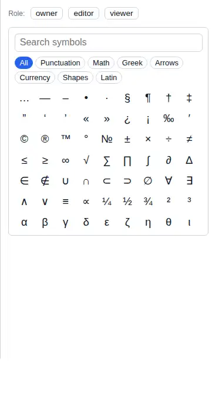

A picker for special characters and symbols, searchable and operable by keyboard. A chosen symbol is typed at the caret.

## Keys

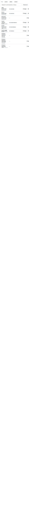

Every command has a key, and every key can be changed here. The tab lists them, finds conflicts, remembers your choices between visits, and shows a cheat sheet.

## Comments

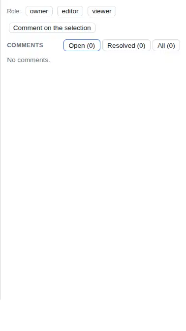

Comments are notes anchored to text, with replies, resolved state and @mentions of people by handle (never an address that is not theirs to show). They follow the text when it is edited and travel with Word files.

## Review (suggestions)

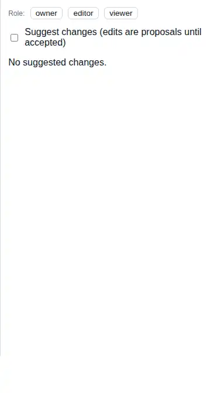

In suggestion mode your edits are proposals until someone accepts them: inserted text is marked, deleted text is struck through, and the list lets you accept or reject each. Two people proposing at once end up with the same document.

## Outline

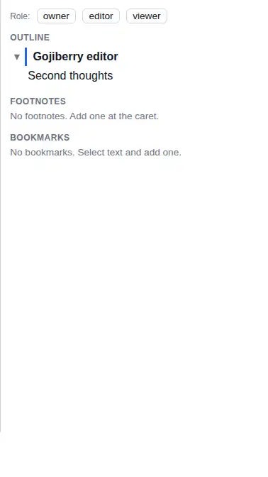

The headings of the document as a list: click one to go there, fold what is under a heading, and move a section (with its subsections) up or down with the buttons or by dragging. Bookmarks are listed too, and marked on the page while you edit.

## Footnotes

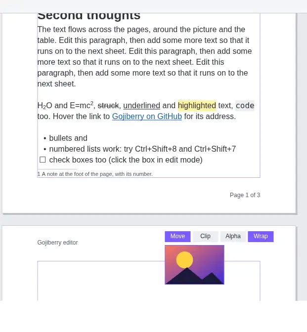

A footnote is typed in a small dialog with a counter of the characters left (limit 1000), and appears at the foot of the page under a short rule. The page gives its notes the room they need and the text above gives way; a note too long for the page goes on at the foot of the next one, and nothing is cut. Press a note on the page to edit it.

## Columns

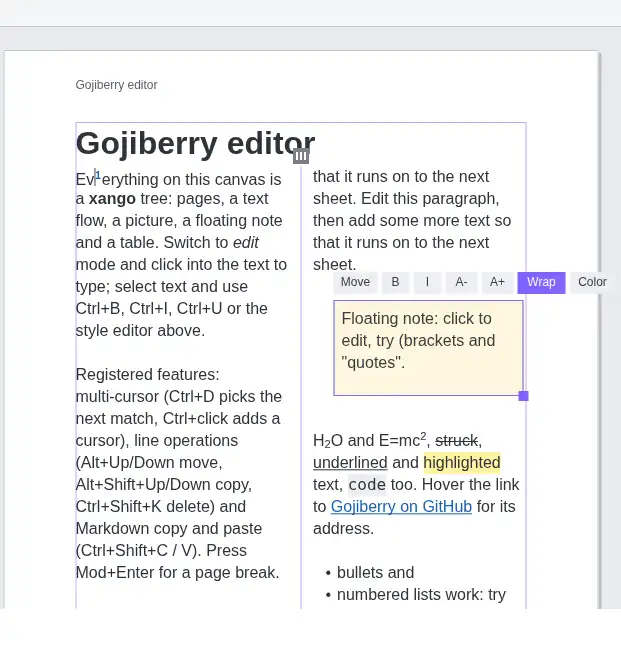

Text can run in up to four columns from any paragraph on, with the space between them set (narrow, standard, wide). Drag the grip above a gap to change widths; **Reset column widths** (Edit > Columns) makes them equal again. A column break moves text to the next column.

## Table styles

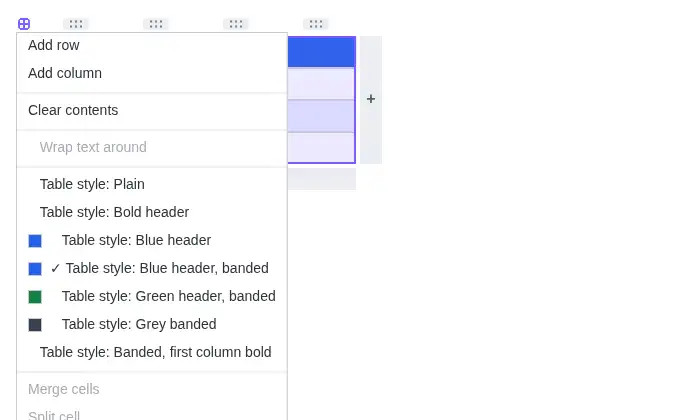

Tables have cell formatting (background, colour, bold, alignment, merged cells) and, from the table's handle menu or the Styles tab, **named table styles**: plain, bold header, blue or green header with banded rows, grey banded, banded with a bold first column. A style is applied in one step as cell formatting, so it is saved with the table, written by the exports that write cell shading, and can still be changed cell by cell; the menu marks the style the table is dressed in now. A table dressed in a style stays dressed in it when rows are added, removed, moved or sorted. In the Styles tab you can also define styles of your own (a header colour, a text colour, banded rows, bold header, bold first column); they are listed with the built-in ones and saved with the document.

## Image legend and picture formats

A picture can carry a visible **legend** (Insert picture > Pictures tab, "Add a legend"): it is drawn under the picture, saved with it and written by every export (an italic line under the picture; the title in Markdown). PNG, JPEG, GIF, WebP, AVIF and SVG files can be inserted. WebP, AVIF and SVG are converted to PNG on insert (an SVG at least 1024 pixels on its long side, drawn as a picture only: its scripts never run), so Word, ODT, EPUB and PDF carry them and a shared document never holds an SVG. Animated GIF and WebP show their first frame. AVIF needs a browser that can decode it.

## Find a picture online

In the Pictures tab, **Find a picture online** searches repositories of public-domain and Creative Commons pictures (Openverse and Wikimedia Commons to start). A repository is asked nothing until you turn it on and search. Each result shows its author and licence before you insert it; the picture goes in with that credit as its legend, and the author, licence and page are saved with it. Only licences that allow reuse with credit are listed, and pictures are limited in size and type. Exported to Word or OpenDocument, the credit is also in the picture's properties. "More results" reads the next page. An operator can add repositories of their own (mirrors of Openverse or a MediaWiki site) in `image-repos.json` next to the page; they start off like the others.

## Mentions

Write @name in a comment or a reply and that person is told: the screen reader announcer says who mentioned them, and the Comments tab shows **Mentions of you** with a way to go to the comment and to mark it as read (a mention marked as read stays read when the page is opened again, in this browser). Comments name people by handle, never by an address. A host can deliver the same notices by its own channel; package `mentionmail` mails each person what is new (one mail per person, never twice, no addresses of others in it) when the host calls it on a changed document. When the page is closed, **Web push** can tell the person instead: if the host names a push server in `push.json`, the Comments tab offers "Notify me of mentions when this page is closed" (the browser asks permission); the notification says who and where, never what, and travels encrypted. See `docs/web-push.md`.

## Table formulas

A table cell that starts with `=` is a formula: `=B2*C2`, `=SUM(B2:B9)`, `=ROUND(AVERAGE(C1:C4), 1)`, `=IF(D2>=10, "ok", "low")`. The table shows the value, the cell keeps the formula (it shows when you edit the cell), and the exports and the reading copy carry the value. A formula that cannot be computed shows an error such as #DIV/0! or #CYCLE! instead of stopping anything. Start a cell with `\=` to write a cell that begins with = without making it a formula. A table always opens on the calculated view: values of formulas are blue, a formula cell cannot be changed there, and holding the pointer over it shows its formula. The switch at the table's top right (an eye, or f(x) in the formula view) or **Show formulas** in the table menu shows the formulas in red and lets you edit them. The column grips are lettered (A, B, ...) and the row grips numbered (1, 2, ...), the names a formula uses. Markdown keeps the formula as typed, so `| =A1*B2 |` is a formula wherever the Markdown is read as a table by this editor.

## Equations

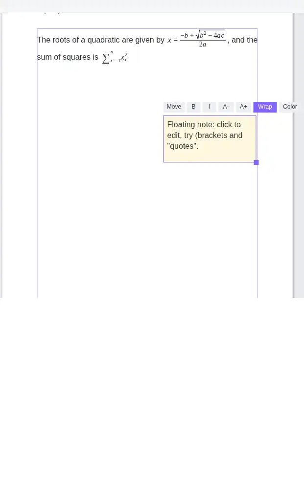

Formulas are written in a small notation (`x^2 + y_1`, `frac{a}{b}`, `sqrt{x}`, `sum_{i=1}^{n}`, Greek names like `pi`) and drawn the way mathematics is written: fractions over a rule, roots under a radical sign, raised and lowered scripts. A formula can be on a line of its own or in the middle of a sentence, on the baseline of the words round it. Every formula carries a text alternative, which is what the exports write for it (the HTML export also writes MathML, for a formula on its own line and for one in a sentence; Word gets Office Math for a formula on its own line and in a sentence, and reads it back). In a formula on its own line, the limits of a sum or `lim` sit above and below it, and a bracket round a fraction grows with it. `matrix{a & b \\ c & d}` draws a matrix between brackets and `aligned{x &= 1 \\ y &= 2}` lines equations up at the `&`. Typing `$pi r^2$` in the text makes an inline formula when the closing `$` is typed (a price like "$5 and $6" stays text); it has no text alternative yet, so the accessibility check asks for words.

## Table grips and sizes

Every table in the text has the grips of an editable table around it: column letters above, row numbers at the left (the names formulas use), and the table icon. In edit mode, drag the edge of a column grip to make that column wider or narrower, or the edge of a row grip to change that row's height (at least 24 x 18 pixels). The sizes are saved with the document. The exports lay tables out on their own and do not carry them yet.

## Markdown tables

Type a header row, the row of dashes under it and one row of cells with the same number of columns, then press Enter, and the three lines become a table:

```
| A | B |
|---|---|
| a | b |
```

Cells keep what you typed, so `| 3 | =A1*2 |` is a formula. A table has a switch at its top right corner, an eye while values are shown and f(x) while formulas are, and its column and row grips carry the letters and numbers formulas use. Whole Markdown files can be imported from the Files tab, with their footnotes (`[^1]` and `[^1]: the note`) and pictures given as data addresses; the import says what it left out (pictures on a server are never fetched, formatting inside table cells is shown as text). Pasting a Markdown table, or cells copied from a spreadsheet, into a table fills the cells from the one you are in and adds the rows and columns it needs.

## References

The References tab keeps the sources a document cites (books, articles, web pages, reports) and writes them in the style of a publication: APA, MLA, Chicago, IEEE, Harvard, Vancouver or ABNT. **Cite it here** puts the in-text mark at the caret, for example (Silva & Costa, 2020) or [3]; **Insert the list of references** writes the list at the end, in order, with titles in italics. Change the style and the same sources are written the new way. The sources are saved with the document.

## Form fields

**Experimental.** Form fields are behind the build tag `exp_forms` (or `experimental`); sending answers to an address is behind `exp_forms_submit`. A default build has no Forms tab. See [phase-2.md](phase-2.md).

A table cell can be a field too: in the Forms tab tick "Put the next field in a table cell", say the table, row and column (counted from 1), and add the kind. The cell shows what was filled in; pressing it in the text fills it in; a formula that points at it reads the value; the exports write the label and the value as the cell's text. A table with a formula or a field has room around it for the grips of the columns (letters), the rows (numbers) and, beside its top right corner, a grip with an eye: press the eye (it becomes a pen) to see the formulas as typed and the fields as what they are, where a press on a field changes it; press again to see all the values. The Forms tab has *See all* and *Edit all* for every table at once.

Insert > Form fields, or the bar of kinds in the Forms tab, puts a field in the text: one line, several lines, e-mail, number, phone, web address, date, a checkbox or a choice list. A field has a label, a placeholder, a pattern (a regular expression the whole value must match), a required mark and, for a choice list, its choices; what the person writes in it is saved with the document. Each field shows a small **eye** (fill it in) and a small **pen** (change what the field is); the problem with a value (not an e-mail address, does not match the pattern, required and empty) is said as it is typed and the field is outlined in red. The owner can **lock** a field: it keeps its properties, so it has no pen, and only its value can be filled in. A lock is sealed with a **key**: if you have none, the Forms tab says so and offers **Make a key** (and shows its backup once; **Restore a key** brings it back); the field then says which key locked it and whether it is still as it was locked, and only that key takes the lock off. If you have an owner key, that is the one used. **Clear form fields** empties them all. Every export writes the label and the value as text (the HTML export writes real controls that can be filled in on the page), the Check tab asks for a label on each field, and Find searches them. **Download the answers** saves what was written as a JSON object or a CSV row, with a key from each field's name, or the page as a **web form**: give an https or mailto address and the exported page holds a form with a send button. Opening a web page (or one of these) that has form controls brings them in as form fields with what was written in them; passwords, hidden values and files are left out.

## Add-ons

The Add-ons tab lists the optional scripts this page has (the person who runs the page adds them) for things that need a large program or model: reader voices, dictation, and later pictures, scans, translation. For those that keep models it shows them, with size and terms, only when you ask, and downloads or removes one on request. With the **whisper** add-on, the Speech tab can dictate on this device instead of sending the recording to a recogniser at an address. With the **describe** add-on, "Draft a description from the picture" (Preferences > Editor) says what the picture shows, as a draft marked as possibly wrong that goes into the description only when the author uses it. With the **ocr** add-on, "Read the text in the picture" (a scan, a photographed page) shows the text to correct and puts it after the picture, or uses it as the long description, when the author says so. With the **translate** add-on, the Language tab translates the selection on this device (without a translation server in the address), and the translation replaces the selection only when you say so. With the **llm** add-on, the grammar check runs on this device (without a model server in the address), and **Writing help** summarises the selection, says it in plainer words, shortens it, makes it more formal or friendlier, or explains it. The answer is shown as machine-made, to read and change, and goes into the document only when you press Replace or Put it after. With the **spell** add-on, the dictionaries it keeps on this device are offered in the Spelling tab, so spelling works offline in more languages. With the **diagram** add-on, the Pictures tab draws a flowchart or a map from a description; it goes into the document as a picture only with a description in words, and the source is kept as the picture's long description. A diagram picture has **Change the diagram** in the Pictures list: it puts the description back into the form, and the new drawing takes the picture's place (same width and legend). See [addons.md](addons.md).

## Two-page spread

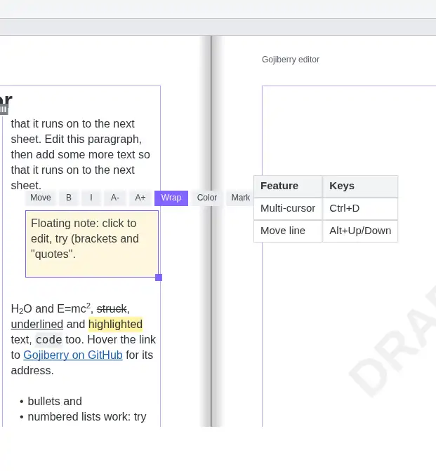

The sheets can be shown two to a row as facing pages (View > Two-page spread). The inner edges are shaded toward the fold, a picture can run across the gutter, and a folded corner on each outer bottom corner turns to the next or previous pair.

## Page and print layout

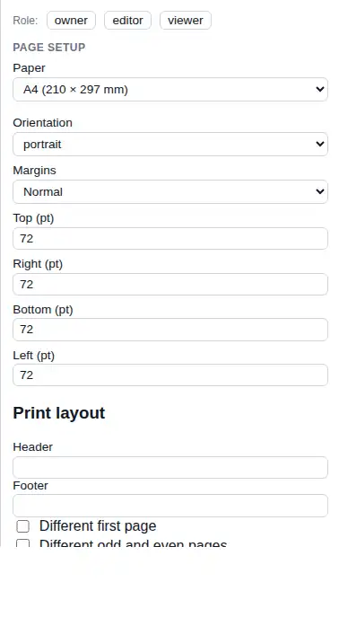

Paper size and orientation, margins, headers and footers, page numbers, a different first page, odd and even pages, a watermark and background, and a table of contents that links to the headings. The exports write the same layout.

## Pictures

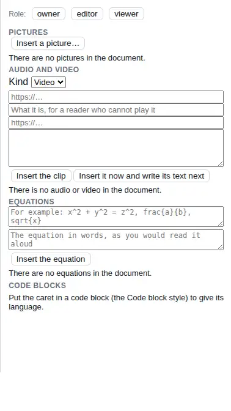

Insert a picture from a file; the tab asks you to describe it for people who cannot see it, or to say it is decorative, flags the ones with no description, and can draft a description on your device. Pictures can be inline or floating, wrapped, cropped and faded.

## Find and replace

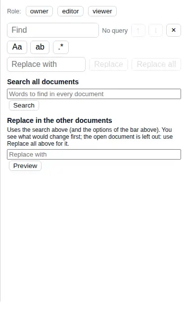

Search the document with case and whole-word options, step through matches, replace one or all, and search across all your documents.

## Spelling

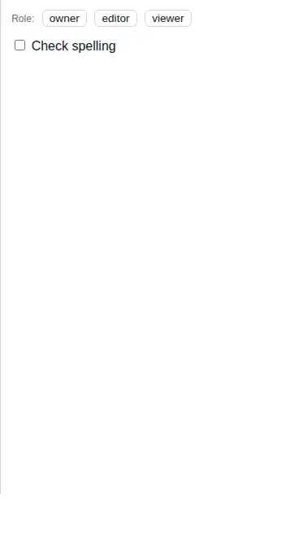

Misspelled words are underlined with suggestions, and your own words are kept. English is built in; other languages' Hunspell dictionaries load on demand from a dictionary server you choose.

## Language

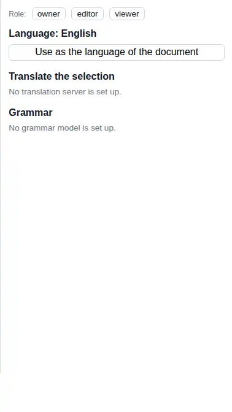

The document's language, the language of a selection, detection from the text, hyphenation, translation and grammar checks through servers you point it at (an Ollama-compatible server works for grammar). Right-to-left and mixed-direction text lays out correctly.

## Stats

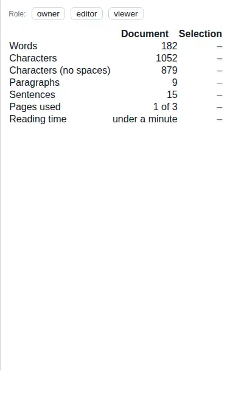

Words, characters, paragraphs, sentences, pages used and reading time, for the whole document and for the selection.

## Share

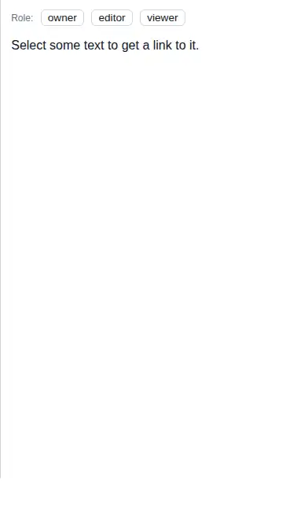

Select text and get a link to it. The link carries the capability in its fragment, so the address you share is the permission you give.

## People

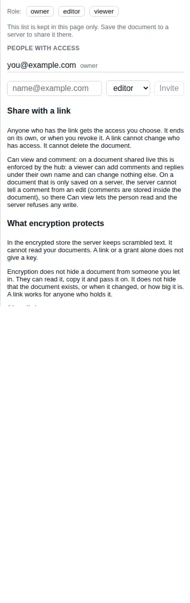

Who can see the document and as what: add or remove people, set a role (owner, editor, viewer, comment-only), set an expiry, and see who is online. With encryption on, keys are managed here too.

## Accessibility check

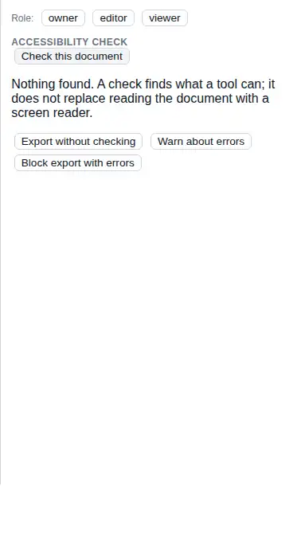

Finds what a tool can: pictures with no description, empty headings, tables with no header row, paragraphs that only look like lists, low contrast. Each finding jumps to the place, many have a one-click fix, and export can be blocked while errors remain.

## Files: import and export

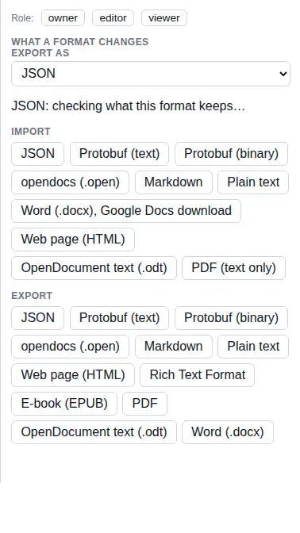

Import Word, OpenDocument, HTML, PDF text and Markdown; export Word, OpenDocument, PDF (tagged), RTF, EPUB, HTML, Markdown and plain text. Before you export, the tab says what the chosen format leaves out of this document.

## Save

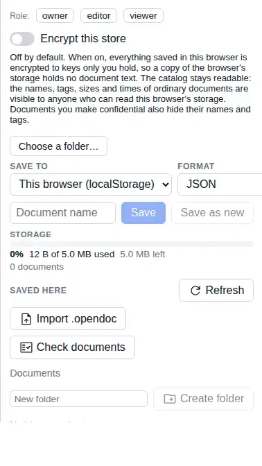

Where the document is kept: this browser, a folder on your computer, a server, or an end-to-end encrypted store. Versions are kept and can be compared and restored; documents can be put in folders, tagged, trashed and brought back.

## Migrate

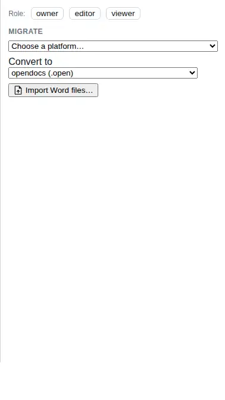

Bring documents from other editors: Word files, a Google account (with comments and, if you ask, the revision history) and others. A second run leaves what an earlier run brought, unless you ask for it again.

## Console

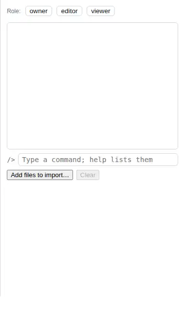

A command line over your documents (`ls`, `cat`, `mv`, `rm`, `find` by name, and more) that runs in the page, with the same rules as the editor: nothing is deleted without asking.

## Public link

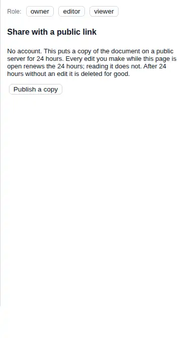

Put a copy on a public server for 24 hours with no account. Every edit renews the 24 hours, reading does not, and after 24 idle hours it is deleted for good. There is an edit link and a read-only link, a countdown, and a way to report.

## Speech

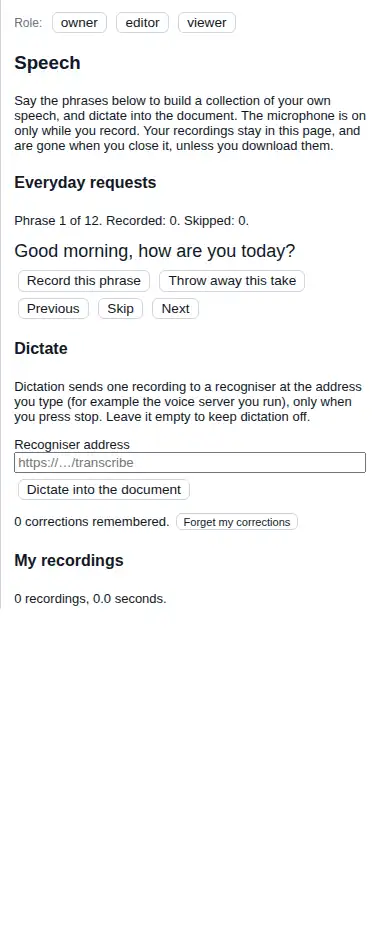

Dictate into the document through a recogniser you name, and, if you want, record a set of phrases to build a collection of your own speech. The microphone is on only while recording; recordings stay in the page unless you download them.

## Privacy

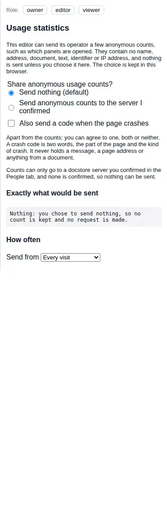

What the page counts about its own use (nothing leaves the page unless you choose), crash codes as a separate opt-in, and what each choice does in plain words.

## Preferences

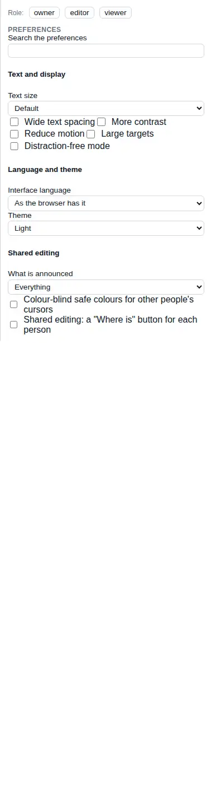

Reduced motion, high contrast, text size, wide spacing, larger targets, distraction-free mode, language of the interface, plain-words mode, dwell click and single-switch scanning, and more, in one searchable list that can be exported as a file and follows you when you ask.

## Read aloud

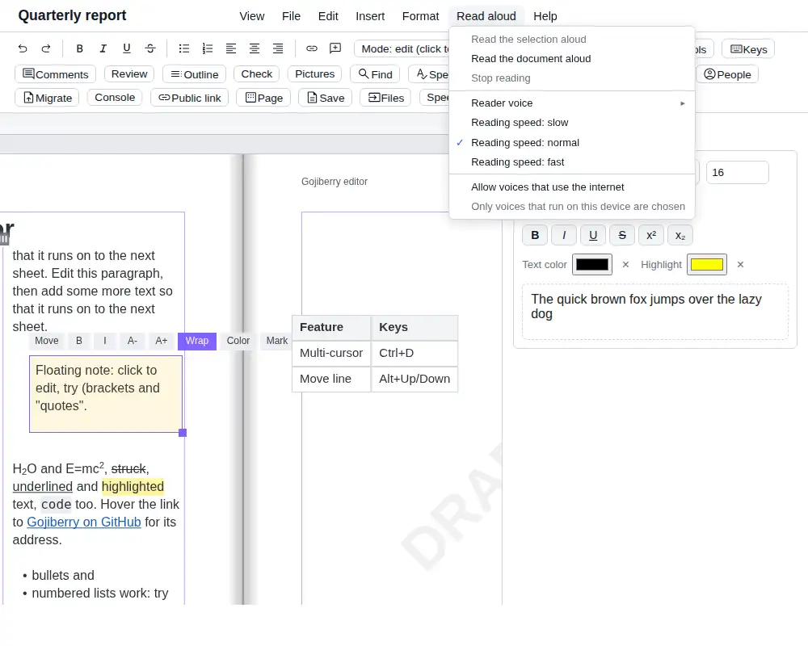

Read the whole document or the selection aloud, a sentence at a time, with the sentence and the word marked as they are spoken. A bar offers previous, pause, next and stop; speed is slow, normal or fast; and the **Reader voice** menu lists the voices for the document's language with their accent and gender (American or British, female or male). **Reader** chooses what reads: the voices the browser offers, or **downloaded voices (Piper)**, which run in the page so that the text never leaves the device. The Reader voices tab lists the voices for the document's language with their size and a link to whose voice it is and under what terms, downloads one on request (nothing is fetched before), and removes it again. Downloaded voices need a Piper runtime script that the person who runs the page supplies (docs/reader-voices.md). When the operator names a voice server, **Voices on a server** is a third reader: its voices send the text to the server while it reads, so it is used only when voices that use the internet are allowed, and the bar says so.

## Typewriter scrolling

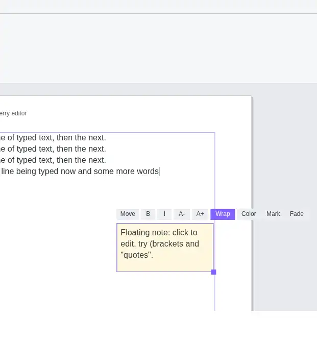

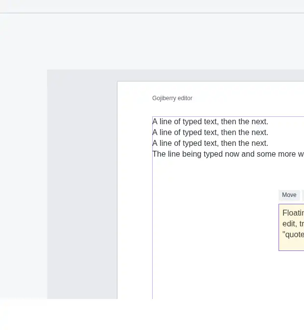

An optional mode (Preferences, off by default) in which the line you are typing stays in the middle of the view and the page moves under it, the way paper moves on a typewriter. It follows typing, the arrow keys and commands; clicking in the text never moves the page. With **Typewriter carriage** also on, the letter being typed stays in one place across the view too: the page slides left as each character goes in (first picture) and, on Enter, slides back right and up a line so the start of the new line is at that place (second picture), past the page's own edge, as the paper of a typewriter runs past the carriage.

## Scripts

The Scripts tab runs a small script in a sandbox that has nothing of the page: no network, no storage, no document. The script can list the editor's commands, run any of them by name (so a command added later is reachable at once), say something in a log, and, if you allow it, read the text of the document or write text at the caret. It is stopped after ten seconds or on request. Run only scripts you wrote or trust: a script that may read the text could show it to its author (docs/scripting.md).

## Menus and commands

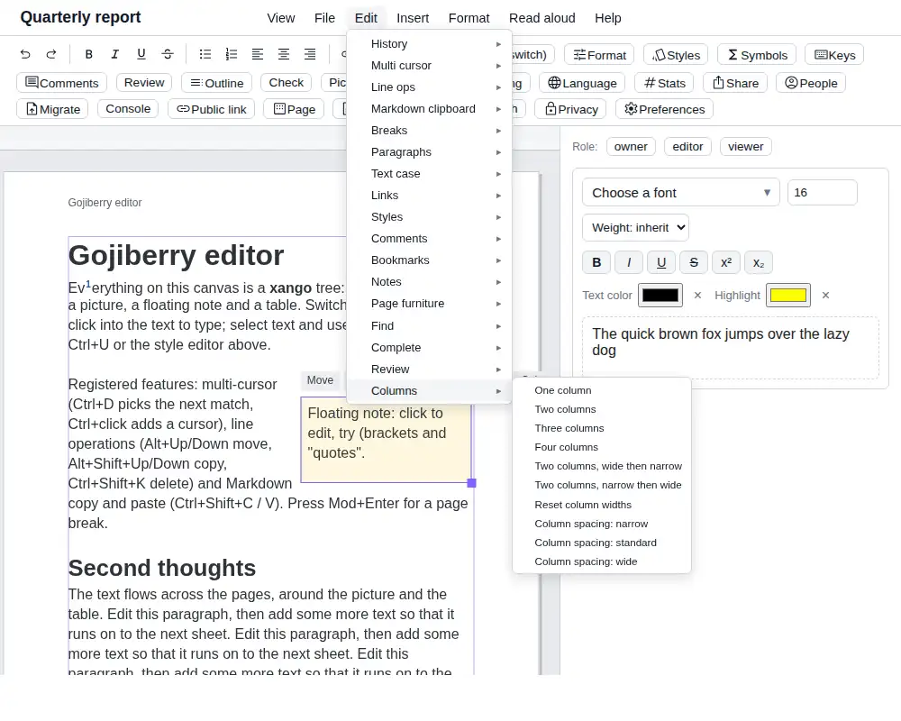

Every command is in a menu, has a key, and is the same command the keys and the toolbar call. Menus are operated with the arrow keys, and every entry can be reached without a mouse.
